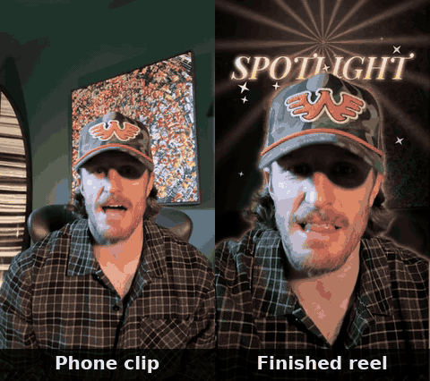
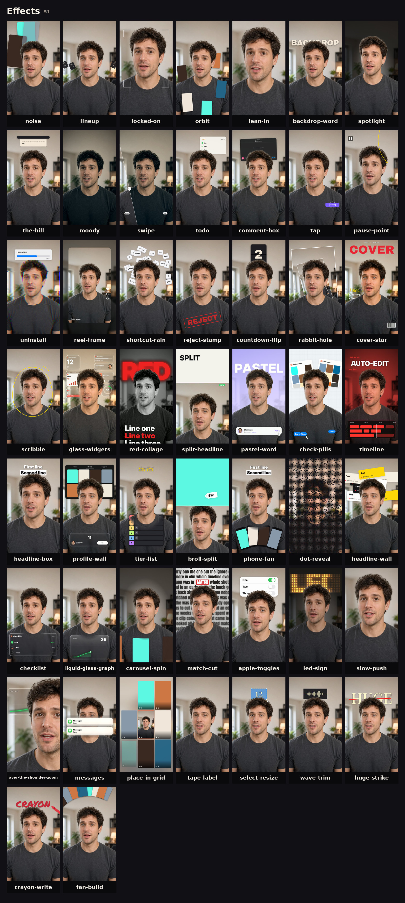
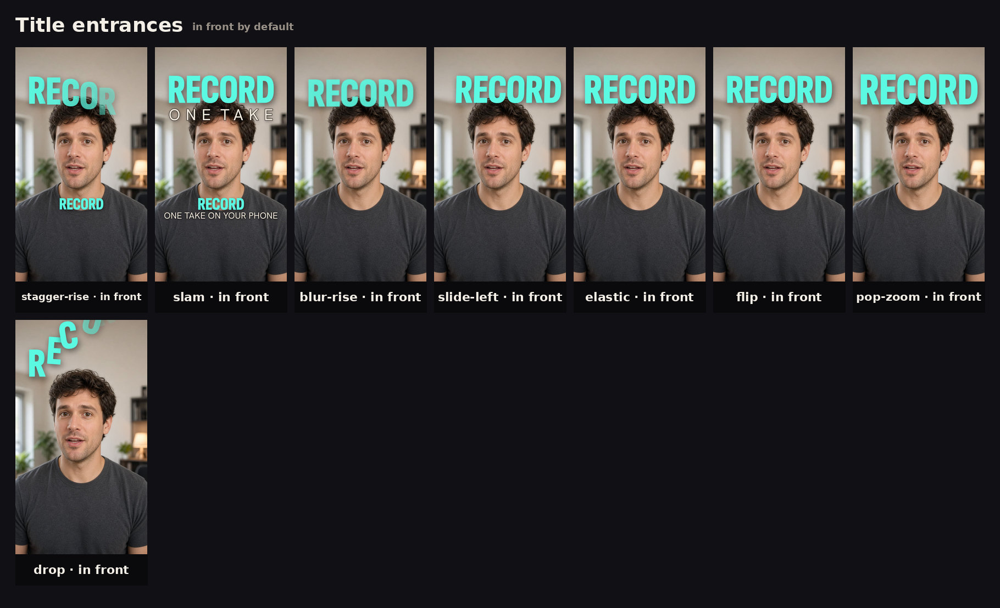
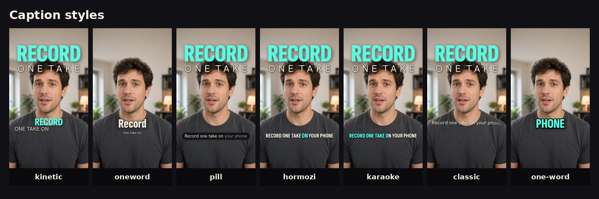

# aigent-talking-head

Turn one phone clip into a styled talking-head reel with your coding agent: kinetic captions, titles behind your head, 29 graphics planned from what you say, 56 transitions, 51 effects, beat-synced music, film finishes and exports for TikTok, Reels and Shorts. Runs locally. Apache-2.0. From [The AIgent](https://theaigent.xyz).

[Quick start](#quick-start) · [Install](#install) · [Agent skill and MCP](#agent-skill-claude-code-cursor-codex) · [Graphics](#graphics) · [Reel.md recipes](#reelmd-recipes) · [Guide](docs/guide.md) · [Full gallery](showcase/GALLERY.md) · [Credits](#credits-and-licences)

## Get started

Paste this into your agent:

```
Read https://raw.githubusercontent.com/wrg32786/aigent-talking-head/main/INSTALL.md and follow it to install aigent-talking-head in this agent.
```

Works with your agent: Claude Code, Codex, Cursor, Gemini CLI, OpenCode, and any agent that runs commands and reads `SKILL.md` skills (`npx skills add wrg32786/aigent-talking-head`).



Phone clip on the left, finished reel on the right. [Watch the 40-second demo](kit/example/demo-reel/demo-reel.mp4) (20 effects, with the [plan files](kit/example/demo-reel/)).

Prefer to run it by hand? See [Quick start](#quick-start).

## Quick start

Install once ([Install](#install)), then `npm run smoke` should end with `SMOKE PASS`. Record yourself upright on your phone, drop the file in `inbox/`, and:

```
npm run reel -- inbox/my-take.mov --name my-reel --draft     # 1. transcribe and cut (Whisper small.en)
npm run plan -- my-reel                                      # 2. graphics proposed from what you said -> jobs/my-reel/Reel.md
#                                                              3. review the Reel.md: keep, change or delete lines
npm run reel -- --recipe jobs/my-reel/Reel.md --clips jobs/my-reel/clips --name my-reel --force --export reels   # 4. render
npm run verify -- my-reel --export reels                     # 5. VERIFY PASS, then look at jobs/my-reel/verify/contact.png
```

You get `jobs/my-reel/reel-v1.mp4` and `reel-v1-reels.mp4` (inside Instagram's safe area). Exports: `tiktok`, `reels`, `shorts`, `feed45` (4:5), `square`. Or ask your agent: "Make a reel from the newest clip in my inbox."

- Just captions and titles, one command: `npm run reel` (newest video in `inbox/`).
- Change something: edit `jobs/<name>/build/captions.js` or `build/cut.json`, then `npm run reel -- --rebuild --name <name>`.
- Accuracy over speed: `--model large-v3` (about 3 GB, downloaded once, a notice prints first).
- Everything else (looks, edit rules, themes, manual steps, presets, the file map): [docs/guide.md](docs/guide.md). Every command and flag: [contract.json](contract.json).

## Install

| Need | Mac | Linux | Windows |
|---|---|---|---|
| Node 18+ | `brew install node` | your package manager or nodejs.org | nodejs.org installer |
| ffmpeg + ffprobe | `brew install ffmpeg` | `sudo apt install ffmpeg` | `winget install ffmpeg` |
| Python 3.9+ (3.11+ for the BiRefNet mask) | `brew install python` | usually installed | python.org installer (gives `py`) |
| Chrome or Chromium | google.com/chrome | `google-chrome` or `chromium` package | google.com/chrome |

Then, in the repo folder:

```
npm install
python3 -m pip install -r requirements.txt      # Windows: py -3 -m pip install -r requirements.txt
npm run chrome                                  # prints the Chrome it found
npm run smoke                                   # synthetic clips end to end, several minutes, no footage or keys needed
npm run check                                   # copy lint self-test over the examples
```

Skills for your agent: `npx skills add wrg32786/aigent-talking-head` (aigent-talking-head, talking-head-reel, talking-head-recipe, talking-head-brand, talking-head-teardown, talking-head-ad, clip-raw-footage). Agents can do the whole install from [INSTALL.md](INSTALL.md).

Optional teardown engine: `npm run teardown -- <file> --install` adds [rea-video](https://github.com/JuneYaooo/rea-video) (Apache-2.0) to the kit's Python.

Chrome is found automatically in the usual Mac, Linux and Windows install paths or on PATH. Set `CHROME_PATH` to use a different one. Set `PYTHON` if your Python isn't `python3` (or `py` on Windows). `npm run smoke:whisper` also runs a tiny Whisper model. Your footage, `jobs/` and `.env*` files are gitignored.

Optional: a HeyGen account with Cinematic Avatar if you generate takes, and `FREESOUND_API_KEY` if you search for new sounds.

## Agent skill: Claude Code, Cursor, Codex

[skills/aigent-talking-head/SKILL.md](skills/aigent-talking-head/SKILL.md) gives your agent the workflow, every command, its inputs and outputs, and what to do when something fails. [contract.json](contract.json) lists each command's args, types, defaults and outputs for agent frameworks, and `npm run check` fails if it drifts from the CLI.

| Agent | Install the skills |
|---|---|
| Claude Code | `npx skills add wrg32786/aigent-talking-head -a claude-code` |
| Cursor | `npx skills add wrg32786/aigent-talking-head -a cursor` |
| Codex | `npx skills add wrg32786/aigent-talking-head -a codex` |

Add `-g` to install for every project. By hand: copy the folders under `skills/` into `.claude/skills/` (Claude Code) or `.agents/skills/` (Cursor, Codex). The skills drive a local checkout, so the agent still needs the kit installed ([INSTALL.md](INSTALL.md)).

**MCP.** `npm run mcp` serves the same flow as MCP tools (menu, draft, plan, validate, render, verify) with schemas generated from contract.json. Setup for Claude Code, Cursor and Codex: [docs/mcp.md](docs/mcp.md).

## Effects



## Graphics

29 overlay graphics, each with its own entrance and exit, drawn in your theme's colours and fonts: ordinal sticker, app label, screen card (with an optional pointer that clicks and a camera that zooms and pans), lower third, stat callout (counts up, or rolls like an odometer), checklist, quote card, highlight (circle, arrow, underline or box), step counter, versus card, icon badge, sticker pop, price tag, CTA end card, code card, data chart (bars or a line), chapter card, logo bug, channel bug (LIVE and a clock), terminal session, news strap, ticker, split-flap board, feature cards, release pill, CTA button (a pointer clicks it), HUD callout, flash cards and keyword caption. They share one card look (soft two-layer shadow, top-lit fill, fine grain, rim light), spring and emphasized easing with motion blur on fast moves, tabular digits and Tabler icons (MIT). Bring your icon or screen recording where a graphic takes one, or the kit draws a neutral placeholder.


Add one as a line in a Reel.md (`#06 15-17 | type stat-callout | text 10,000+ | sub readers`) or a `captions.js` flip. The words on a graphic have to be words you say: on a recipe job the kit drops any you don't, and a checklist ticks each row as you say it. Add `cues` (words you say, or seconds) and a chart bar, a terminal command, a feature card or a flash card lands on the word. Set `layer behind` and only the top of your head (hair and crown) goes over the graphic, never your face. Every type, field and default is in [docs/reel-md.md](docs/reel-md.md) and [kit/graphics.json](kit/graphics.json).

## Film finishes


## Title entrances

Titles sit in front by default. Set a title behind the head, or use auto for the strongest 1 or 2 punch titles.




## Captions and type

Top captions tuck behind your hair where they meet it (`--caption-layer front|behind|auto`, auto by default). Kinetic hero words can come in letter by letter (`--caption-entrance unfurl|cascade|orbit|warp|crystallize|compute|levitate|undulate`, pop by default). Screen cards, b-roll panels and graphics placed high in the frame go behind only the top of your head, never your face (`--panel-layer`). Details in [docs/reel-md.md](docs/reel-md.md).




## Presets


## Remake a reel you like

```
npm run teardown -- reference.mp4                                       # what it is made of, as a Reel.md
npm run reel -- --recipe teardown/reference/Reel.md --clip inbox/me.mp4  # the same style, your clip and brand
```

[rea-video](https://github.com/JuneYaooo/rea-video) breaks the reference down shot by shot; the kit maps it onto the menu above and shows you what it found before anything renders. Local files, or one Instagram post with `--url` if you install the optional instaloader (you need the rights to it). How accurate it is: [docs/teardown.md](docs/teardown.md).

## Reel.md recipes

A reel's whole style in one Markdown file you can read, edit and share. VIDEO.md compatible. Spec: [docs/reel-md.md](docs/reel-md.md). Examples: [examples/recipes/](examples/recipes/).

````markdown
## Style
- captions: one-word
- title-layer: front

## Shots
```videomd-timeline
#01 0-4 | story hook | finish warm
#02 4-12 | story proof | punch big
#03 12-20 | story payoff | finish teal,vignette
```

## Titles
```reel-titles
#01 0.3-1.8 | entrance slam | layer behind | text Stop scrolling
```
````

`npm run reel -- --recipe my.Reel.md --clip inbox/me.mp4` makes it. `npm run reelmd -- export <job>` turns any finished reel back into one.

Every option, labelled, is in the [full gallery](showcase/GALLERY.md). The [HTML gallery](showcase/index.html) needs a full clone or zip of the repo; if you download only that HTML file, the images will not load. `npm run menu` prints the same list. `npm run showcase` rebuilds the stills and these sheets. Stills use an AI-generated fictional presenter.

## More

[docs/guide.md](docs/guide.md) has the depth: what you get, the effects pass, looks, caption styles and fonts, edit rules, themes, step by step by hand, the file map, the rules the pipeline carries and brand presets. Recipes: [docs/reel-md.md](docs/reel-md.md). Teardowns: [docs/teardown.md](docs/teardown.md). MCP: [docs/mcp.md](docs/mcp.md). Agents: [AGENTS.md](AGENTS.md).

## Credits and licences

Code and docs: Apache-2.0, Copyright 2026 Will Gwyn (wrg32786). See [LICENSE](LICENSE). The files below keep their own licences and marks.

- `kit/sfx/F-cinematic-woosh-648729.mp3`: "Cinematic Woosh SFX-010" by AudioPapkin, Freesound 648729, CC0.
- `kit/sfx/D-quick-woosh-683101.mp3`: "quick woosh" by florianreichelt, Freesound 683101, CC0.
- `kit/sfx/whoosh.wav` and `kit/sfx/swipe.wav`: mono 48 kHz WAV conversions of the two Freesound files above, CC0.
- `kit/sfx/boom.wav`, `click.wav`, `typing.wav`: from [motion-pack](https://github.com/ANVEAI/motion-pack) by ANVEAI (sounds `snd.hit.deep_impact`, `snd.ui.click`, `snd.ui.typing_burst`), CC0 1.0 under its LICENSE-MEDIA.
- `kit/sfx/{hit,riser,release,whoosh,swipe,pop,ui,glitch,camera,paper,counter,sub,shimmer}/` and `kit/sfx/sfx.json`: 31-sound cinematic pack. DAEDAL Transition / UI packs, Kenney Interface Sounds, OpenGameArt / Freesound CC0 items, and original synths dedicated CC0. Full credits in [THIRD_PARTY.md](THIRD_PARTY.md).
- `kit/fonts/`: Google Fonts under the SIL Open Font License 1.1, each with its licence file. See [kit/fonts/README.md](kit/fonts/README.md).
- Teardown engine (installed on request, not vendored): [rea-video](https://github.com/JuneYaooo/rea-video) by JuneYaooo, Apache-2.0. Reel.md follows the [VIDEO.md](https://github.com/videomd/videomd) card and timeline syntax (Apache-2.0). The recipe idea, the one-line agent install and skills packaging were inspired by [OpenMotion](https://github.com/nexu-io/openmotion) (Apache-2.0). No text or code copied; see [THIRD_PARTY.md](THIRD_PARTY.md).
- Ideas adapted, no code copied: the transition name map from motion-pack (MIT), the Hormozi and karaoke caption looks from [Capite](https://github.com/muneebkhan08/Capite) (MIT), the title entrances from [motion-anything](https://github.com/nexu-io/motion-anything) (Apache-2.0, reference only). See [THIRD_PARTY.md](THIRD_PARTY.md).
- `kit/example/skool-logo.svg`: the Skool wordmark, a trademark of Skool. It's included only to mark The AIgent's own Skool group in the Awakening example; it isn't in any theme. Don't use it for other brands.
- `effects/vendor/claude-video-effects/`: [claude-video-effects](https://github.com/Vibha-Ramprakash/claude-video-effects) by Vibha Ramprakash, MIT. Its models (YuNet, MIT; MediaPipe Selfie Segmenter, Apache-2.0) and fonts (SIL OFL 1.1, Permanent Marker Apache-2.0) keep their own licences; see `NOTICE` and `effects/README.md`.
- Person-mask quality backend (installed by `npm run effects:setup`, not vendored): [rembg](https://github.com/danielgatis/rembg) by Daniel Gatis, MIT; [onnxruntime](https://github.com/microsoft/onnxruntime) by Microsoft, MIT; birefnet-general-lite weights from [BiRefNet](https://github.com/ZhengPeng7/BiRefNet) by ZhengPeng, MIT, downloaded on first use into rembg's cache. See [THIRD_PARTY.md](THIRD_PARTY.md).
- `kit/music/*.mp3`: tracks made by Will Gwyn / The AIgent with Suno on a paid plan (song ids in `kit/music/beds.json`). Dedicated [CC0 1.0](kit/music/LICENSE.md); anyone may use them, including commercially. See [kit/music/README.md](kit/music/README.md).
- `showcase/source/presenter.jpg`: an AI-generated fictional person made for this project, to demo finishes, titles and effects. No third-party rights. Licensed Apache-2.0 with the repo. See [THIRD_PARTY.md](THIRD_PARTY.md).
