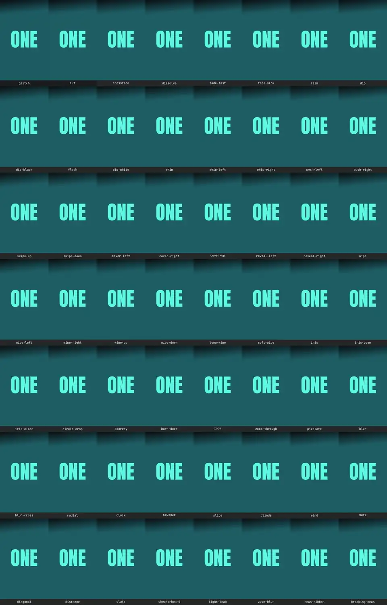
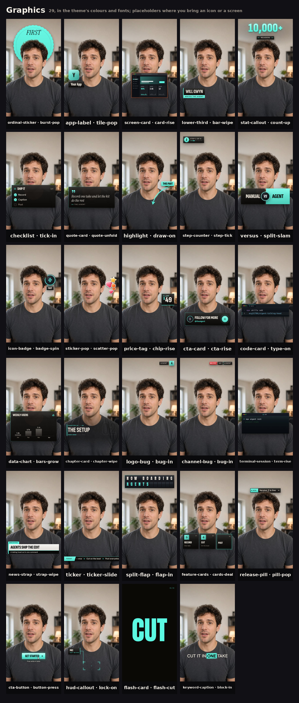
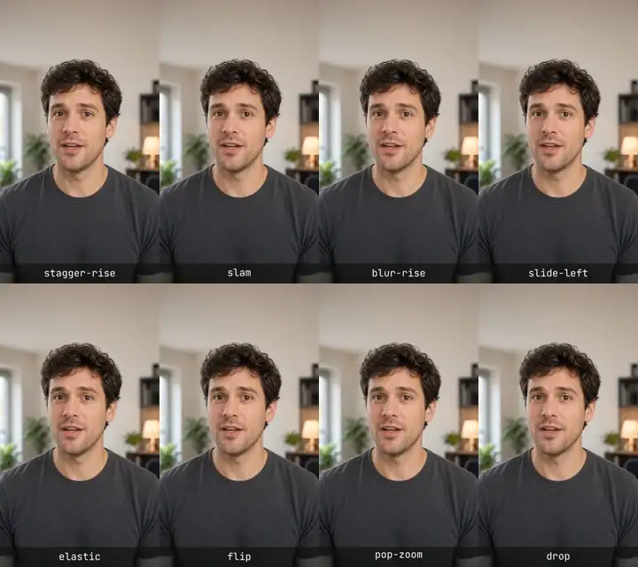
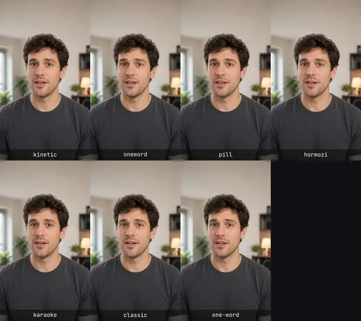

# aigent-talking-head

**aigent-talking-head is a free, open-source (Apache-2.0) talking-head video editor that turns one phone clip into a captioned vertical reel for TikTok, Instagram Reels and YouTube Shorts, run by you or your coding agent (Claude Code, Codex, Cursor or any MCP client) on your own machine with Whisper, FFmpeg and Chrome.**

Made by Will Gwyn at [The AIgent](https://theaigent.xyz).

[Quick start](#quick-start) · [Install](#install) · [Features](#features) · [How it compares](#how-it-compares) · [FAQ](#faq) · [Agent skill and MCP](#how-agents-use-it-skill-and-mcp) · [Guide](docs/guide.md) · [Full gallery](showcase/GALLERY.md)


Phone clip on the left, finished reel on the right. [Watch the 40-second demo reel](kit/example/demo-reel/demo-reel.mp4) (20 effects) or read [the plan files behind it](kit/example/demo-reel/).

## What it does

- **Transcribes your clip locally** with Whisper and cuts it into clean sentences, keeping the best take of each.
- **Captions every word on time**, with kinetic hero words and titles that can sit behind your head.
- **Plans graphics from what you say**: a number becomes a stat callout, a list a checklist, the close a call-to-action card. The words on a graphic are words you said.
- **Keeps your face clear**: a title or graphic set behind you goes behind only your hair and crown, never your face, and a layout pass moves captions out of the way of graphics.
- **Exports for each platform** inside its safe area, then checks the finished file (loudness, overlaps, safe area) before you post.
- **Works from your agent**: a one-line skill install for Claude Code, Codex and Cursor, plus a local MCP server.

## Quick start

**With an agent.** Paste this into Claude Code, Codex, Cursor, Gemini CLI, OpenCode or any agent that runs commands and reads `SKILL.md` skills:

```
Read https://raw.githubusercontent.com/wrg32786/aigent-talking-head/main/INSTALL.md and follow it to install aigent-talking-head in this agent.
```

Then ask it: "Make a reel from the newest clip in my inbox."

**By hand.** Install once ([Install](#install)), then `npm run smoke` should end with `SMOKE PASS`. Record yourself upright on your phone, drop the file in `inbox/`, and:

```
npm run reel -- inbox/my-take.mov --name my-reel --draft     # 1. transcribe and cut (Whisper small.en)
npm run plan -- my-reel                                      # 2. graphics proposed from what you said -> jobs/my-reel/Reel.md
#                                                              3. review the Reel.md: keep, change or delete lines
npm run reel -- --recipe jobs/my-reel/Reel.md --clips jobs/my-reel/clips --name my-reel --force --export reels   # 4. render
npm run verify -- my-reel --export reels                     # 5. VERIFY PASS, then look at jobs/my-reel/verify/contact.png
```

You get `jobs/my-reel/reel-v1.mp4` and `reel-v1-reels.mp4` (inside Instagram's safe area). Exports: `tiktok`, `reels`, `shorts`, `feed45` (4:5), `square`.

- Just captions and titles, one command: `npm run reel` (newest video in `inbox/`).
- Change something: edit `jobs/<name>/build/captions.js` or `build/cut.json`, then `npm run reel -- --rebuild --name <name>`.
- Accuracy over speed: `--model large-v3` (about 3 GB, downloaded once, a notice prints first).
- Everything else (looks, edit rules, themes, manual steps, presets, the file map) is in the [user guide](docs/guide.md). Every command and flag is in [contract.json](contract.json).

## Install

| Need | Mac | Linux | Windows |
|---|---|---|---|
| Node 18+ | `brew install node` | your package manager or nodejs.org | nodejs.org installer |
| ffmpeg + ffprobe | `brew install ffmpeg` | `sudo apt install ffmpeg` | `winget install ffmpeg` |
| Python 3.9+ (3.11+ for the BiRefNet mask) | `brew install python` | usually installed | python.org installer (gives `py`) |
| Chrome or Chromium | google.com/chrome | `google-chrome` or `chromium` package | google.com/chrome |

Then, in the repo folder:

```
npm install
python3 -m pip install -r requirements.txt      # Windows: py -3 -m pip install -r requirements.txt
npm run chrome                                  # prints the Chrome it found
npm run smoke                                   # synthetic clips end to end, several minutes, no footage or keys needed
npm run check                                   # copy lint self-test over the examples
```

Skills for your agent: `npx skills add wrg32786/aigent-talking-head` (details in [How agents use it](#how-agents-use-it-skill-and-mcp)). Agents can do the whole install from [the agent install steps](INSTALL.md).

Optional teardown engine: `npm run teardown -- <file> --install` adds [rea-video](https://github.com/JuneYaooo/rea-video) (Apache-2.0) to the kit's Python.

Chrome is found automatically in the usual Mac, Linux and Windows install paths or on PATH. Set `CHROME_PATH` to use a different one. Set `PYTHON` if your Python isn't `python3` (or `py` on Windows). `npm run smoke:whisper` also runs a tiny Whisper model. Your footage, `jobs/` and `.env*` files are gitignored.

Optional: a HeyGen account with Cinematic Avatar if you generate takes, and `FREESOUND_API_KEY` if you search for new sounds.

## Features

| What | How many | Where to look |
|---|---|---|
| Overlay graphics (stat callout, checklist, lower third, CTA, code card, data chart, terminal and more) | 29 | [Graphics](#graphics), [kit/graphics.json](kit/graphics.json) |
| Transitions, six of them drawn by the kit | 56 | [Effects menu](docs/effects.md#transitions) (animated previews) |
| Effects, sorted by moment (hook, claim, list, proof, CTA) | 51 | [Effects catalog](effects/CATALOG.md), [effects menu](docs/effects.md#effects) |
| Caption styles, plus 8 letter-by-letter entrances for hero words | 7 | [Effects menu](docs/effects.md#caption-entrances) (animated previews) |
| Title entrances, in front of or behind your head | 8 | [Effects menu](docs/effects.md#title-entrances) (animated previews) |
| Film finishes | 10 | [Film finishes](#film-finishes) |
| Font pairings (SIL OFL) | 17 | [kit/fonts](kit/fonts/README.md) |
| Brand presets | 10 | [Presets](#presets) |
| Sound effects and CC0 music beds, beat-synced | 37 and 11 | [Music beds](kit/music/README.md) |
| Export presets: TikTok, Reels, Shorts, 4:5, 1:1 | 5 | [Quick start](#quick-start) |
| Agent skills, installed with `npx skills add wrg32786/aigent-talking-head` | 7 | [Agent skill and MCP](#how-agents-use-it-skill-and-mcp) |
| MCP tools: menu, list_effects, draft, plan, validate, render, verify | 7 | [MCP setup](docs/mcp.md) |

Also: a `plan` step that proposes graphics from your transcript, a layout pass that stops overlaps, `verify` with a contact sheet, [Reel.md recipes](#reelmd-recipes) you can share, and [teardowns](#remake-a-reel-you-like) that turn a reel you like into a recipe. `npm run menu` prints every option.

### Effects menu

**[docs/effects.md](docs/effects.md)** is the menu of every transition, title entrance, caption entrance and caption style, each with a looping preview, its exact name and the line to paste. `npm run list -- transitions` (or `titles`, `captions`, `graphics`, `effects`) prints the same list in a terminal, and `--json` gives it to agents.



### Effects


### Graphics

29 overlay graphics, each with its own entrance and exit, drawn in your theme's colours and fonts: ordinal sticker, app label, screen card (with an optional pointer that clicks and a camera that zooms and pans), lower third, stat callout (counts up, or rolls like an odometer), checklist, quote card, highlight (circle, arrow, underline or box), step counter, versus card, icon badge, sticker pop, price tag, CTA end card, code card, data chart (bars or a line), chapter card, logo bug, channel bug (LIVE and a clock), terminal session, news strap, ticker, split-flap board, feature cards, release pill, CTA button (a pointer clicks it), HUD callout, flash cards and keyword caption. They share one card look (soft two-layer shadow, top-lit fill, fine grain, rim light), spring and emphasized easing with motion blur on fast moves, tabular digits and Tabler icons (MIT). Bring your icon or screen recording where a graphic takes one, or the kit draws a neutral placeholder.




Add one as a line in a Reel.md (`#06 15-17 | type stat-callout | text 10,000+ | sub readers`) or a `captions.js` flip. The words on a graphic have to be words you say: on a recipe job the kit drops any you don't, and a checklist ticks each row as you say it. Add `cues` (words you say, or seconds) and a chart bar, a terminal command, a feature card or a flash card lands on the word. Set `layer behind` and only the top of your head (hair and crown) goes over the graphic, never your face. Every type, field and default is in the [Reel.md spec](docs/reel-md.md) and [kit/graphics.json](kit/graphics.json).

### Film finishes


### Title entrances

Titles sit in front by default. Set a title behind the head, or use auto for the strongest 1 or 2 punch titles.




Each entrance plays in a loop above. Names, descriptions and the line to use are in the [effects menu](docs/effects.md#title-entrances).

### Captions and type

Top captions tuck behind your hair where they meet it (`--caption-layer front|behind|auto`, auto by default). Kinetic hero words can come in letter by letter (`--caption-entrance unfurl|cascade|orbit|warp|crystallize|compute|levitate|undulate`, pop by default). Screen cards, b-roll panels and graphics placed high in the frame go behind only the top of your head, never your face (`--panel-layer`). Details in the [Reel.md spec](docs/reel-md.md).





### Presets


### Remake a reel you like

```
npm run teardown -- reference.mp4                                       # what it is made of, as a Reel.md
npm run reel -- --recipe teardown/reference/Reel.md --clip inbox/me.mp4  # the same style, your clip and brand
```

[rea-video](https://github.com/JuneYaooo/rea-video) breaks the reference down shot by shot; the kit maps it onto the menu above and shows you what it found before anything renders. Local files, or one Instagram post with `--url` if you install the optional instaloader (you need the rights to it). See [how accurate teardowns are](docs/teardown.md).

### Reel.md recipes

A reel's whole style in one Markdown file you can read, edit and share. VIDEO.md compatible. Read the [Reel.md spec](docs/reel-md.md) or start from an [example recipe](examples/recipes/).

````markdown
## Style
- captions: one-word
- title-layer: front

## Shots
```videomd-timeline
#01 0-4 | story hook | finish warm
#02 4-12 | story proof | punch big
#03 12-20 | story payoff | finish teal,vignette
```

## Titles
```reel-titles
#01 0.3-1.8 | entrance slam | layer behind | text Stop scrolling
```
````

`npm run reel -- --recipe my.Reel.md --clip inbox/me.mp4` makes it. `npm run reelmd -- export <job>` turns any finished reel back into one.

Every option, labelled, is in the [full gallery](showcase/GALLERY.md). The [HTML gallery](showcase/index.html) needs a full clone or zip of the repo; if you download only that HTML file, the images will not load. `npm run menu` prints the same list. `npm run showcase` rebuilds the stills and these sheets. Stills use an AI-generated fictional presenter.

## How it compares

The tools people usually reach for, from their own sites and docs, checked November 2026. Each is good at something different; this table is about how they work, not which is better.

| | aigent-talking-head | CapCut auto captions | Submagic | Opus Clip | Descript | Remotion |
|---|---|---|---|---|---|---|
| What it is | Talking-head reel pipeline | Video editor app | Caption and short-clip web app | Long video to short clips web app | Transcript-based video editor | React framework for making videos in code |
| Source | Open source, Apache-2.0 | Closed | Closed | Closed | Closed | Source available; free for individuals and companies of up to 3 people, paid company license above that |
| Where your video is processed | Your machine | CapCut's apps | Submagic's servers | Opus Clip's servers | Descript's apps and cloud | Your machine or your cloud |
| Price | Free | Free tier and paid plans | Free trial, then paid plans | Free tier and paid plans | Free tier and paid plans | See Source |
| Agent access | Skills plus a local MCP server | No official MCP server | Hosted MCP server | Hosted MCP server (tool calls on paid plans) | Hosted MCP server | You or your agent write React code |
| Best at | One phone clip to a finished, captioned 9:16 reel with graphics | Hands-on editing with a timeline | Fast styled captions | Finding clips in long videos | Editing video by editing text | Custom, data-driven video in code |

Pick aigent-talking-head if you want a local, scriptable pipeline your agent can run end to end and you are fine installing Node, Python, FFmpeg and Chrome. Pick a hosted app if you want a web editor, team sharing or multi-language captions today: this kit transcribes English only.

## FAQ

More answers in the [full FAQ](docs/faq.md).

### How do I add animated captions to a talking head video for free?

Install aigent-talking-head, drop your clip in `inbox/` and run `npm run reel`. It transcribes the clip with Whisper on your machine and burns in word-timed kinetic captions. No account, watermark or API key.

### Can Claude Code edit videos?

Yes. Install the skills with `npx skills add wrg32786/aigent-talking-head -a claude-code` and ask "make a reel from the newest clip in my inbox". Claude Code runs the kit's commands: draft, plan, render and verify. Codex and Cursor work the same way.

### Is there an MCP server for video editing?

Yes. `npm run mcp` starts a local MCP server over stdio with six tools (menu, draft, plan, validate, render, verify). Setup for Claude Code, Cursor and Codex is in the [MCP setup guide](docs/mcp.md).

### Does it run locally?

Yes. Transcription, rendering and checks all run on your computer, and nothing is uploaded. It needs Node 18+, Python, FFmpeg and Chrome, and runs on a CPU. The Whisper model downloads once on first use; after that only optional extras (HeyGen takes, Freesound search, fetching a reel by URL for a teardown) go online.

### Is it an open-source alternative to CapCut, Submagic or Opus Clip?

For talking-head reels, yes: it covers captions, titles, graphics, music and platform exports in a free, local pipeline. It is a command-line tool rather than a timeline editor, it does not find clips in long videos, and captions are English only. See [How it compares](#how-it-compares).

### Will the captions and graphics cover my face?

No. Titles and graphics can sit behind your head, but only your hair and crown go over them. A layout pass moves captions off graphics, and `npm run verify` fails if anything still overlaps.

### What license is it? Can I use it commercially?

The code and docs are Apache-2.0, so commercial use is fine. The bundled sounds and music are CC0 and the fonts are SIL OFL. Third-party files keep their own licences; see [Credits and licences](#credits-and-licences).

## Use cases

- **Creators and founders** posting a daily talking-head reel to TikTok, Reels and Shorts from one phone take.
- **Product launches and changelogs**: release pill, feature cards, terminal session and a CTA button that gets clicked on screen.
- **Course and newsletter promos**: stat callouts, quote cards and a CTA end card in your brand preset.
- **Ads and offers**: price tags, versus cards and a checklist, turned around from a teammate's recording.
- **Agencies and teams**: a Reel.md recipe per client, so every reel keeps the same look.
- **Agent builders**: a tested video pipeline your agent can call through skills or MCP.

## How agents use it: skill and MCP

[skills/aigent-talking-head/SKILL.md](skills/aigent-talking-head/SKILL.md) gives your agent the workflow, every command, its inputs and outputs, and what to do when something fails. [contract.json](contract.json) lists each command's args, types, defaults and outputs for agent frameworks, and `npm run check` fails if it drifts from the CLI.

| Agent | Install the skills |
|---|---|
| Claude Code | `npx skills add wrg32786/aigent-talking-head -a claude-code` |
| Cursor | `npx skills add wrg32786/aigent-talking-head -a cursor` |
| Codex | `npx skills add wrg32786/aigent-talking-head -a codex` |

That installs seven skills: aigent-talking-head, talking-head-reel, talking-head-recipe, talking-head-brand, talking-head-teardown, talking-head-ad and clip-raw-footage. Add `-g` to install for every project. By hand: copy the folders under `skills/` into `.claude/skills/` (Claude Code) or `.agents/skills/` (Cursor, Codex). The skills drive a local checkout, so the agent still needs the kit installed ([agent install steps](INSTALL.md)).

**MCP.** `npm run mcp` serves the same flow as MCP tools (menu, list_effects, draft, plan, validate, render, verify) with schemas generated from contract.json. See the [MCP setup for Claude Code, Cursor and Codex](docs/mcp.md). For a summary written for language models, see [llms.txt](llms.txt).

## Cite this

> Gwyn, W. (2026). *aigent-talking-head: an open-source talking-head video editor for coding agents* (Version 1.2.0) [Computer software]. The AIgent. https://github.com/wrg32786/aigent-talking-head

Machine-readable metadata is in [CITATION.cff](CITATION.cff), and GitHub shows it under "Cite this repository".

## Docs

- [Effects menu](docs/effects.md): every transition, title entrance, caption entrance and caption style, animated, with the exact name to use.
- [User guide](docs/guide.md): what you get, the effects pass, looks, caption styles and fonts, edit rules, themes, manual steps, the file map and brand presets.
- [Reel.md recipe spec](docs/reel-md.md) and [example recipes](examples/recipes/).
- [Teardown guide and accuracy notes](docs/teardown.md).
- [MCP server setup](docs/mcp.md).
- [Full FAQ](docs/faq.md).
- [Notes for agents working in this repo](AGENTS.md) and the [changelog](CHANGELOG.md).

## Credits and licences

Code and docs: Apache-2.0, Copyright 2026 Will Gwyn (wrg32786). See [LICENSE](LICENSE). The files below keep their own licences and marks.

- `kit/sfx/F-cinematic-woosh-648729.mp3`: "Cinematic Woosh SFX-010" by AudioPapkin, Freesound 648729, CC0.
- `kit/sfx/D-quick-woosh-683101.mp3`: "quick woosh" by florianreichelt, Freesound 683101, CC0.
- `kit/sfx/whoosh.wav` and `kit/sfx/swipe.wav`: mono 48 kHz WAV conversions of the two Freesound files above, CC0.
- `kit/sfx/boom.wav`, `click.wav`, `typing.wav`: from [motion-pack](https://github.com/ANVEAI/motion-pack) by ANVEAI (sounds `snd.hit.deep_impact`, `snd.ui.click`, `snd.ui.typing_burst`), CC0 1.0 under its LICENSE-MEDIA.
- `kit/sfx/{hit,riser,release,whoosh,swipe,pop,ui,glitch,camera,paper,counter,sub,shimmer}/` and `kit/sfx/sfx.json`: 31-sound cinematic pack. DAEDAL Transition / UI packs, Kenney Interface Sounds, OpenGameArt / Freesound CC0 items, and original synths dedicated CC0. Full credits in [THIRD_PARTY.md](THIRD_PARTY.md).
- `kit/fonts/`: Google Fonts under the SIL Open Font License 1.1, each with its licence file. See [kit/fonts/README.md](kit/fonts/README.md).
- Teardown engine (installed on request, not vendored): [rea-video](https://github.com/JuneYaooo/rea-video) by JuneYaooo, Apache-2.0. Reel.md follows the [VIDEO.md](https://github.com/videomd/videomd) card and timeline syntax (Apache-2.0). The recipe idea, the one-line agent install and skills packaging were inspired by [OpenMotion](https://github.com/nexu-io/openmotion) (Apache-2.0). No text or code copied; see [THIRD_PARTY.md](THIRD_PARTY.md).
- Ideas adapted, no code copied: the transition name map from motion-pack (MIT), the Hormozi and karaoke caption looks from [Capite](https://github.com/muneebkhan08/Capite) (MIT), the title entrances from [motion-anything](https://github.com/nexu-io/motion-anything) (Apache-2.0, reference only). See [THIRD_PARTY.md](THIRD_PARTY.md).
- `kit/example/skool-logo.svg`: the Skool wordmark, a trademark of Skool. It's included only to mark The AIgent's own Skool group in the Awakening example; it isn't in any theme. Don't use it for other brands.
- `effects/vendor/claude-video-effects/`: [claude-video-effects](https://github.com/Vibha-Ramprakash/claude-video-effects) by Vibha Ramprakash, MIT. Its models (YuNet, MIT; MediaPipe Selfie Segmenter, Apache-2.0) and fonts (SIL OFL 1.1, Permanent Marker Apache-2.0) keep their own licences; see `NOTICE` and `effects/README.md`.
- Person-mask quality backend (installed by `npm run effects:setup`, not vendored): [rembg](https://github.com/danielgatis/rembg) by Daniel Gatis, MIT; [onnxruntime](https://github.com/microsoft/onnxruntime) by Microsoft, MIT; birefnet-general-lite weights from [BiRefNet](https://github.com/ZhengPeng7/BiRefNet) by ZhengPeng, MIT, downloaded on first use into rembg's cache. See [THIRD_PARTY.md](THIRD_PARTY.md).
- `kit/music/*.mp3`: tracks made by Will Gwyn / The AIgent with Suno on a paid plan (song ids in `kit/music/beds.json`). Dedicated [CC0 1.0](kit/music/LICENSE.md); anyone may use them, including commercially. See [kit/music/README.md](kit/music/README.md).
- `showcase/source/presenter.jpg`: an AI-generated fictional person made for this project, to demo finishes, titles and effects. No third-party rights. Licensed Apache-2.0 with the repo. See [THIRD_PARTY.md](THIRD_PARTY.md).

