# Effects menu

Every transition, title entrance, caption entrance and caption style in aigent-talking-head, with a looping preview rendered by the kit itself, the exact name to use, and where to put it. Graphics and video effects are listed at the end.

**56 transitions · 9 title entrances · 10 title effects and exits · 10 caption entrances · 7 caption styles · 30 graphics · 51 effects**

Jump to: [Transitions](#transitions) · [Title entrances](#title-entrances) · [Title effects and exits](#title-effects-and-exits) · [Caption entrances](#caption-entrances) · [Caption styles](#caption-styles) · [Graphics](#graphics) · [Effects](#effects) · [Editing principles](#editing-principles) · [For agents](#for-agents)

## How to pick

- Browse the previews below. Each one loops: the effect plays, holds for a moment, then starts again. The name is burned into the bottom of every preview.
- Copy the name into your `cut.json`, `captions.js`, Reel.md or command line, as shown in the **Use** column.
- From a terminal: `npm run list -- transitions` (or `titles`, `captions`, `graphics`, `effects`) prints the same names with a one-line description (`editing` lists the editing principles). Add `--json` for machine-readable output.
- Previews use an AI-generated fictional presenter made for this project (`showcase/source/presenter.jpg`) and a plain gradient plate. Rebuild them with `npm run menu:render`.
- Want a whole look, or to stop the kit picking for you? [Style packs](packs.md) bundle a set of these with locks (`--pack magazine`, `--lock "transitions=whip,zoom; titles=typewriter"`), and every draft writes `choices.json` listing what was picked per beat and why, for you to edit.

## Transitions

56 named cuts between segments. The default is `glitch`, a hard cut with a quick shake on the seam. Set one per segment in `cut.json` (`"transition": "crossfade"`, optional `"transitionDur"` in seconds, default 0.3), at the top level of `cut.json` for every cut, or in a Reel.md (`- transition: crossfade` under Style, or `| transition crossfade` on a shot line). Any raw ffmpeg xfade mode name also works.

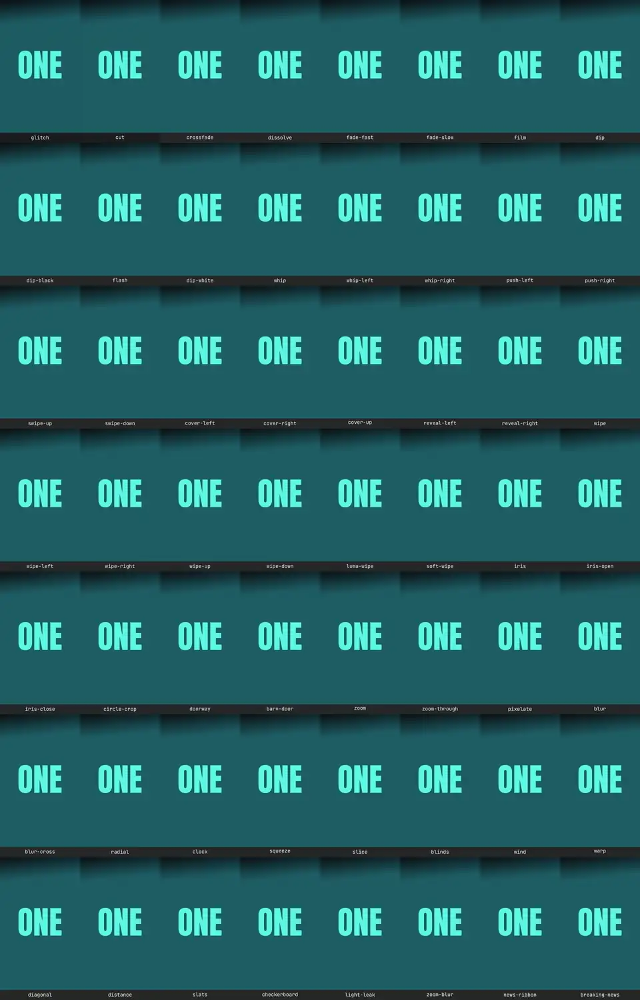

| Preview | Name | What it does | Use |
|---|---|---|---|
| 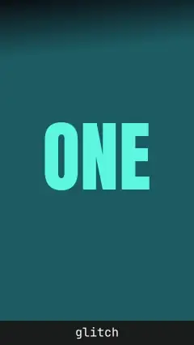 | `glitch` | Hard cut with a quick shake and colour split on the seam (the default). | `"transition": "glitch"` Reel.md `transition glitch` |
| 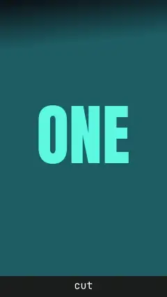 | `cut` | Plain hard cut, no blend and no shake. | `"transition": "cut"` Reel.md `transition cut` |
| 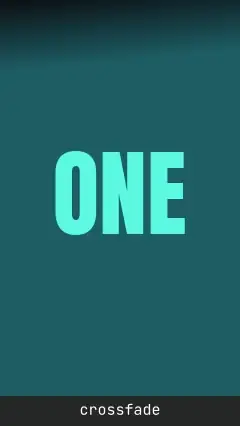 | `crossfade` | The two shots blend smoothly into each other. | `"transition": "crossfade"` Reel.md `transition crossfade` |
|  | `dissolve` | The new shot appears through a scatter of random pixels. | `"transition": "dissolve"` Reel.md `transition dissolve` |
|  | `fade-fast` | A quick crossfade. | `"transition": "fade-fast"` Reel.md `transition fade-fast` |
|  | `fade-slow` | A slow, soft crossfade. | `"transition": "fade-slow"` Reel.md `transition fade-slow` |
|  | `film` | Fades through grey, like an old film cut. | `"transition": "film"` Reel.md `transition film` |
|  | `dip` | Dips to black, then fades up on the new shot. | `"transition": "dip"` Reel.md `transition dip` |
|  | `dip-black` | Dips to black, then fades up on the new shot. Same as `dip`. | `"transition": "dip-black"` Reel.md `transition dip-black` |
|  | `flash` | Flashes to white, then the new shot. | `"transition": "flash"` Reel.md `transition flash` |
| 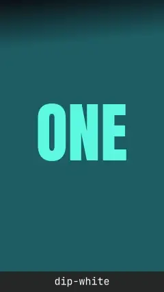 | `dip-white` | Dips to white, then fades up on the new shot. Same as `flash`. | `"transition": "dip-white"` Reel.md `transition dip-white` |
|  | `whip` | The new shot pushes the old one off to the left. | `"transition": "whip"` Reel.md `transition whip` |
| 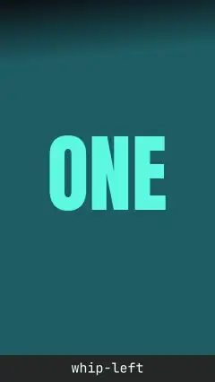 | `whip-left` | The new shot pushes the old one off to the left. Same as `whip`. | `"transition": "whip-left"` Reel.md `transition whip-left` |
| 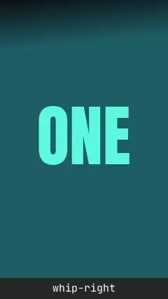 | `whip-right` | The new shot pushes the old one off to the right. | `"transition": "whip-right"` Reel.md `transition whip-right` |
| 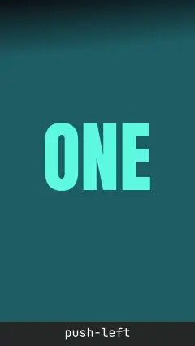 | `push-left` | The new shot pushes the old one off to the left. Same as `whip`. | `"transition": "push-left"` Reel.md `transition push-left` |
| 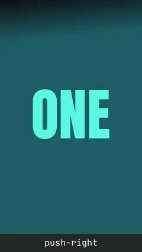 | `push-right` | The new shot pushes the old one off to the right. Same as `whip-right`. | `"transition": "push-right"` Reel.md `transition push-right` |
| 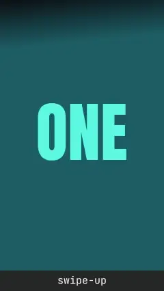 | `swipe-up` | The new shot pushes the old one up and out of frame. | `"transition": "swipe-up"` Reel.md `transition swipe-up` |
|  | `swipe-down` | The new shot pushes the old one down and out of frame. | `"transition": "swipe-down"` Reel.md `transition swipe-down` |
|  | `cover-left` | The new shot slides in over the old one, moving left. | `"transition": "cover-left"` Reel.md `transition cover-left` |
|  | `cover-right` | The new shot slides in over the old one, moving right. | `"transition": "cover-right"` Reel.md `transition cover-right` |
| 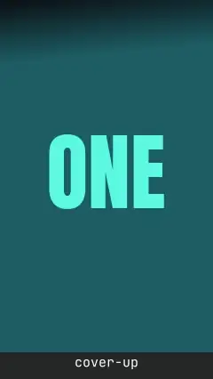 | `cover-up` | The new shot slides up over the old one. | `"transition": "cover-up"` Reel.md `transition cover-up` |
| 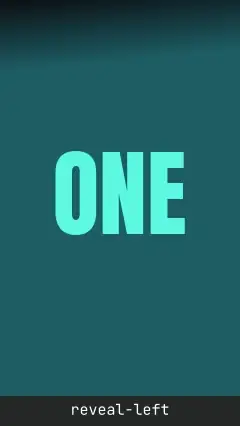 | `reveal-left` | The old shot slides away to the left, revealing the new one under it. | `"transition": "reveal-left"` Reel.md `transition reveal-left` |
| 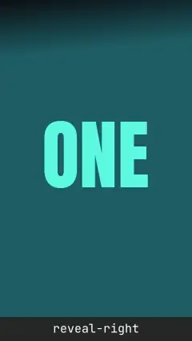 | `reveal-right` | The old shot slides away to the right, revealing the new one under it. | `"transition": "reveal-right"` Reel.md `transition reveal-right` |
|  | `wipe` | A hard edge wipes the new shot in, moving left. | `"transition": "wipe"` Reel.md `transition wipe` |
| 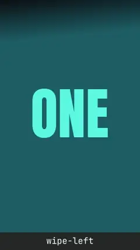 | `wipe-left` | A hard edge wipes the new shot in, moving left. Same as `wipe`. | `"transition": "wipe-left"` Reel.md `transition wipe-left` |
| 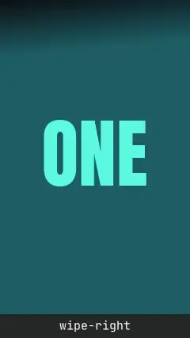 | `wipe-right` | A hard edge wipes the new shot in, moving right. | `"transition": "wipe-right"` Reel.md `transition wipe-right` |
| 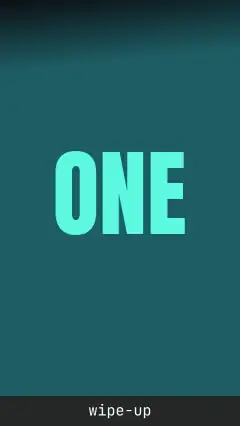 | `wipe-up` | A hard edge wipes the new shot in, moving up. | `"transition": "wipe-up"` Reel.md `transition wipe-up` |
| 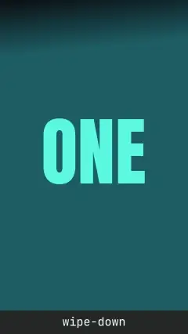 | `wipe-down` | A hard edge wipes the new shot in, moving down. | `"transition": "wipe-down"` Reel.md `transition wipe-down` |
| 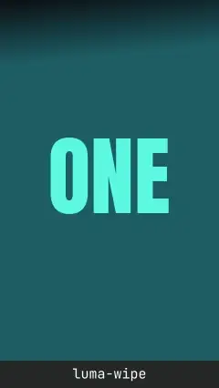 | `luma-wipe` | A soft-edged wipe moving left. | `"transition": "luma-wipe"` Reel.md `transition luma-wipe` |
| 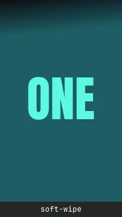 | `soft-wipe` | A soft-edged wipe moving left. Same as `luma-wipe`. | `"transition": "soft-wipe"` Reel.md `transition soft-wipe` |
|  | `iris` | A circle opens from the centre onto the new shot. | `"transition": "iris"` Reel.md `transition iris` |
| 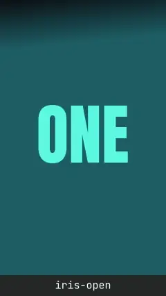 | `iris-open` | A circle opens from the centre onto the new shot. Same as `iris`. | `"transition": "iris-open"` Reel.md `transition iris-open` |
| 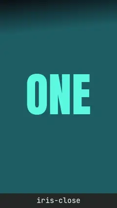 | `iris-close` | The old shot shrinks away in a closing circle, the new one around it. | `"transition": "iris-close"` Reel.md `transition iris-close` |
|  | `circle-crop` | The old shot closes to a circle on black, then the new shot opens out of it. | `"transition": "circle-crop"` Reel.md `transition circle-crop` |
|  | `doorway` | The new shot opens out from a horizontal line across the middle. | `"transition": "doorway"` Reel.md `transition doorway` |
| 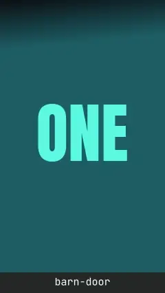 | `barn-door` | The new shot opens out from a vertical line down the middle, like barn doors. | `"transition": "barn-door"` Reel.md `transition barn-door` |
| 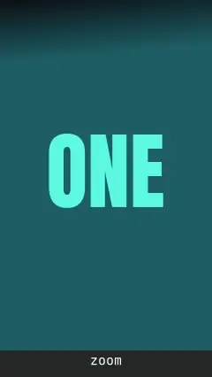 | `zoom` | Zooms into the old shot as the new one fades in. | `"transition": "zoom"` Reel.md `transition zoom` |
| 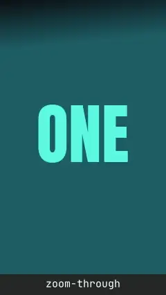 | `zoom-through` | Zooms into the old shot as the new one fades in. Same as `zoom`. | `"transition": "zoom-through"` Reel.md `transition zoom-through` |
| 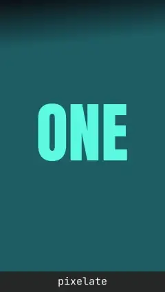 | `pixelate` | Breaks into big pixels, then resolves on the new shot. | `"transition": "pixelate"` Reel.md `transition pixelate` |
|  | `blur` | A horizontal smear blur carries one shot into the next. | `"transition": "blur"` Reel.md `transition blur` |
| 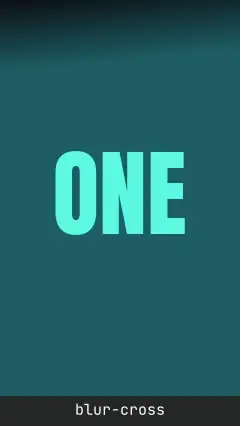 | `blur-cross` | A horizontal smear blur carries one shot into the next. Same as `blur`. | `"transition": "blur-cross"` Reel.md `transition blur-cross` |
|  | `radial` | A clock-hand sweep around the centre reveals the new shot. | `"transition": "radial"` Reel.md `transition radial` |
| 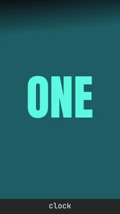 | `clock` | A clock-hand sweep around the centre reveals the new shot. Same as `radial`. | `"transition": "clock"` Reel.md `transition clock` |
| 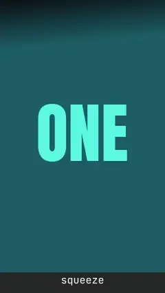 | `squeeze` | The old shot squeezes flat to a line and the new one stretches out. | `"transition": "squeeze"` Reel.md `transition squeeze` |
| 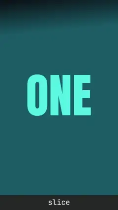 | `slice` | Staggered horizontal slices sweep the new shot in. | `"transition": "slice"` Reel.md `transition slice` |
| 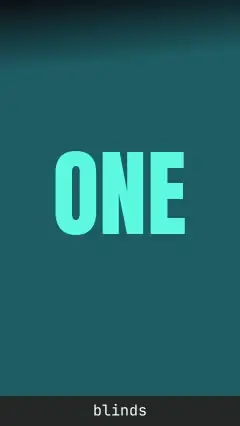 | `blinds` | Staggered horizontal slices sweep the new shot in, like blinds. Same as `slice`. | `"transition": "blinds"` Reel.md `transition blinds` |
| 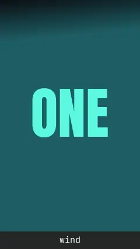 | `wind` | A streaky, wind-blown edge sweeps the new shot in. | `"transition": "wind"` Reel.md `transition wind` |
|  | `warp` | A diagonal edge wipes across from one corner to the other. | `"transition": "warp"` Reel.md `transition warp` |
|  | `diagonal` | A diagonal edge wipes across from one corner to the other. Same as `warp`. | `"transition": "diagonal"` Reel.md `transition diagonal` |
|  | `distance` | The old shot melts into the new one by colour difference. | `"transition": "distance"` Reel.md `transition distance` |
|  | `slats` | Twelve vertical slats open one after another, left to right. | `"transition": "slats"` Reel.md `transition slats` |
|  | `checkerboard` | A grid of tiles in the theme accent flips across on a diagonal. | `"transition": "checkerboard"` Reel.md `transition checkerboard` |
| 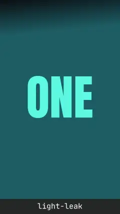 | `light-leak` | A warm glow drifts across and blooms while the shots cross. | `"transition": "light-leak"` Reel.md `transition light-leak` |
|  | `zoom-blur` | Zooms into the old shot and out of the new one with a radial blur. | `"transition": "zoom-blur"` Reel.md `transition zoom-blur` |
| 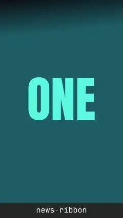 | `news-ribbon` | A red and white broadcast ribbon sweeps up across the frame. | `"transition": "news-ribbon"` Reel.md `transition news-ribbon` |
| 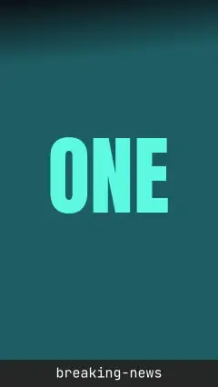 | `breaking-news` | A red and white broadcast ribbon sweeps up across the frame. Same as `news-ribbon`. | `"transition": "breaking-news"` Reel.md `transition breaking-news` |

## Title entrances

9 ways a kinetic title (a mode 7 flip) comes in. Use each one at most once per video. In `captions.js` set `"entrance"` on the title; in a Reel.md put `entrance <name>` on a line of the `reel-titles` block. Titles sit in front of the presenter by default; `"layer": "behind"` tucks the hero word behind the head.

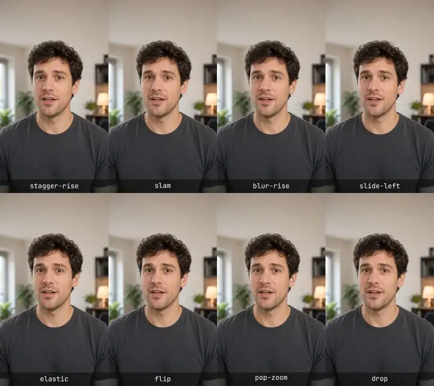

| Preview | Name | What it does | Use |
|---|---|---|---|
|  | `stagger-rise` | Letters rise into place one after another. | `{ "mode": 7, "text": "Record one take", "entrance": "stagger-rise" }` Reel.md `#01 0.3-1.8 \| entrance stagger-rise \| text Record one take` |
|  | `slam` | The word slams in oversized, overshoots and shakes to a stop. | `{ "mode": 7, "text": "Record one take", "entrance": "slam" }` Reel.md `#01 0.3-1.8 \| entrance slam \| text Record one take` |
|  | `blur-rise` | The word rises from below out of a heavy blur. | `{ "mode": 7, "text": "Record one take", "entrance": "blur-rise" }` Reel.md `#01 0.3-1.8 \| entrance blur-rise \| text Record one take` |
|  | `slide-left` | The word slides in from the right with a slant that straightens. | `{ "mode": 7, "text": "Record one take", "entrance": "slide-left" }` Reel.md `#01 0.3-1.8 \| entrance slide-left \| text Record one take` |
| 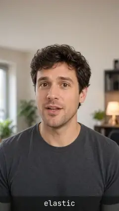 | `elastic` | The word scales up with an elastic wobble. | `{ "mode": 7, "text": "Record one take", "entrance": "elastic" }` Reel.md `#01 0.3-1.8 \| entrance elastic \| text Record one take` |
|  | `flip` | The word flips in vertically, like a card turning over. | `{ "mode": 7, "text": "Record one take", "entrance": "flip" }` Reel.md `#01 0.3-1.8 \| entrance flip \| text Record one take` |
|  | `pop-zoom` | The word pops in from nothing with a small overshoot. | `{ "mode": 7, "text": "Record one take", "entrance": "pop-zoom" }` Reel.md `#01 0.3-1.8 \| entrance pop-zoom \| text Record one take` |
|  | `drop` | Each letter falls in from above with a small bounce and tilt. | `{ "mode": 7, "text": "Record one take", "entrance": "drop" }` Reel.md `#01 0.3-1.8 \| entrance drop \| text Record one take` |
|  | `typewriter` | The letters type on one at a time from the left behind a blinking caret. | `{ "mode": 7, "text": "Record one take", "entrance": "typewriter" }` Reel.md `#01 0.3-1.8 \| entrance typewriter \| text Record one take` |

## Title effects and exits

A title can be set as a designed phrase: one to three lines split by `|`, small partner words in the text colour and one larger key word (`"key"`) in the accent. Add `"phrase": true` to draw the lines as written. `"words": [[start, end, word], ...]` times each word, and a word is never drawn before its start. With no effect the words come in as you say them (`"build": "word"`), typed (`"letter"`) or a line at a time (`"line"`).

An effect is how the title arrives, one per title: `"effect"` on the title, or `"titleEffect"` in `captions.js` for every title that names none. An exit is how it leaves, over its last 0.2 to 0.45 s: `"exit"` on the title, or `"titleExit"` for the job. When the title ends within 0.2 s of a cut, the exit is the transition at that cut: the picture makes the same move, in place of the segment's own transition, and the build log says so. The previews show the title only. `"glow": "soft"` or `"strong"` and `"dim": 0.4` work on one title, also when the job has `titleGlow` and `titleDim` off.

Key words: `--key-words off|subtle|strong|dramatic` sets how big the strongest word of a kinetic caption line gets (captions.js `"keyWords"`). `off`, or leaving it out, keeps the size it always had. The layout pass still moves a bigger word off the face. In Studio it is the Key words step of the builder.

Transition timing: `--transitions-when every-cut|topic|hook-cta` keeps named transitions only on those joins; the rest are plain hard cuts (no blend and no shake). Each segment of `cut.json` is tagged `"section": "hook" | "body" | "cta"` (`kit/sections.cjs`: the hook runs to the end of the first sentence after 3 s, the call to action from the last line or two that asks for something), and the timing stays in `cut.json` (`transitionsWhen`) so `--rebuild` applies it again. `every-cut`, or leaving it out, is how it always was.

For the whole reel: `--title-effect <name>` and `--title-exit <name>`, or `- title-effect:` and `- title-exit:` under Style in a Reel.md. In Studio they are one Effect and one Exit pick on Text and graphics. Some effects need something from the title: `slot-roll` a number in the key word or a `"swap"` list, `count-up` a number, `stack-fade` two lines or more, and `polaroid`, `glitch-slice` and `dip-black` a cut where the title ends. When a draft from a reference cannot give an effect what it needs, the title comes in by its plain build (an exit just ends) and the build log says which effect was not drawn and why. The table behind this is `kit/title-effects.json`.

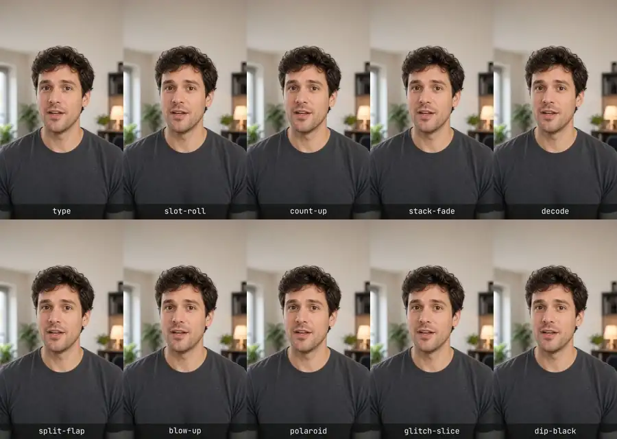

| Preview | Name | What it does | Use |
|---|---|---|---|
|  | `type` | The title is typed letter by letter behind a caret, about 12 letters a second, line after line. | `{ "mode": 7, "text": "THE ONLY\|Question\|YOU NEED", "phrase": true, "key": "Question", "effect": "type" }` |
|  | `slot-roll` | The key word's digits roll like a slot reel with motion blur and lock left to right; with "swap" one word of the line rolls through a list while the rest stays put. | `{ "mode": 7, "text": "$3.9M\|WAS THE LOWEST", "key": "$3.9M", "effect": "slot-roll" }` `{ "mode": 7, "text": "I DON'T KNOW\|How to pitch", "key": "How to pitch", "swap": ["pitch", "market", "do sales"] }` |
|  | `count-up` | The key word counts up with an ease ("count": from, to, unit), then rolls to a final text ("1 Day" to "365 Days" to "1 Year"). | `{ "mode": 7, "text": "THAT'D KEEP ME GOING FOR\|365 Days", "key": "365 Days", "count": { "from": 1, "to": 365, "unit": "Days", "final": "1 Year" } }` |
|  | `stack-fade` | Lines arrive one at a time; older lines go grey, blur and fade as new ones stack under them. | `{ "mode": 7, "text": "THE ONLY\|Question\|YOU NEED", "phrase": true, "key": "Question", "effect": "stack-fade" }` |
|  | `decode` | Random glyphs scramble, then settle into the key word from left to right. | `{ "mode": 7, "text": "THE ONLY\|Question\|YOU NEED", "phrase": true, "key": "Question", "effect": "decode" }` |
|  | `split-flap` | The title on a flap board: dark tiles flip through characters and settle line by line, the key word in the accent. | `{ "mode": 7, "text": "THE ONLY\|Question\|YOU NEED", "phrase": true, "key": "Question", "effect": "split-flap" }` |
|  | `blow-up` | Exit: the key word scales up past the lens into a full-frame flash of its colour that fades after the cut. | `{ "mode": 7, "text": "THE ONLY\|Question\|YOU NEED", "phrase": true, "key": "Question", "exit": "blow-up" }` |
|  | `polaroid` | Exit: the picture and the title shrink into a tilted white-border print that slides off, the next shot under it. | `{ "mode": 7, "text": "THE ONLY\|Question\|YOU NEED", "phrase": true, "key": "Question", "exit": "polaroid" }` |
|  | `glitch-slice` | Exit: the title and the picture tear out sideways in horizontal bands. | `{ "mode": 7, "text": "THE ONLY\|Question\|YOU NEED", "phrase": true, "key": "Question", "exit": "glitch-slice" }` |
|  | `dip-black` | Exit: the title fades as the picture dips to black and back. | `{ "mode": 7, "text": "THE ONLY\|Question\|YOU NEED", "phrase": true, "key": "Question", "exit": "dip-black" }` |

## Caption entrances

10 ways the big hero word of a kinetic caption comes in, most of them letter by letter. Set one for the whole reel with `--caption-entrance <name>`, `"captionEntrance": "<name>"` in `captions.js`, or `- caption-entrance: <name>` under Style in a Reel.md. A caption flip's own `"entrance"` wins. They apply to the `kinetic` caption style (the default look).

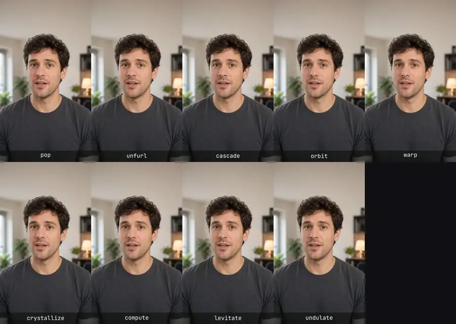

| Preview | Name | What it does | Use |
|---|---|---|---|
|  | `pop` | The whole word springs in with a pop (default). | `--caption-entrance pop` `"captionEntrance": "pop"` |
|  | `unfurl` | Each letter opens out from its left edge. | `--caption-entrance unfurl` `"captionEntrance": "unfurl"` |
|  | `cascade` | Letters drop in one after another and settle. | `--caption-entrance cascade` `"captionEntrance": "cascade"` |
|  | `orbit` | Letters swing in on an arc. | `--caption-entrance orbit` `"captionEntrance": "orbit"` |
|  | `warp` | Letters stretch and wobble, then settle. | `--caption-entrance warp` `"captionEntrance": "warp"` |
|  | `crystallize` | Scattered, blurred letters gather into the word. | `--caption-entrance crystallize` `"captionEntrance": "crystallize"` |
|  | `compute` | The word decodes from random characters. | `--caption-entrance compute` `"captionEntrance": "compute"` |
|  | `levitate` | Letters float up into place. | `--caption-entrance levitate` `"captionEntrance": "levitate"` |
|  | `undulate` | Letters ride a wave that calms down. | `--caption-entrance undulate` `"captionEntrance": "undulate"` |
|  | `typewriter` | The word types on letter by letter behind a blinking caret. | `--caption-entrance typewriter` `"captionEntrance": "typewriter"` |

## Caption styles

7 kinetic caption styles. A look (`--look`) picks one for you; override it with `--style <name>`, `"captionStyle": "<name>"` in `captions.js`, or `- captions: <name>` under Style in a Reel.md.

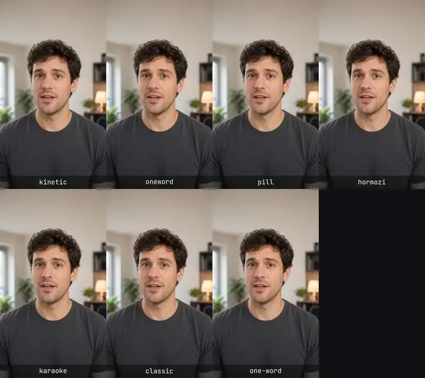

| Preview | Name | What it does | Use |
|---|---|---|---|
|  | `kinetic` | Two-font lockup, hero word big in the display face. | `--style kinetic` `"captionStyle": "kinetic"` |
|  | `oneword` | One word at a time, key word big in the display face with the phrase building under it. | `--style oneword` `"captionStyle": "oneword"` |
|  | `pill` | 3 to 5 words in a lower-third pill. | `--style pill` `"captionStyle": "pill"` |
|  | `hormozi` | Bold caps with a cyan active word. | `--style hormozi` `"captionStyle": "hormozi"` |
|  | `karaoke` | Colour wipe as each word is said. | `--style karaoke` `"captionStyle": "karaoke"` |
|  | `classic` | The original phrase captions. | `--style classic` `"captionStyle": "classic"` |
|  | `one-word` | One big word at a time, punchy, in the display face. | `--style one-word` `"captionStyle": "one-word"` |

## Graphics

30 overlay graphics drawn in the theme colours and fonts, each with its own entrance. Add one as a flip in `captions.js` with its `"mode"`, or as a line in a Reel.md `reel-graphics` block with `type <name>`. Words on a graphic must be words you say. Field details are in [reel-md.md](reel-md.md) and [contract.json](../contract.json); stills of every one are in the [gallery](../showcase/GALLERY.md#graphics).

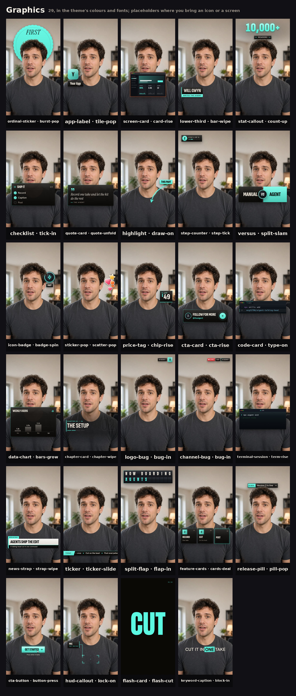

| Name | Mode | Entrance | What it is | Use |
|---|---|---|---|---|
| `ordinal-sticker` | 9 | `burst-pop` | list number sticker: an italic serif word (FIRST, SECOND, NEXT) set on a flat seal in the theme accent; the seal can sit behind your head | `"mode": 9` Reel.md `type ordinal-sticker` |
| `app-label` | 10 | `tile-pop` | app or logo label: a top-lit icon tile springs in and a name plate wipes out under it; your icon image, or a monogram of the name | `"mode": 10` Reel.md `type app-label` |
| `screen-card` | 11 | `card-rise` | screen card: a dark window card (title bar, address pill, accent rim with a glow), inset in the lower middle, showing your screenshot or screen recording; optional pointer clicks and pan and zoom keyframes on beats you say | `"mode": 11` Reel.md `type screen-card` |
| `lower-third` | 12 | `bar-wipe` | lower third name tag: an accent rule springs up, a name plate wipes out from it and a small line follows on an accent tab | `"mode": 12` Reel.md `type lower-third` |
| `stat-callout` | 13 | `count-up` | big number callout: the number blurs in and counts up to its value in equal digit cells, accent gradient and glow, a label plate rises under it | `"mode": 13` Reel.md `type stat-callout` |
| `checklist` | 14 | `tick-in` | checklist card: rows slide in, and each check springs in and draws its tick as you say its item; a done count in the header | `"mode": 14` Reel.md `type checklist` |
| `quote-card` | 15 | `quote-unfold` | quote card: a quote mark springs in, the line fades up word by word in an italic serif, with a small attribution under it | `"mode": 15` Reel.md `type quote-card` |
| `highlight` | 16 | `draw-on` | highlight: a tapered marker circle, arrow, underline or box draws itself on with a glow, with an optional short label on an accent plate | `"mode": 16` Reel.md `type highlight` |
| `step-counter` | 17 | `step-tick` | step counter: a plate with the step number rolling over in an accent disc, STEP 2 OF 5 beside it and a segmented bar that fills to the current step | `"mode": 17` Reel.md `type step-counter` |
| `versus` | 18 | `split-slam` | versus card: two halves slide in from the sides and a VS badge slams between them | `"mode": 18` Reel.md `type versus` |
| `icon-badge` | 19 | `badge-spin` | round icon badge: springs in while its conic ring draws round; a built-in glyph (Tabler icon) or your icon, with an optional label plate | `"mode": 19` Reel.md `type icon-badge` |
| `sticker-pop` | 20 | `scatter-pop` | reaction stickers: a little cluster of die-cut vinyl stickers (hearts, stars, fire, sparks) springs in around a point and floats up | `"mode": 20` Reel.md `type sticker-pop` |
| `price-tag` | 21 | `chip-rise` | price tag: a price card rises and springs into place, the price big with a raised currency sign and an old price struck through above | `"mode": 21` Reel.md `type price-tag` |
| `cta-card` | 22 | `cta-rise` | call-to-action end card: a card rises with an avatar ring, your line and handle, and a follow button pulses with ripples | `"mode": 22` Reel.md `type cta-card` |
| `code-card` | 23 | `type-on` | code snippet card: an editor window with a file tab, line numbers and a current-line band, the code typing itself on with syntax colour and a caret; the card widens or the type steps down so no line is clipped | `"mode": 23` Reel.md `type code-card` |
| `data-chart` | 24 | `bars-grow` | data chart card: gridlines draw, then each bar (or each point of a line) grows on its beat with a spring while its value counts up; the top value glows in the accent | `"mode": 24` Reel.md `type data-chart` |
| `chapter-card` | 25 | `chapter-wipe` | chapter card: a soft scrim and accent rule, CHAPTER 02 and the title rising out of a mask line by line, a ghost numeral behind and progress ticks | `"mode": 25` Reel.md `type chapter-card` |
| `logo-bug` | 26 | `bug-in` | logo bug: your mark (an icon file, else a monogram tile in the accent) springs into a corner with its name on a dark plate; a slow sheen passes now and then | `"mode": 26` Reel.md `type logo-bug` |
| `channel-bug` | 27 | `bug-in` | channel bug: a red LIVE pill with a breathing dot, a running clock in tabular digits and the channel name, on dark plates in a corner | `"mode": 27` Reel.md `type channel-bug` |
| `terminal-session` | 28 | `term-rise` | terminal session: a terminal window rises; each $ command types on its beat with a spinner, then its output lands line by line (ticks green, errors red); a block cursor blinks | `"mode": 28` Reel.md `type terminal-session` |
| `news-strap` | 29 | `strap-wipe` | news strap: a broadcast lower third; a light plate wipes out from an accent bar with the headline, a tag tab drops onto its top edge and the sub line slides in on a dark strip | `"mode": 29` Reel.md `type news-strap` |
| `ticker` | 30 | `ticker-slide` | ticker: a full-width band rises from the bottom edge with a slanted accent label block; the items you say scroll right to left between accent diamonds | `"mode": 30` Reel.md `type ticker` |
| `split-flap` | 31 | `flap-in` | split-flap board: hinged departure-board tiles flip through letters and land on your words left to right in Anton; a second row in the accent | `"mode": 31` Reel.md `type split-flap` |
| `feature-cards` | 32 | `cards-deal` | feature cards: two to four cards deal in side by side as you say each feature, with an icon tile in the accent, a number, the feature and a short line; the newest card glows | `"mode": 32` Reel.md `type feature-cards` |
| `release-pill` | 33 | `pill-pop` | release pill: a glass pill springs in with an accent NEW chip (its dot pulsing a ring), your line and an arrow; a sheen sweeps across once | `"mode": 33` Reel.md `type release-pill` |
| `cta-button` | 34 | `button-press` | CTA button: a lit accent button rises, a pointer glides in and clicks it (the button squashes and flashes, a ripple rings out); a sub line under it | `"mode": 34` Reel.md `type cta-button` |
| `hud-callout` | 35 | `lock-on` | HUD callout: corner brackets spin in and lock onto a region (a flash, centre ticks, a scan line), a leader line draws out with an elbow to a label that decodes into place | `"mode": 35` Reel.md `type hud-callout` |
| `flash-card` | 36 | `flash-cut` | flash cards: full-bleed type cards, one word each in Anton, hard cut on each beat with a punch-in, alternating accent and ink grounds; covers the frame | `"mode": 36` Reel.md `type flash-card` |
| `keyword-caption` | 37 | `block-in` | keyword caption: a caption line rises word by word, then a solid accent block wipes in behind the keyword and its letters flip to ink on it; an optional tag above | `"mode": 37` Reel.md `type keyword-caption` |
| `number-pop` | 38 | `num-pop` | number pop: a listicle intro, the numbers 1 to N pop in one by one on solid tiles around your head (alternating sides, never over the face), hold, then pop out together; pair it with a pop sound | `"mode": 38` Reel.md `type number-pop` |

## Effects

51 optional second-pass video effects, applied with `npm run fx`. Pick them by the moment in your script. The full catalog with options, energy and pairings is [effects/CATALOG.md](../effects/CATALOG.md); stills are in the [gallery](../showcase/GALLERY.md#effects).

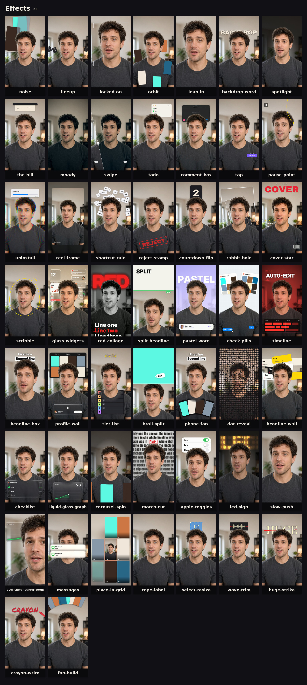

| Name | Moments | What it does | Use |
|---|---|---|---|
| `noise` | hook, proof | Your reels (or frames from this clip) pile up behind your head, one every quarter second. | `"fx": "noise"` |
| `lineup` | list | Numbered tiles fan out in an arc above your head. | `"fx": "lineup"` |
| `locked-on` | hook, claim | Corner brackets snap onto your face and the camera follows you, with a tag pill under the face. | `"fx": "locked-on"` |
| `orbit` | proof, hook | Your reels circle your head: in front at the bottom, behind you at the top. | `"fx": "orbit"` |
| `lean-in` | claim, reveal, objection | A fast punch-in on one word. | `"fx": "lean-in"` |
| `backdrop-word` | hook, claim, reveal | A giant word in tall type rises in behind you, letter by letter, with your head cutting into it. | `"fx": "backdrop-word"` |
| `spotlight` | reveal, hook, cta | Kills the lights and keeps you lit, with an optional glowing word behind you. look=sparkle (alias glitter-spotlight) adds golden rays and sparkles. | `"fx": "spotlight"` |
| `the-bill` | list, proof | Prints your instructions like a receipt into the wall above your head. | `"fx": "the-bill"` |
| `moody` | transition, objection | A colour grade: darker, softer, teal shadows. grade= moody, bw, warm, cool or pop. | `"fx": "moody"` |
| `swipe` | reveal, proof | A before-and-after slider sweeps across you, with a pill label near the bottom. | `"fx": "swipe"` |
| `todo` | list | A checklist card beside your head that ticks off as you talk. | `"fx": "todo"` |
| `comment-box` | cta | An Instagram comments sheet above your head types your word, posts it, gets a heart and your reply. look=bar for the old bottom bar. | `"fx": "comment-box"` |
| `tap` | cta | A Follow button pops up and flips to Following. | `"fx": "tap"` |
| `pause-point` | reveal, objection | Freezes the frame and points at you with a hand-drawn arrow and label. | `"fx": "pause-point"` |
| `uninstall` | objection, transition | A glitchy uninstall bar breaks the frame apart. | `"fx": "uninstall"` |
| `reel-frame` | proof, transition | Your video shrinks into an Instagram reel card. | `"fx": "reel-frame"` |
| `shortcut-rain` | list, proof | Keyboard keys rain down behind you. | `"fx": "shortcut-rain"` |
| `reject-stamp` | objection, reveal | A big red stamp slams onto the screen. | `"fx": "reject-stamp"` |
| `countdown-flip` | hook, cta, reveal | A 3, 2, 1 flip clock above your head. | `"fx": "countdown-flip"` |
| `rabbit-hole` | transition, reveal | The room tunnels into itself, spinning, while you stay in front. | `"fx": "rabbit-hole"` |
| `cover-star` | hook, proof | You become a magazine cover, with the title behind your head and cover lines down the side. look=editorial for a classic warm cover. | `"fx": "cover-star"` |
| `scribble` | hook, reveal | Marker doodles draw themselves around you, with a label and arrow. | `"fx": "scribble"` |
| `glass-widgets` | proof, hook | Frosted glass widgets and mini artifacts (stats, profile, calendar, render bar) float around your head, with an optional "Edited by" pill near the bottom (off unless you opt in). look=simple for 3 widgets. | `"fx": "glass-widgets"` |
| `red-collage` | hook, claim | Black-and-white you, a giant red word behind, three lines slam in beside you. | `"fx": "red-collage"` |
| `split-headline` | hook, claim | A headline card slides down and pushes you into the bottom of the frame. | `"fx": "split-headline"` |
| `pastel-word` | cta, hook | A soft lavender room, a giant word behind you and a profile card that gets followed. | `"fx": "pastel-word"` |
| `check-pills` | list, proof | Grid-paper room, reel boards pinned behind you and blue pills that a cursor clicks. | `"fx": "check-pills"` |
| `timeline` | transition, proof | A dark red cinematic grade with an editing timeline, a REC timecode and a glowing playhead. | `"fx": "timeline"` |
| `headline-box` | hook, claim | A punch-in with a two-line headline above your head, the second line in a white box. | `"fx": "headline-box"` |
| `profile-wall` | proof | Your reels grid fills the wall behind you while a view counter ticks up below your face. | `"fx": "profile-wall"` |
| `tier-list` | proof, claim | A tier list drops in front of you and your item flies into S tier. | `"fx": "tier-list"` |
| `broll-split` | proof, transition | Split screen: b-roll on top with a price-tag sticker, you on the bottom. | `"fx": "broll-split"` |
| `phone-fan` | proof, hook | Your reels fan out like a hand of phones under a two-line headline. | `"fx": "phone-fan"` |
| `dot-reveal` | hook, transition, reveal | Your shot builds itself out of glowing dots, then snaps into the full picture. | `"fx": "dot-reveal"` |
| `headline-wall` | proof | Your own headlines pile up behind your head, then a total pops in front. | `"fx": "headline-wall"` |
| `checklist` | list, proof | A task list builds under your chin: each step spins, then ticks green. | `"fx": "checklist"` |
| `liquid-glass-graph` | proof | A liquid glass card floats under your chin while a graph climbs and the number counts up. look=bento moves it to a smoked glass screen behind your head with tiles in front. | `"fx": "liquid-glass-graph"` |
| `carousel-spin` | proof, hook | Your reels spin around you in a 3D carousel, then slow to a stop. | `"fx": "carousel-spin"` |
| `match-cut` | claim, proof, reveal | News pages cut on one word, locked in a red box behind your head. | `"fx": "match-cut"` |
| `apple-toggles` | list, cta | An iPhone settings card flips its switches on, one line at a time. Default sits above you tucked behind your head with a gentle zoom; pos=below puts it under the chin. | `"fx": "apple-toggles"` |
| `led-sign` | hook, cta, reveal | The lights drop and a glowing LED sign types itself out behind you. | `"fx": "led-sign"` |
| `slow-push` | claim, objection, cta, transition | A slow cinematic push-in to your face while the room melts out of focus. | `"fx": "slow-push"` |
| `over-the-shoulder-zoom` | proof | The camera pushes into one top corner and a liquid glass graph pops beside your head, pulls back, then the other corner with a second graph. | `"fx": "over-the-shoulder-zoom"` |
| `messages` | proof, objection, cta | iMessage notifications pop in one after another, stacking up just above 61% height. | `"fx": "messages"` |
| `place-in-grid` | proof, cta | You shrink into the centre tile of your 3x3 profile grid, then 8 reels pop in around you with view counts. | `"fx": "place-in-grid"` |
| `tape-label` | claim, cta | A level strip of yellow tape with your line lands on your chest. | `"fx": "tape-label"` |
| `select-resize` | proof, reveal | A blue selection box grabs your number above your head and a cursor drags it bigger. | `"fx": "select-resize"` |
| `wave-trim` | proof, transition | A dark panel above your head shows your voice; the silent ends collapse until only your words are left. | `"fx": "wave-trim"` |
| `huge-strike` | objection, reveal | One huge serif word wipes in behind your head, then a red line crosses it out. | `"fx": "huge-strike"` |
| `crayon-write` | claim, hook | A red crayon writes your word behind your head, then underlines it and flies off. | `"fx": "crayon-write"` |
| `fan-build` | proof | Your reel covers deal into a fan behind your head, one card at a time. | `"fx": "fan-build"` |

## Editing principles

Common short-form editing advice, built into the engine. Each one works on its own; `--preset magazine` (or `- preset: magazine` under Brand kit in a Reel.md) turns them all on, and [examples/recipes/magazine.Reel.md](../examples/recipes/magazine.Reel.md) shows every line. Why each one helps, in plain words: [guide.md](guide.md#editing-principles-built-in). The `typewriter` entrances are in the tables above and `number-pop` is in Graphics.

| Name | What it does | Use |
|---|---|---|
| `magazine` | Every principle below at once: serif and sans mixed, placed titles, colour and chapter cards, energy-matched music, mapped and capped sounds, 12% punch-ins, typewriter and crossfades, no dead air. | `--preset magazine  or  Reel.md  - preset: magazine` |
| `accent-script` | Three faces in one phrase: a serif numeral or hero word, one italic serif word, sans for the rest (pairings playfair and dmserif do it by default). | `"lockup": { "accent": "script" }  or  Reel.md title  \| accent script \|` |
| `place-left` | The words sit left of your head at eye level. | `"place": "left"  on a title or caption  or  Reel.md  \| place left \|` |
| `place-right` | The words sit right of your head at eye level. | `"place": "right"  or  \| place right \|` |
| `place-above` | The words sit above your head. | `"place": "above"  or  \| place above \|` |
| `place-chest` | The words sit across your chest. | `"place": "chest"  or  \| place chest \|` |
| `place-face` | Big over your face, behind your head while it covers under 22% of the letters, else above it (a title goes in front with layer front). | `"place": "face"  or  \| place face \|` |
| `title-places` | Drafted titles take these places in turn. | `"titlePlaces": ["left","face","right","chest"]  in a preset  or  Reel.md  - title-places: left, face, right` |
| `colour-card` | The frame cuts to a flat colour for a beat and your caption words carry it in the card ink (olive, ivory, sage, clay, blush, forest, navy, cream, paper, blue, ink). | `{ "mode": 8, "bg": "olive" }  or  Reel.md reel-cards  #01 4.2-5.4 \| bg olive` |
| `chapter-card` | A colour card with a big serif numeral, one per list item. | `{ "mode": 8, "bg": "ivory", "chapter": "2" }  or  reel-cards  \| bg ivory \| chapter 2` |
| `cards-auto` | Chapter cards when you count off a list, colour cards on short lines to land, and the number-pop intro; npm run plan -- <job> --cards writes them to the Reel.md first. | `--cards auto  or  "cards": "auto"  or  Reel.md  - cards: auto` |
| `music-energy` | A library bed picked by energy; auto reads how fast you talk. | `--music-energy low\|mid\|high\|auto  or  Reel.md Music  - energy: auto  (- bed: auto)` |
| `sfx-map` | A whoosh on named transitions, a swipe on cards, a pop on titles, graphics and list numbers, typing under a typewriter title, a click on a big punch-in. | `"sfxMap": true  or  Reel.md  - sfx-map: on` |
| `sfx-cap` | The sound density cap, on by default: sounds stay apart and sparse, the bigger move wins. | `"sfxCap": { "minGap": 0.25, "per10": 6 }  or  --no-sfx-cap  or  Reel.md  - sfx-cap: 0.4/4` |
| `punch` | Every other cut punches in by this much (10% by default; 10 to 15% reads best). | `"punch": 0.12  in cut.json or a preset  or  Reel.md  - punch: 0.12` |
| `tighten` | No dead air: a pause inside a line longer than this cuts to a jump, keeping a breath. | `--tighten 0.3  or  "tighten": 0.3  or  Reel.md  - tighten: 0.3   (--no-tighten)` |

## For agents

- `npm run list -- <kind> --json` returns `{ kind, sections: [{ id, title, hint, items: [{ id, flag, label, preview }] }] }`. Kinds: `transitions`, `titles`, `captions` (caption entrances and caption styles), `graphics`, `effects`, `editing`, or any section id from `npm run menu`.
- The MCP server (`npm run mcp`) has a `list_effects` tool with the same kinds, and the `menu` tool for every option.
- `npm run check` fails if a name in the kit is missing from this page, so the menu cannot fall behind the code.
