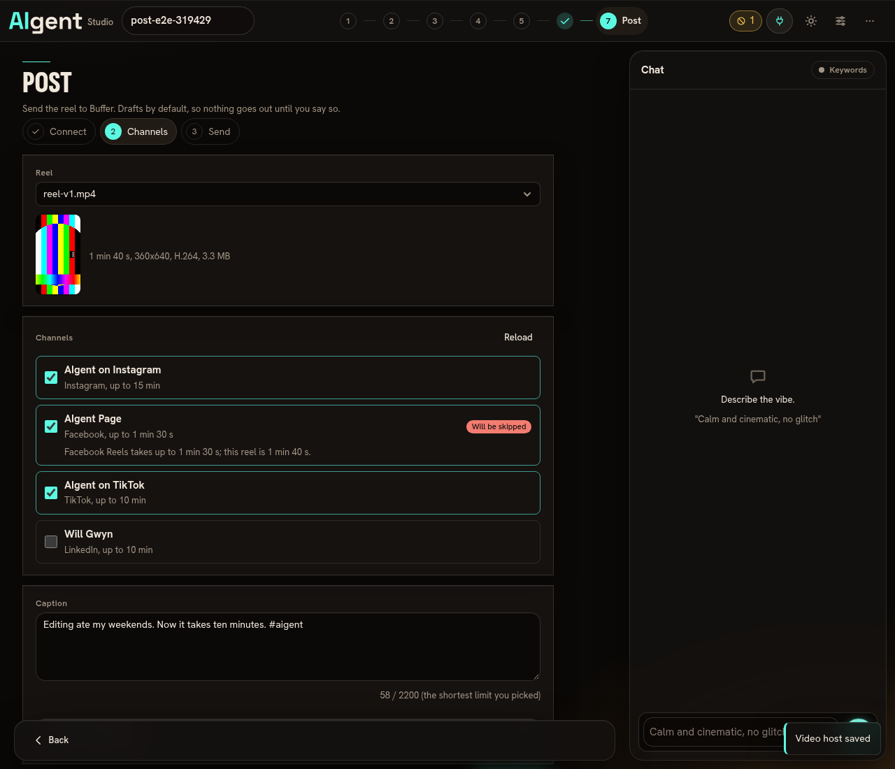
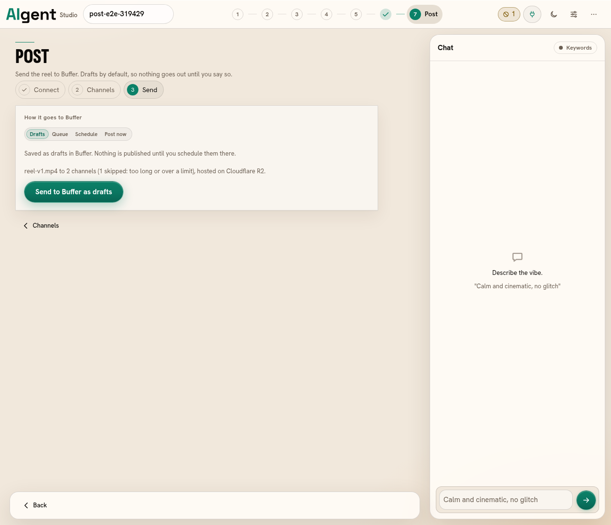

# Posting to Buffer

The Post step is the last step in Studio. It sends a rendered reel to your [Buffer](https://buffer.com) account, one post per channel, and saves each one as a Buffer draft unless you pick otherwise. Your terminal agent can do the same with the `buffer_post_reel` MCP tool.

## What you need

1. **A Buffer API key.** In Buffer, open Settings, then API ([publish.buffer.com/settings/api](https://publish.buffer.com/settings/api)), and create a personal key with posting allowed. The API works on every Buffer plan, including Free.
2. **Somewhere public for the video.** Buffer has no upload. It fetches the video from a public https link when the post goes out, which can be hours or days later for drafts and scheduled posts. Studio supports:
   - **Cloudinary.** Your cloud name plus an unsigned upload preset (Cloudinary, Settings, Upload, Upload presets, set to Unsigned), or your API key and secret for signed uploads. Files over 100 MB go up in 20 MB chunks.
   - **Cloudflare R2.** A bucket with public access turned on (its `r2.dev` address or your own domain), the bucket's public URL, your account ID, and an R2 API token with Object Read and Write. Studio uploads with the S3 API (SigV4, no extra library) and posts the public bucket URL, never a signed link, because signed links expire.
   - **My own link.** Paste a public https link to the MP4 when you send.

   Dropbox and Google Drive share links do not work with Buffer, and Studio refuses them, along with signed or expiring links and anything on your computer or home network.

## The three parts

The step shows one part at a time:

1. **Connect.** Your Buffer key (saved and tested in place) and the video host with only that host's fields. Next stays off until both are saved. Once they are, Studio opens straight on Channels next time.
2. **Channels.** Pick the reel (the newest render is picked), tick channels from your Buffer account, and write one caption. Under the reel a note says which file goes where: Reels and Stories get the 9:16 file, the Instagram Feed gets the 4:5 file. Each Instagram channel has **Post to: Reels or Feed** (Reels by default), and shows the file it will get. Per-channel options are folded away: a caption for one channel, the YouTube title and category, and whether an Instagram Reel also shows in the feed.
3. **Send.** Drafts (the default), Queue, Schedule (a date and time) or Post now. Post now asks you to tick "Yes, publish this now" first. The result lists every channel with its Buffer status or the reason it failed, and a link to review the drafts in Buffer.

Studio remembers the channels you picked last time.

## The Instagram Feed gets the 4:5 file

Instagram only takes a 9:16 video as a Reel or a Story. A Feed post has to be between 4:5 and 1.91:1, and a 9:16 upload is refused there. So:

- A channel set to **Reels** gets the reel you picked (`reel-v1.mp4`).
- A channel set to **Feed** gets the 4:5 file of the same version (`reel-v1-feed-4x5.mp4`) on its own link, as an Instagram post. You do not pick it; Studio finds it.
- When that version has no 4:5 file yet, the Feed channel's row says **Can't post yet. Needs the 4:5 version.** with one button, **Make it**. It makes the file from the same edit (the frame follows your face and the captions are laid out again), with progress in the page, and the channel is ready when it is done. Ticking **Instagram Feed 4:5** on Render makes it with the reel in the first place.
- A 9:16 file is never sent to the Feed in its place.
- With **My own link** as the host, paste a second link for the 4:5 file.

Nothing about how posts go out changes: they are still saved as Buffer drafts unless you pick something else.

## Checks before anything is sent

- **The video.** Buffer asks for H.264 MP4 with AAC sound. A render that is not (for example HEVC from a phone, or over 25 Mbps) is re-encoded into `jobs/<job>/post/` first.
- **Length per network.** A channel the reel cannot go to is skipped with the reason, and the others still go:

  | Network | Video length | Caption |
  | --- | --- | --- |
  | Instagram Reels | 3 s to 15 min | 2,200 |
  | Facebook Reels | 3 s to 90 s | 5,000 |
  | TikTok | 3 s to 10 min | 2,200 |
  | YouTube Shorts | up to 3 min, title required (100) | 5,000 description |
  | LinkedIn | up to 10 min (warning) | 3,000 |
  | X | plays natively up to 2 min 20 s (warning) | 280 (Premium allows more) |
  | Threads | up to 5 min | 500 |

  Instagram Reels, Facebook and YouTube also warn when the video is not 9:16. An Instagram Feed post is checked against 4:5 to 1.91:1 instead. Buffer counts UTF-16 units, so emoji count double.
- **The public link.** After the upload Studio opens the public link the way Buffer will. If it needs a sign-in, is missing, or is a web page instead of a video, the send stops and says how to fix it (usually: turn on public access for the bucket).
- **The same file twice.** Sending the same render again reuses its link instead of uploading again.

Keep the file in your bucket until every post has gone out: Buffer fetches it when it publishes and does not keep its own copy before then.

## Rate limits

Buffer allows 150 requests per 15 minutes on Free (450 on Essentials, 1,500 on Team), shared by your keys and MCP connections. A send uses two reads plus one request per channel. When Buffer answers 429, Studio waits for its Retry-After (up to a minute) and tries again. Buffer's Free plan allows 3 channels and 10 scheduled posts per channel; drafts are unlimited, which is one reason drafts are the default.

## Keys and privacy

- The Buffer, R2 and Cloudinary keys are your own. They are saved in `jobs/.studio/keys.json` (owner-only, git ignores it) from Settings, API keys and providers, Posting, or from the Connect part. An environment variable wins: `BUFFER_API_KEY`, `R2_ACCESS_KEY_ID` and `R2_SECRET_ACCESS_KEY`, `CLOUDINARY_API_KEY` and `CLOUDINARY_API_SECRET`.
- The page never sees a key and never calls Buffer, R2 or Cloudinary. Studio's local server does (`kit/studio/post.mjs`), and the MCP tools run the same code.
- The non-secret host fields (cloud name, preset, bucket, public URL, account ID) and the channels you picked live in `jobs/.studio/settings.json`.
- Buffer's terms license the API to you for your own account. The kit never ships, collects or proxies a shared key: each person uses their own.
- Every post is created with `source: aigent-talking-head` so you can tell them apart in Buffer.

## For your agent

- `buffer_channels`: your channels (id, name, service) with each network's limits, and whether a key and host are set up.
- `buffer_post_reel`: `channels` (ids, or a service such as `instagram` for every channel of that network), `caption` and optional `captions` per channel id, `reel` (default: the newest render of the Studio job) or `url`, `mode` (`draft` by default, `queue`, `schedule` with `dueAt`, or `now` with `confirmNow: true`), `youtubeTitle`, `youtubeCategory`, `shareToFeed`, and `placements` for Instagram (`{ "<channel id>": "feed" }` or `{ "instagram": "feed" }`; the default is `reel`). A Feed placement is sent the 4:5 file of the same version; when it is missing that channel comes back skipped with `needs: "feed45"`, so make it (`render` with `export: "feed45"`, or `studio_run` with `sizes: ["4:5"]`) and send again. It returns each channel's Buffer post id, the file it got, or the error.
- `setup_status` includes `posting`: whether a Buffer key and a host are set up. Posting is optional and never blocks anything else.

Buffer also runs an official MCP server at `https://mcp.buffer.com/mcp` for general Buffer work (queues, ideas, analytics). Studio's tool is the one that knows about your local renders and hosting.

## Not in this version

- OAuth "Connect Buffer" for a hosted, multi-user Studio (BYOK personal keys only for now)
- First comments, Instagram Stories as their own placement, Feed placements on networks other than Instagram, TikTok titles, thumbnails, and notification publishing for Instagram personal profiles
- Deleting the uploaded file from R2 or Cloudinary after the posts go out
