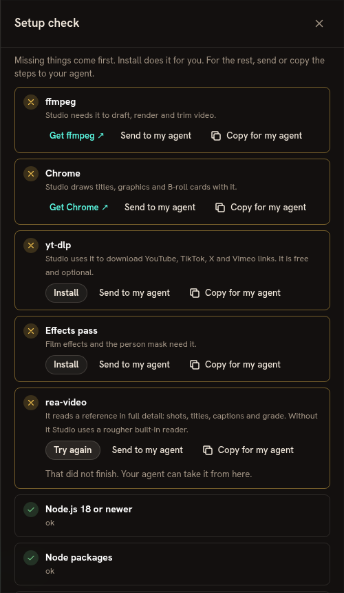

# aigent-talking-head v1.10.2

Studio no longer shows you terminal commands. When something is missing, it says what and why in plain words and gives you buttons instead.

## What is new

- **Install.** Where Studio can install something itself, one click does it and shows the result: the Python tools for transcribing, the Whisper model, yt-dlp and instaloader for reference links, the effects pass, the person mask and rea-video.
- **Send to my agent.** When your terminal agent is connected, one click sends it the steps through the Studio chat. The chat shows your short ask, and the agent's answer shows up there too.
- **Copy for my agent.** Copies a plain instruction you can paste into any agent, with the steps inside it.
- **Links for what only you can install.** ffmpeg, Chrome and Node.js get a link to their download page, plus the agent buttons.
- **Errors that help.** A draft or render that cannot run, a reference link that needs yt-dlp, a transcript that needs Python, or B-roll cards that need Chrome now explain what is missing and show the same buttons.
- **Setup check** lists what is missing first, each with its buttons.
- **For your agent.** The Render step's command fold is now a button that copies your reel as an instruction for your agent.

## Also fixed

- **B-roll ideas no longer vanish.** An older reply from Studio could land after a newer update, like an idea from your agent, and put the old B-roll lane back on screen. Studio now reloads the latest view instead.
- **Steadier tests.** The browser tests wait for Studio to finish loading and for each action to complete, so slow machines and GitHub's runners no longer fail them at random.

## Update

Tell your agent "Update aigent-talking-head", or press **Copy for my agent** on anything Studio says is missing.

Full list: [CHANGELOG.md](https://github.com/wrg32786/aigent-talking-head/blob/v1.10.2/CHANGELOG.md).
