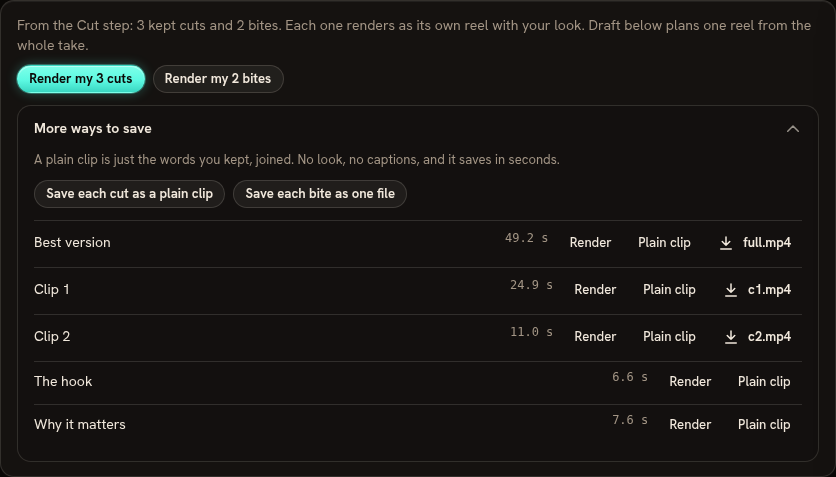

# aigent-talking-head v1.11.1

Render now lives in one place. The Cut step is for choosing, and every video gets made on the Render step.

## What is new

- **Cut only chooses.** Keep, drop, trim and order your cuts and bites. No Render buttons there anymore. It tells you how many you kept and that they render at the end.
- **Everything renders on the Render step.** A card at the top shows what you kept, with **Render my N cuts** and **Render my N bites**. Each one becomes its own reel with your look.
- **Plain clips are still there.** Open **More ways to save** to save each cut or bite as a plain clip: just your kept words joined, no look, no captions, done in seconds. You can also render or save one at a time.
- **Your agent works the same.** `render_cuts` and `render_bites` are unchanged, and `render_cuts` can now save plain clips with `file: true`.

## Update

Tell your agent "Update aigent-talking-head and restart Studio".

Full list: [CHANGELOG.md](https://github.com/wrg32786/aigent-talking-head/blob/v1.11.1/CHANGELOG.md).
