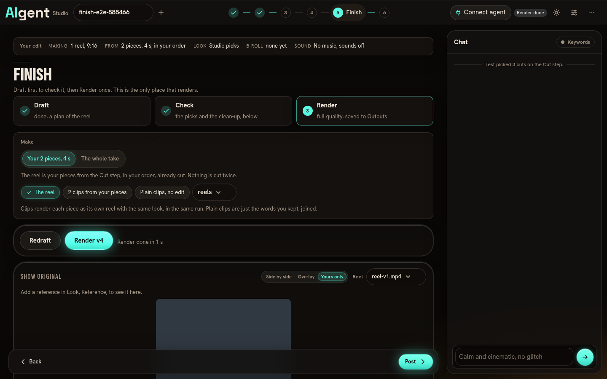

# aigent-talking-head v1.13.0

Studio gets simpler: five steps, one render, and a line that always says what you are making.

## What is new

- **Five steps, plus Post.** Footage, Cut, Look, B-roll, Finish. **Look** holds your look (packs, effects, sound and pace) and the **Reference** in one place, with a switch at the top. Old links still work.
- **Your edit, on every step.** One quiet line says what you are making, from what, the look, the b-roll and the sound, with the next thing to do. Click any part to jump to it.
- **The reel is made from your pieces.** The cuts you keep on the Cut step (in your order) and your bites go straight into the draft, already cut. Nothing gets cut twice, so no word is clipped on the way. You can still pick **The whole take** instead.
- **One Render, on Finish.** Finish goes Draft, Check, Render, in that order. Render waits for a draft of your current pieces and tells you when they changed. Tick **clips from your pieces** or **plain clips** and the same Render makes those too. No more second render card.
- **Your agent can do it all.** New `get_edit` reads the same summary. `studio_run` takes `from: pieces | take` for a draft and `exports` for a render.

## Update

Tell your agent "Update aigent-talking-head and restart Studio".

Full list: [CHANGELOG.md](https://github.com/wrg32786/aigent-talking-head/blob/v1.13.0/CHANGELOG.md).
