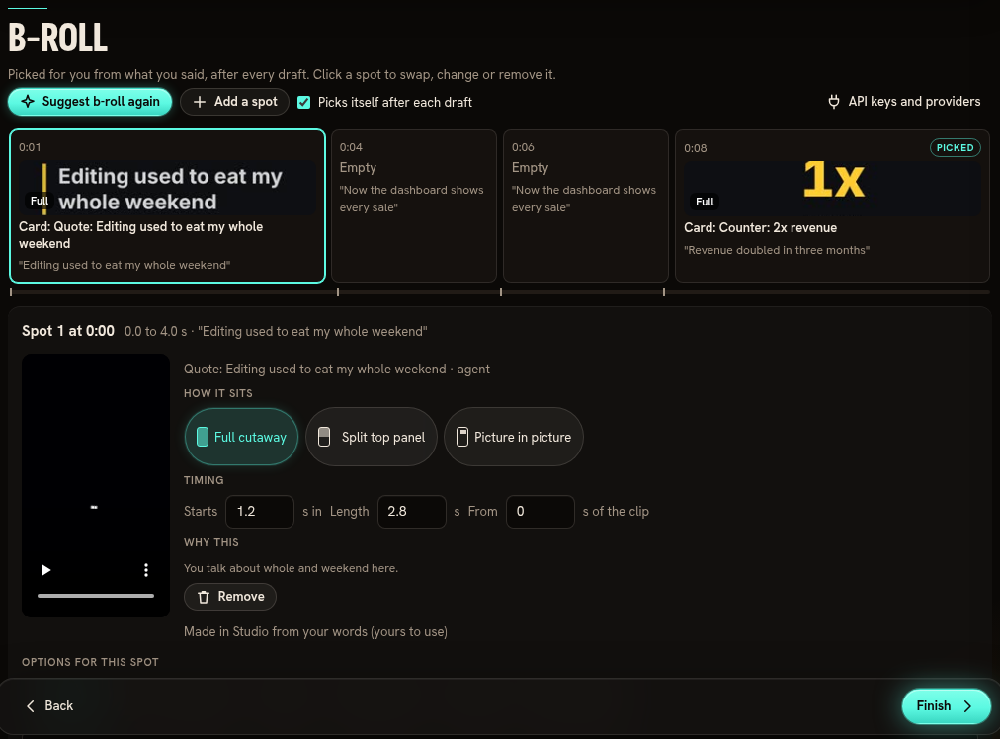

# aigent-talking-head v1.14.0

B-roll now picks itself from what you say, and works without any keys.

## What is new

- **Picked for you after every draft.** Studio reads each moment of your reel and puts b-roll on about one every 6 to 10 seconds. Say a number and you get a counter card. Quote someone and you get a quote card. Anything else gets a clip from your library, or free stock if you added a Pexels key. Each pick says why. Swap, change or remove any of it.
- **Spots, not one long beat.** A long take is split into spots of about 7 seconds at the end of a caption. **Add a spot** anywhere. When your reference cuts to b-roll, the spot at the same point says REF.
- **No keys needed.** Use it works on a fresh install: your library and cards made on your computer need no account. If Chrome is missing, the step shows the fix button.
- **Uploads say what they are.** Testimonial, product demo, screen recording or lifestyle. Testimonials and product demos go where you talk about results, screen recordings where you explain how.
- **Raw footage is cut first.** Tick **It is raw** and Studio cuts the clip into pieces on whole words, the same way it cuts your own footage.
- **Testimonials keep their voice.** **Play in my reel** puts a testimonial piece between your pieces, with its own sound.
- **For your agent.** New `pick_broll`, `add_spot` and `add_testimonial`. `add_broll` takes the kind and raw.

## Update

Tell your agent "Update aigent-talking-head and restart Studio".

Full list: [CHANGELOG.md](https://github.com/wrg32786/aigent-talking-head/blob/v1.14.0/CHANGELOG.md).
