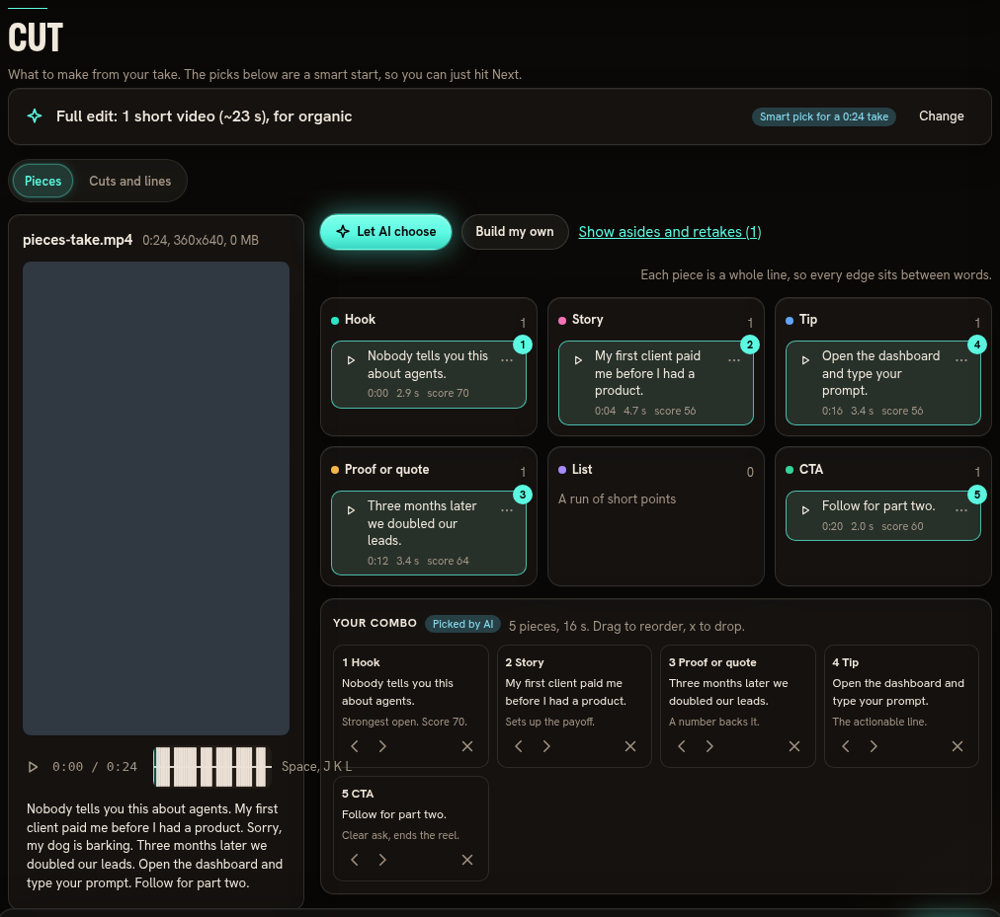

# aigent-talking-head v1.15.0

Build your reel from pieces, and find every version you made.

## What is new

- **Pieces.** The Cut step sorts every line of your take by what it does: hook, story, tip, proof, list and call to action. Asides and retakes stay out of the way until you ask for them.
- **Let AI choose.** One click builds your combo: the strongest hook first, the best middle in the order you said it, the call to action last, with a reason for each. Or **Build my own** and click pieces in.
- **Never a cut word.** Each piece is a whole line with its edges in the quiet around your words, so your combo never starts or ends mid-word.
- **Outputs.** Every render, with the look, length, pieces and files that made it. Re-open one to edit from exactly there, or compare two side by side.
- **For your agent.** New `get_pieces`, `set_combo`, `choose_combo` and `list_outputs`.

## Update

Tell your agent "Update aigent-talking-head and restart Studio".

Full list: [CHANGELOG.md](https://github.com/wrg32786/aigent-talking-head/blob/v1.15.0/CHANGELOG.md).
