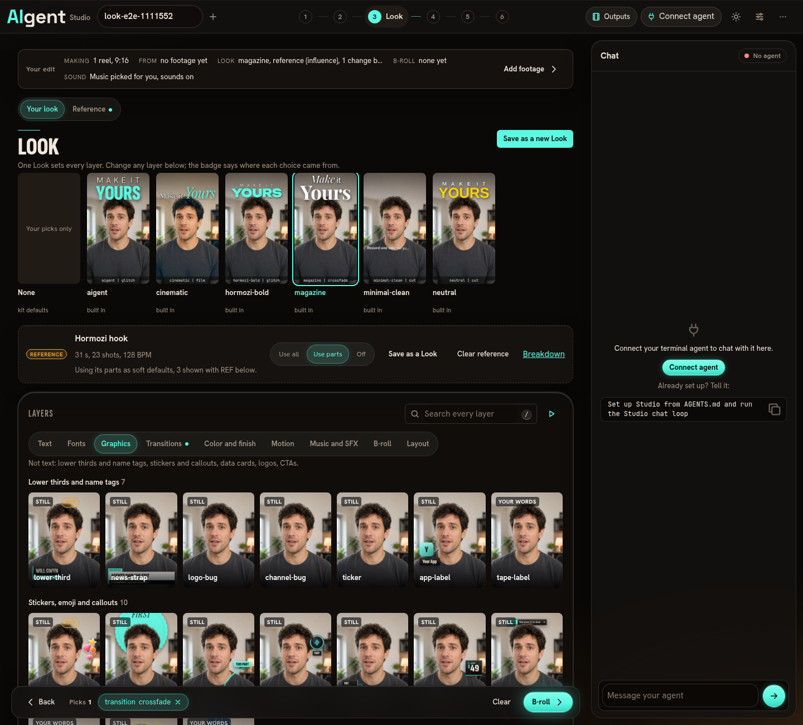

# aigent-talking-head v1.16.0

One Look, in 9 layers, and every option in one place.

## What is new

- **9 layers.** Text, Fonts, Graphics, Transitions, Color and finish, Motion, Music and SFX, B-roll and Layout. Each effect lives in exactly one, so you never find the same option in three tabs.
- **Where each choice came from.** A badge on every picked or suggested tile: YOU, REF for your reference, LOOK for the Look you picked.
- **Clear reference.** Take a reference off with every pick it added, in one click. Undo puts it back.
- **Save a reference as a Look.** It sits beside the built-in Looks, ready for your next reel.
- **Music and SFX together.** The music, sound effects and pace controls sit with the beds and sounds.
- **For your agent.** New `clear_reference` and `save_look`.

## Update

Tell your agent "Update aigent-talking-head and restart Studio".

Full list: [CHANGELOG.md](https://github.com/wrg32786/aigent-talking-head/blob/v1.16.0/CHANGELOG.md).
