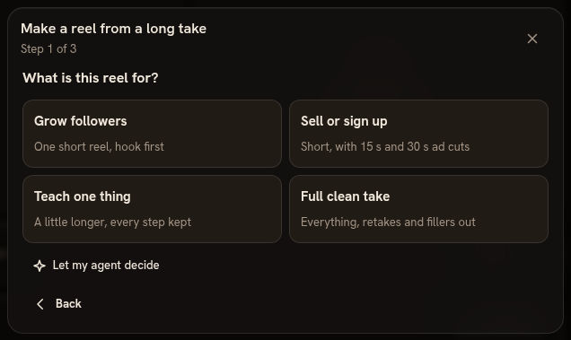

# aigent-talking-head v1.17.0

Point at what to change, and hand the rest to your agent.

## What is new

- **Notes on a stretch.** On Finish, comment on a frame or press Mark the end here to note a whole stretch, "from 0:04 to 0:09".
- **Drag to select.** Drag on the waveform to select part of a take. It snaps to whole words, so it never starts or ends mid-word. Play it, add it as a clip or send a note to your agent.
- **Ask my agent.** A button on every step with prompts for that step. Your agent knows which step you asked from.
- **Apply.** When your agent suggests a change, it comes with an Apply button. Nothing changes until you click it.
- **Wizards.** Three guided starts: a reel from a long take, copy a reference, clips and ads from one take. Each step has Let my agent decide.
- **For your agent.** `studio_reply` takes `suggest`, and a new `run_wizard`.

## Update

Tell your agent "Update aigent-talking-head and restart Studio".

Full list: [CHANGELOG.md](https://github.com/wrg32786/aigent-talking-head/blob/v1.17.0/CHANGELOG.md).
