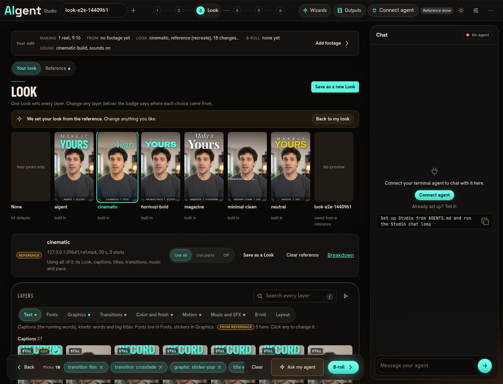

# aigent-talking-head v1.17.1

Pick a reference and we set your look from it.

## What is new

- **Use all sets every layer.** Choose Use all (Recreate) and we set your Look, captions, titles, transitions, grade, effects, music and pace from the reference. No more picking them again by hand.
- **Use parts sets the picks.** Choose Use parts (Influence) and we set the reference's picks as soft defaults, and your Look and sound stay yours.
- **We tell you.** A short line says "We set your look from the reference. Change anything you like." Each choice it set says REF, and the layers it touched get an amber dot.
- **Change anything.** Your change always wins. **Back to my look** takes out only what the reference set and gives you your own picks back.
- **Still reading?** If the reference is still being read, Studio says so and sets your look when it is ready.
- **Fixes.** The Copy a reference wizard now really turns on Use all. Finish counts your pieces the same way Your edit does.

## Update

Tell your agent "Update aigent-talking-head and restart Studio".

Full list: [CHANGELOG.md](https://github.com/wrg32786/aigent-talking-head/blob/v1.17.1/CHANGELOG.md).
