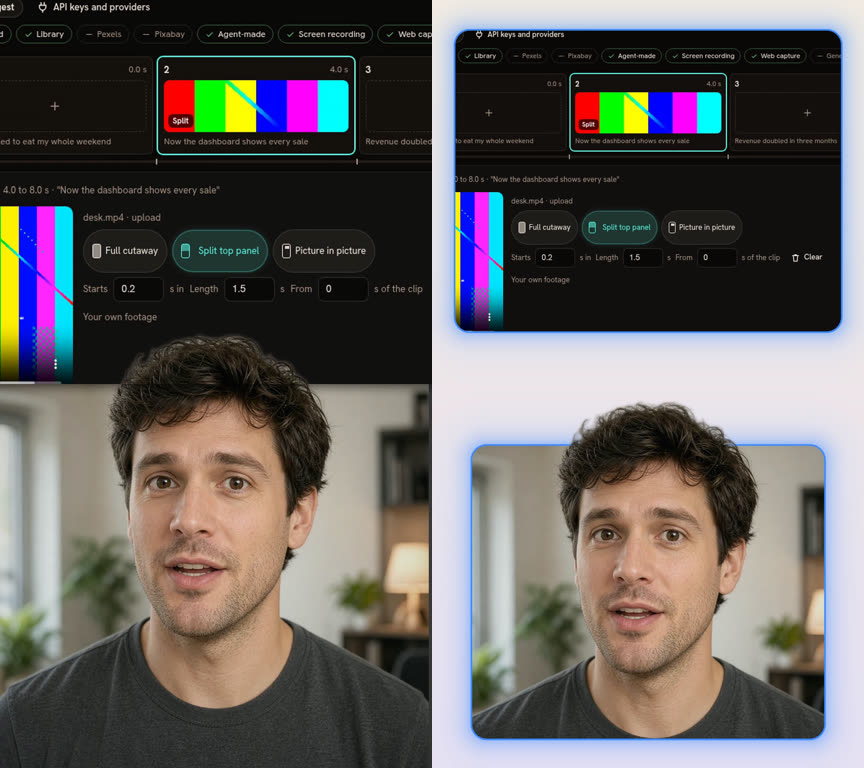

# aigent-talking-head v1.18.0

B-roll that sits around you, not over you.

## What is new

- **Split, behind your head.** On a split, the top of your head now reaches a little into the b-roll panel and draws in front of it, so the panel sits behind you.
- **Framed cards.** A new way for b-roll to sit: the clip in a rounded card up top, you in a smaller card below with your head breaking out over its top edge. A thin blue border and a soft glow on a cream backdrop.
- **Captions stay off your face.** On both layouts the captions move to the open line the layout leaves, and turn dark on the cream backdrop.
- **See it before you render.** The preview next to How it sits shows where the clip and you will be.
- **For your agent.** `fill_slot` and `suggest_broll` take `place: "frame"`.

## Update

Tell your agent "Update aigent-talking-head and restart Studio".

Full list: [CHANGELOG.md](https://github.com/wrg32786/aigent-talking-head/blob/v1.18.0/CHANGELOG.md).
