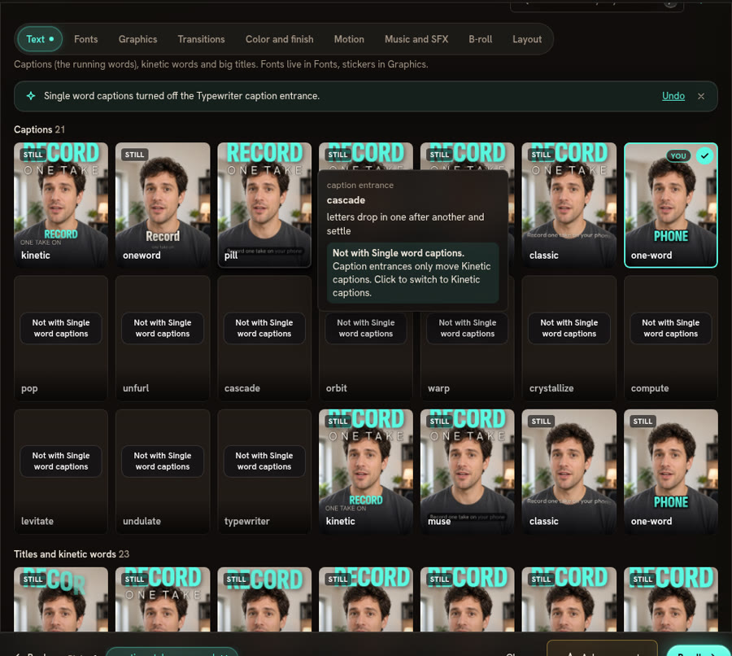

# aigent-talking-head v1.20.0

When one setting rules out another, Studio now shows it.

## What is new

- **Greyed, with the reason.** If a setting can't work with what you picked, it's greyed out with a short reason, for example "Not with Single word captions" on the caption entrances. Caption entrances only animate Kinetic captions.
- **One click to switch.** Click a greyed option and Studio makes the one change it needs and picks it, then tells you what it switched, with Undo.
- **It says what it turned off.** When a new pick turns off an earlier one, one line says so, for example "Single word captions turned off the Typewriter caption entrance.", with Undo.
- **Nothing silently ignored.** The render never uses a setting that can't apply, and the Sound map option now actually works.
- **The same rules for your agent.** If your agent asks for something that can't work, it gets the reason and how to switch, and it's told what a change turned off.

## Update

Tell your agent "Update aigent-talking-head and restart Studio".

Full list: [CHANGELOG.md](https://github.com/wrg32786/aigent-talking-head/blob/v1.20.0/CHANGELOG.md).
