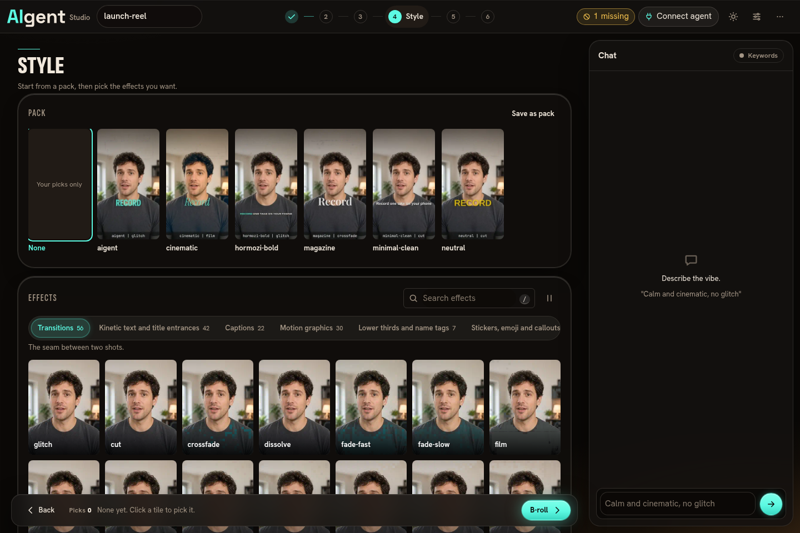
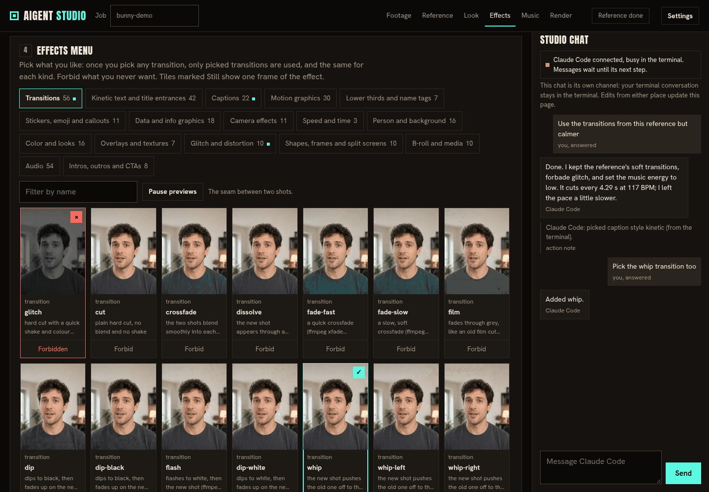
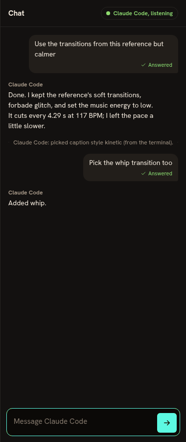
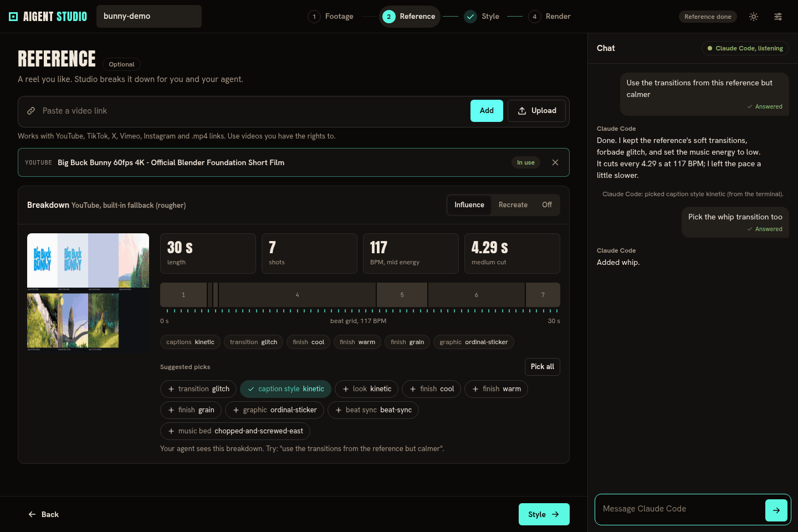
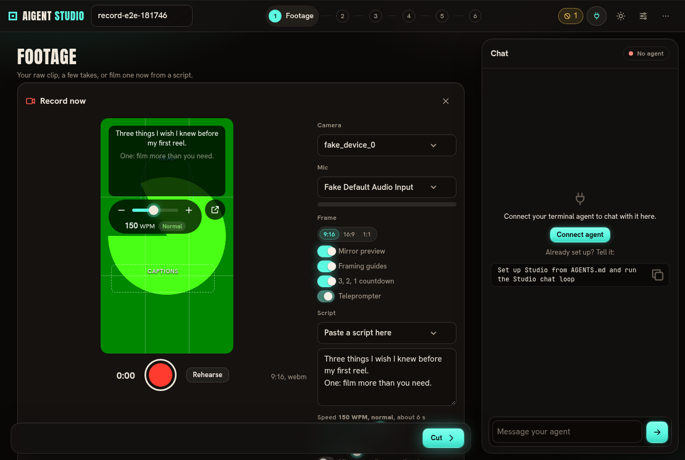
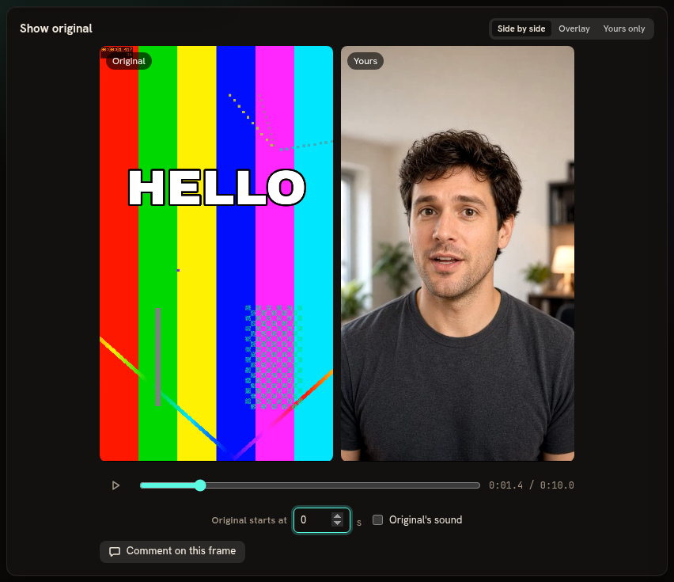

# aigent-talking-head v1.3.0

The first release with Studio: a page on your own computer where you pick your effects by looking at them, chat with your own terminal agent, record yourself, and review the edit before you post it. It also brings style packs, so a whole look is one choice you can lock and share. Still free, open source, no account and no watermark.

## What is new

- **Studio.** Run `npm run studio` and a page opens on your computer (nothing goes to the cloud). Four steps: Footage, Reference, Style, Render. Drag in your clips, pick effects from a grid of looping previews, then draft and render.
- **Your terminal agent in the chat.** Claude Code, Codex or another agent connects to Studio and answers you in its chat. Studio's chat and your terminal chat stay separate, and anything the agent changes shows up on the page right away.
- **Reference links.** Paste a link to a reel you like (YouTube, Shorts, TikTok, X, Vimeo, a public Instagram post or a plain video link). Studio downloads it, breaks it down into shots, beats and titles, and suggests effects to match.
- **Record now.** Film takes with your camera and mic from inside Studio: pick your camera, see your mic level, a countdown, guides for your head and captions. Each take you keep goes straight into the edit.
- **Scripts and a teleprompter.** Write scripts in Studio, or have your agent write them from a topic or a reference. The teleprompter scrolls at your speaking pace near the camera. Agents run the bundled humanizer skill on every draft so scripts sound like you.
- **Review your edit.** See what to swap from the reference, watch the original next to your edit, click on a frame to leave a note for your agent, cut silences and filler words with a review of each cut, and read a receipt of every choice the edit made.
- **A new look.** Studio is built on React and Meta's Astryx design system, with frosted glass panels, a dark theme by default and a light one, and layouts that work on a phone.
- **Style packs and locks.** A style pack is a whole look in one folder: captions, fonts, titles, transitions, finish. Lock the parts you never want changed and every choice shows in one table you can edit.
- **One-line installers.** One command on macOS, Linux or Windows sets everything up and puts a "Talking Head Studio" launcher on your desktop.
- **Engine updates.** Editing principles built in (a magazine preset turns them all on), an effects menu with previews of every option, graphics planned from what you say, nothing overlapping on screen, titles readable behind your head, and fixes for caption fits and colour cards.

## Screenshots

## Update

In your copy of the kit: `git pull`, then `npm install`. Or tell your agent "Update aigent-talking-head and set up Studio from AGENTS.md".

Full list: [CHANGELOG.md](https://github.com/wrg32786/aigent-talking-head/blob/v1.3.0/CHANGELOG.md) (the 1.3.0 section is in the CHANGELOG from v1.4.0 on).
