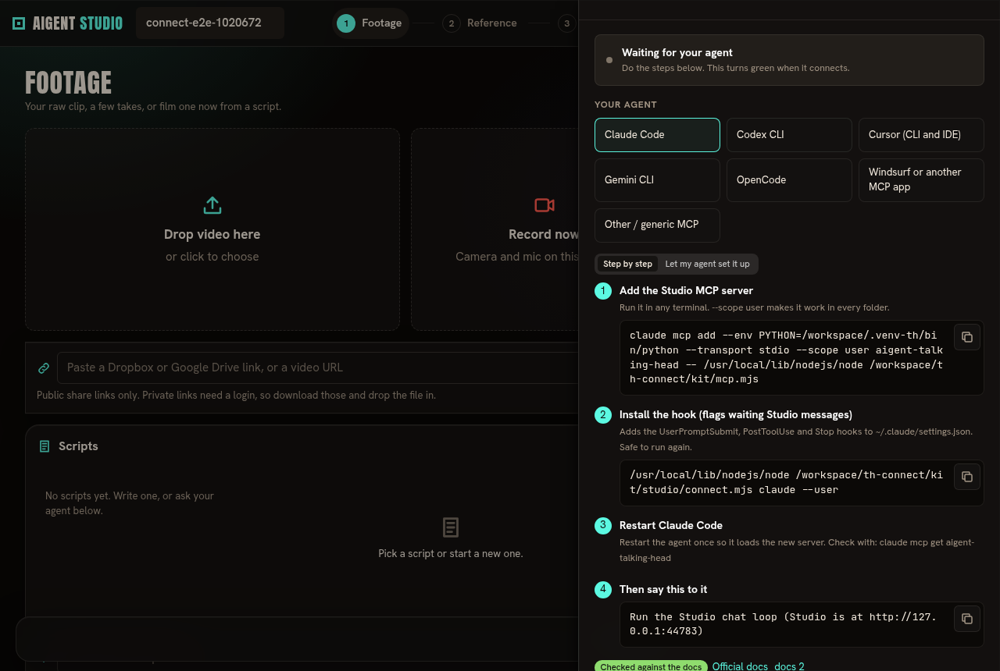
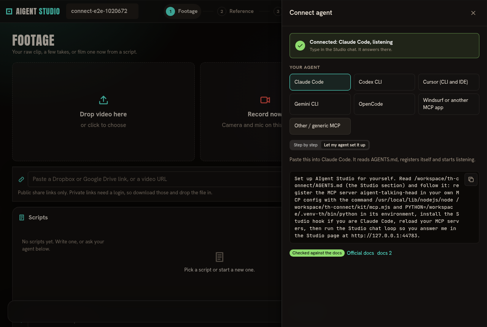
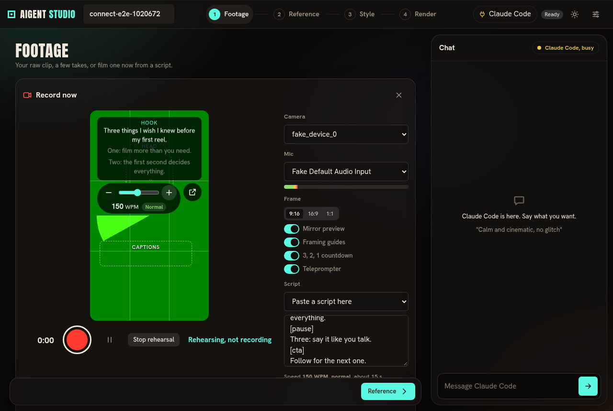
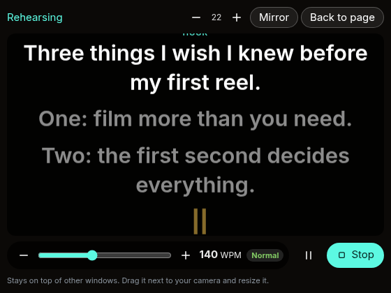
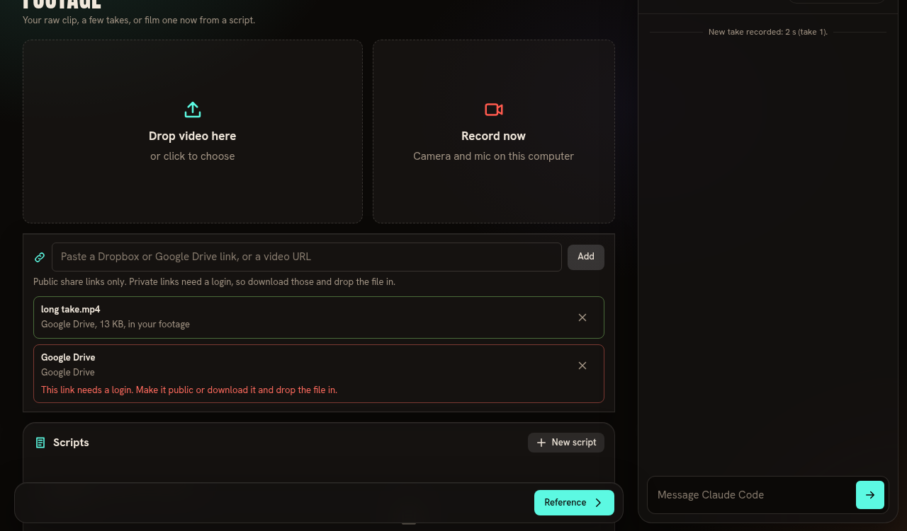

# aigent-talking-head v1.4.0

Setting up and getting your agent talking to Studio is now one step each, the teleprompter is easier to steer and can sit next to your camera, and you can bring footage in from a Dropbox or Google Drive link.

## What is new

- **Connect agent.** A button at the top of Studio. Pick your agent (Claude Code, Codex, Cursor, Gemini CLI, OpenCode, Windsurf or any MCP app) and copy the exact command, with your install's paths already filled in. Or copy one prompt and let your agent set itself up. The button turns green when your agent connects.
- **Everything installs up front.** `npm run setup:all` installs everything the kit uses in one go and is safe to run again. Your agent runs it and then tells you only what it cannot do, like a step that needs your password. Studio has a Setup check that shows what is ready and the one fix for anything missing.
- **Teleprompter speed you can change mid-take.** Plus and minus, a slider or the arrow keys, shown in words per minute with slow, normal or fast. Studio remembers your speed.
- **Rehearse.** Scroll your script with nothing recorded, to practise.
- **Pop-out teleprompter.** Open the teleprompter in its own small window and drag it next to your camera. In Chrome and Edge it stays on top of other apps. It stays in sync with the page, and the controls work from either window.
- **Footage from a link.** Paste a public Dropbox or Google Drive link, or a plain video link, and it downloads into your footage with its size and progress, big Drive files too. A private link tells you to make it public or drop the file in.

## Screenshots

## Update

In your copy of the kit: `git pull`, then `npm run setup:all` (it only installs what is missing). Or tell your agent "Update aigent-talking-head and run npm run setup:all".

Full list: [CHANGELOG.md](https://github.com/wrg32786/aigent-talking-head/blob/v1.4.0/CHANGELOG.md).
