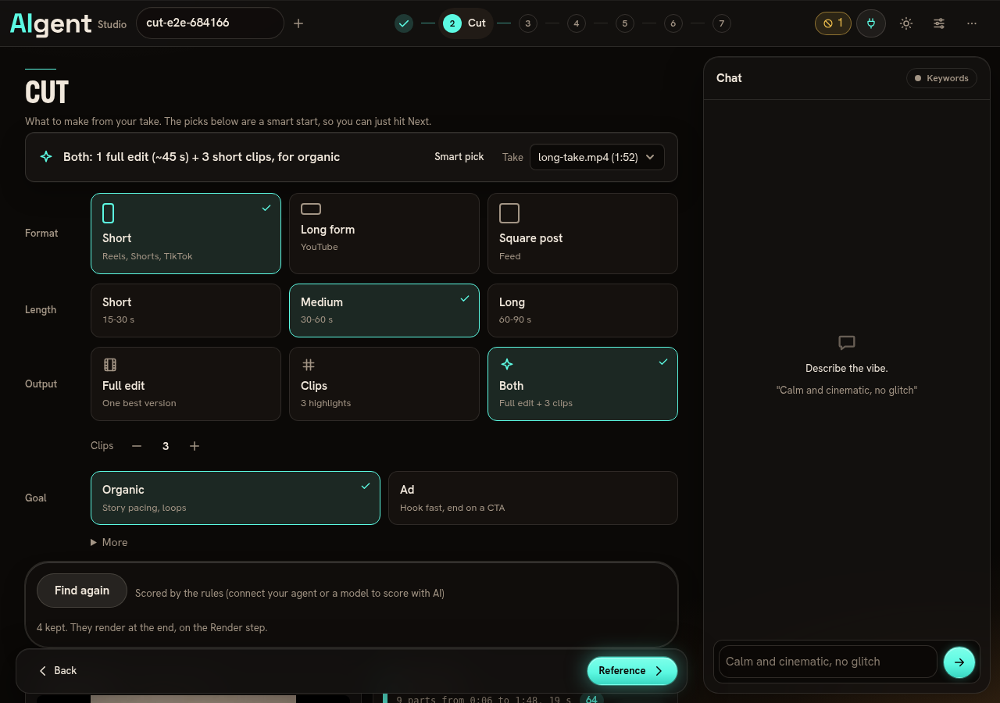
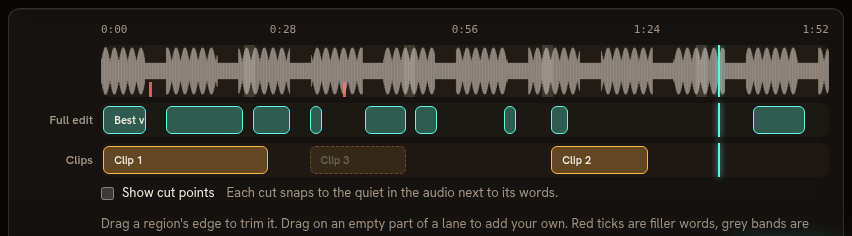
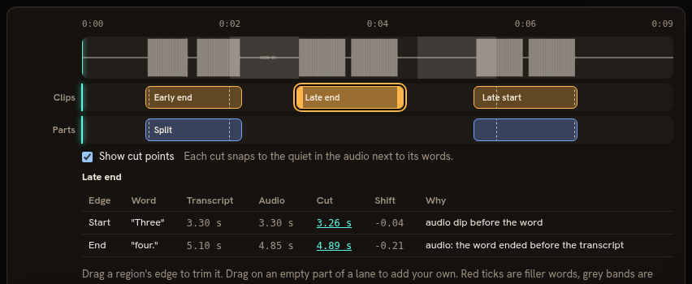
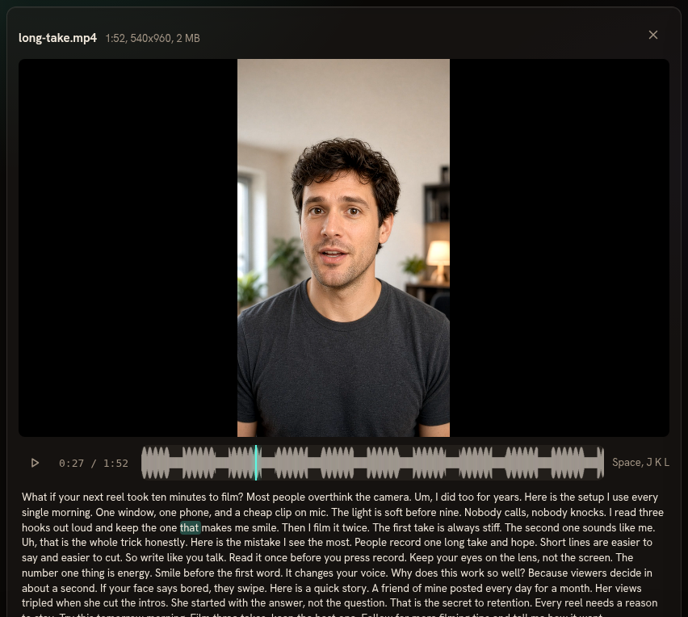
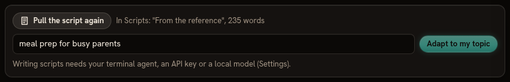

# aigent-talking-head v1.5.0

Studio now helps you decide what to make from a take, finds the best parts of it, and lets you cut them by hand on a timeline. Long takes work too.

## What is new

- **A Cut step.** Right after Footage, pick what you want with big cards: a Short (Reels, Shorts, TikTok), a Long form video for YouTube, or a Square post; a short, medium or long length; one full edit, clips, or both; and whether it is organic or an ad. Studio picks sensible defaults from your take's length, so you can just hit Next. One line sums it up, like "Both: 1 full edit (~10 min) + 5 short clips, for organic".
- **Ads get ad pacing.** A hook in the first second or two, tighter cuts, an end card with your call to action, and optional 15 s and 30 s cuts.
- **Find cuts.** Studio reads the take and lists the best parts, each with the words, the times, a score and why it was picked. Your agent can pick them for you, or an AI model, or simple rules if you have neither. Studio says which one did.
- **Cut on a timeline.** The parts show as colored blocks under the waveform, with filler words and long pauses marked. Drag an edge to trim, drag on an empty spot to add your own, click to preview, keep or drop, and reorder. Then render every one you kept in one go.
- **A footage player.** Click a clip to play it. Scrub on the waveform, follow along in the transcript and click any word to jump there. Space, J, K and L work like a video editor. Big files and formats browsers cannot play get a small preview copy so they start right away.
- **Clean cut points.** Each cut lands in the quiet right after the last word, found in the audio, not just the transcript. No clipped words, no breath left hanging. Show cut points on the timeline tells you where each cut went and why.
- **Long takes.** Transcription goes a chunk at a time with progress, and picks up where it stopped if you close Studio.
- **Use a reference's script.** Pull script puts the reference video's words in your Scripts with the hook, body and call to action marked. Adapt to my topic rewrites it for your subject in the same shape, and keeps the original.

Long form videos are a clean 16:9 edit for now, without captions or graphics.

## Screenshots

## Update

In your copy of the kit: `git pull`, then `npm run setup:all` (it only installs what is missing). Or tell your agent "Update aigent-talking-head and run npm run setup:all".

Full list: [CHANGELOG.md](https://github.com/wrg32786/aigent-talking-head/blob/v1.5.0/CHANGELOG.md).
