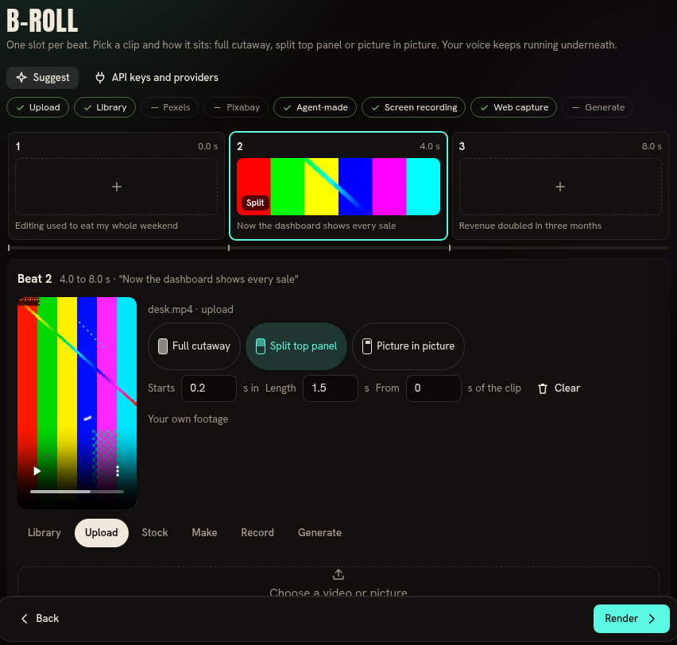
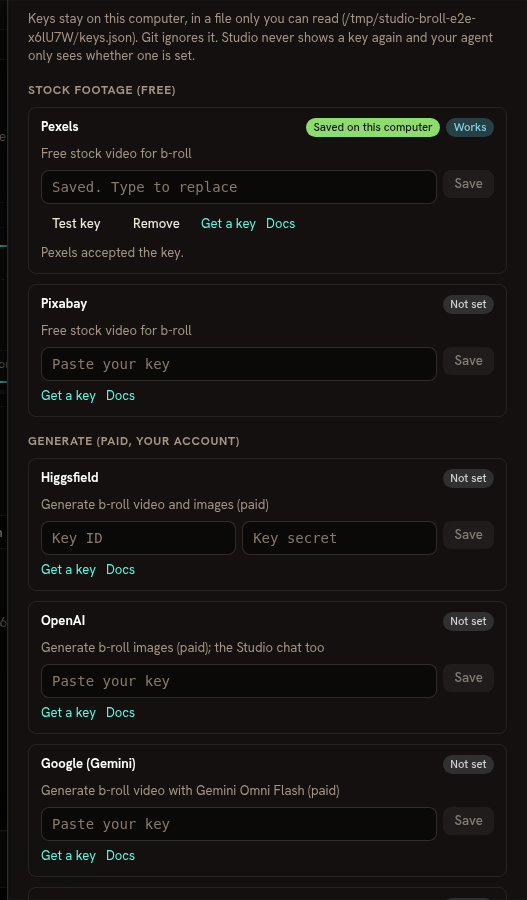
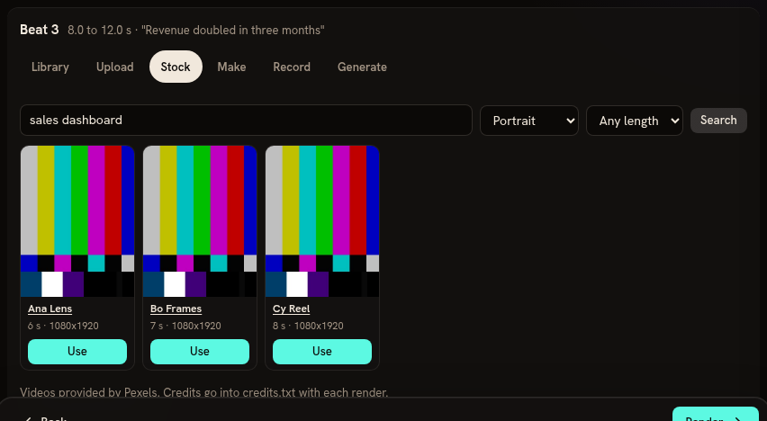
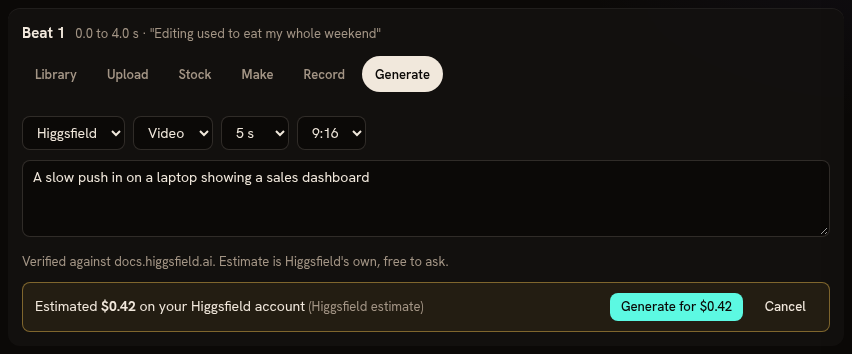
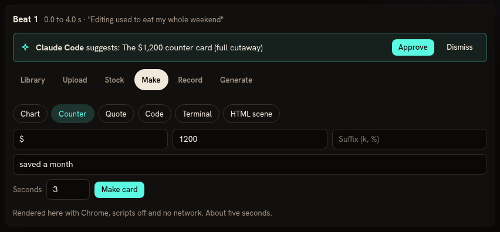

# aigent-talking-head v1.7.0

Studio now adds b-roll: footage over your voice, one beat at a time. Use your own clips, free stock, cards made from your words, your screen, or a generator with your own key.

## What is new

- **A B-roll step.** Each beat of your draft gets a slot. Fill it from your library, an upload, stock, a card, a screen recording or a generate, then pick how it sits: a full cutaway, a split with the clip on top and you below, or a small picture in picture. Your voice keeps running underneath.
- **A library you keep.** Every clip goes into one folder that every job can use, with where it came from and its license. Search it by name or by tags Studio adds for you, like portrait, dark or moving. Each render writes credits.txt with the credits.
- **Free stock.** Add your free Pexels key (or Pixabay) and search right in Studio. Hover to preview, click Use, and it lands on the beat with the photographer credited.
- **Cards made from your words.** Charts, counters, quotes, code and terminal cards, or your own HTML scene, made on your computer in a few seconds.
- **Your agent suggests, you decide.** Your agent can propose a shot for each beat. Each idea waits for you to approve or dismiss.
- **Record your screen.** Right in the browser, with an optional webcam bubble.
- **Generate, only when you say so.** Off by default. Turn it on, add a key for Higgsfield, Google, OpenAI, Replicate or fal, and every generate shows the cost first and waits for your click. Your agent can only ask.
- **API keys and providers in Settings.** One place for every key. Save, test or remove each one. Keys stay on your computer, Studio never shows them again, and your agent only sees whether a key is set.

Not verified yet: Google video generation, OpenAI image prices and the Replicate and fal adapters have only run against test servers. Higgsfield follows its published API.

## Screenshots

## Update

In your copy of the kit: `git pull`, then `npm run setup:all` (it only installs what is missing). Or tell your agent "Update aigent-talking-head and run npm run setup:all".

Full list: [CHANGELOG.md](https://github.com/wrg32786/aigent-talking-head/blob/v1.7.0/CHANGELOG.md).
