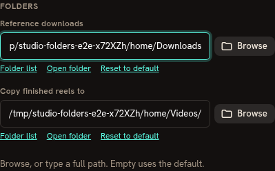
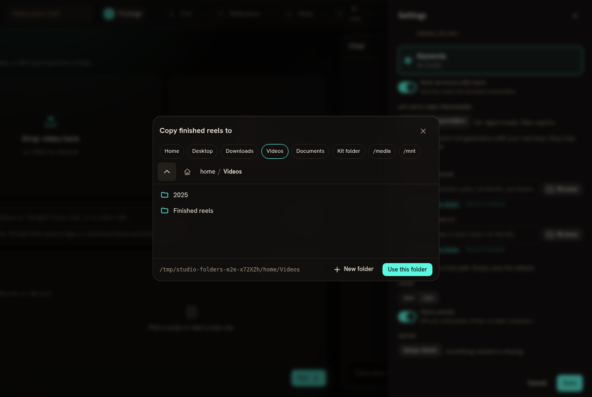
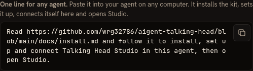

# aigent-talking-head v1.7.1

Pick folders the easy way, and install Studio with one line to your agent.

## What is new

- **Browse for a folder.** Reference downloads, Copy finished reels to and the b-roll library folder each have a **Browse** button. It opens your computer's own folder picker (File Explorer on Windows, Finder on macOS, zenity or kdialog on Linux) and fills in the full path.
- **A folder list in Studio.** When there is no folder picker, or with **Folder list**, Studio shows its own: quick places (Home, Desktop, Downloads, Videos, Documents, the kit folder, drives), a path you can click, Up, Home, **New folder** and **Use this folder**. It lists folders only, never files, and skips hidden folders and the places apps keep passwords and keys.
- **Open folder and Reset to default** under each folder field. Typing a path still works.
- **One line for your agent.** Paste this into Claude Code, Codex, Cursor, Gemini CLI, OpenCode or any agent that runs commands, on any computer:

  ```
  Read https://github.com/wrg32786/aigent-talking-head/blob/main/docs/install.md and follow it to install, set up and connect Talking Head Studio in this agent, then open Studio.
  ```

  Your agent finds your OS, gets the kit (or reuses your copy), installs everything, connects itself to Studio, opens it, checks the setup and tells you only what it can't do itself. The same line is in the Connect agent dialog.

Not verified yet: the Windows and macOS folder pickers have not run on a real Windows or Mac. On those systems the in-page folder list always works.

## Screenshots





## Update

In your copy of the kit: `git pull`, then `npm run setup:all` (it only installs what is missing). Or tell your agent "Update aigent-talking-head and run npm run setup:all".

Full list: [CHANGELOG.md](https://github.com/wrg32786/aigent-talking-head/blob/v1.7.1/CHANGELOG.md).
