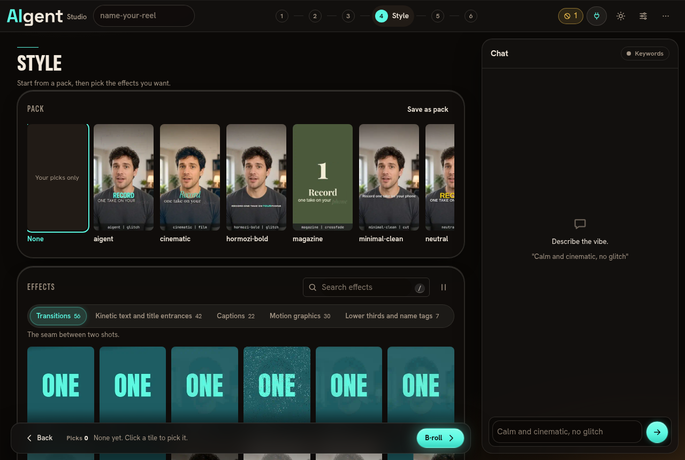
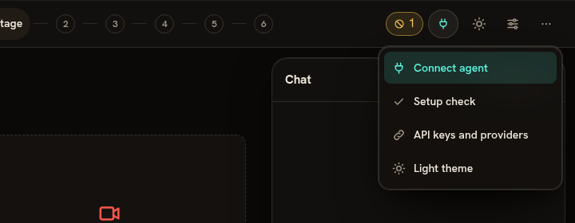
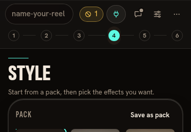
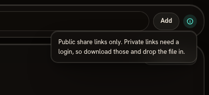

# aigent-talking-head v1.8.0

A new look for Studio, Liquid glass in the AIgent brand, plus a header that always fits, a More menu, fewer words on the page and one smooth way of moving.

## What is new

- **Liquid glass.** Frosted panels with a soft blur, subtle borders and a quiet mint glow. Buttons, switches, the Short / Long form / Square style pickers, sliders, folder fields with Browse, drop-downs, clip cards and the chat all share one look, in dark and light.
- **The AIgent brand.** The AIgent wordmark in the header, the brand cream for the light theme with deep teal buttons, bold condensed step headlines in the brand's display face, and one warm ember glow behind the page. Dark and light both pass contrast checks.
- **The header always fits.** On a laptop only the step you are on shows its name, the setup pill shows just a number and Connect agent shrinks to its plug, so Settings never slides off the screen. On a phone the steps get their own row.
- **A More menu** (the three dots, top right) with Connect agent, Setup check, API keys and providers and the light or dark theme. It works with the keyboard too.
- **Less to read.** Longer explanations now sit behind a small **i**. Click it to read, Escape to close.
- **B-roll tabs on every screen.** The Library, Upload, Stock, Make, Record and Generate tabs now have icons, move with the arrow keys and show on tablets and phones too.
- **One way of moving.** Steps rise in, menus and hints fade in and out, and the theme button turns its moon into a sun. If your computer is set to reduce motion, Studio keeps still.

Built with [Headless UI](https://github.com/tailwindlabs/headlessui) for the menus, tabs, switch and hints, [Open Props](https://github.com/argyleink/open-props) for the motion and shadows, the brand's display face [Sofia Sans Extra Condensed](https://github.com/lettersoup/Sofia-Sans) (OFL) for headlines, and a few styles adapted from [Uiverse.io](https://uiverse.io) creators (Creatlydev, AndrewHeinke and AnthonyPreite) and Uiverse Galaxy patterns. Code is MIT, the font is OFL, all credited in [THIRD_PARTY.md](https://github.com/wrg32786/aigent-talking-head/blob/v1.8.0/THIRD_PARTY.md).

## Screenshots

## Update

In your copy of the kit: `git pull`, then `npm run setup:all` (it only installs what is missing). Or tell your agent "Update aigent-talking-head and run npm run setup:all".

Full list: [CHANGELOG.md](https://github.com/wrg32786/aigent-talking-head/blob/v1.8.0/CHANGELOG.md).
