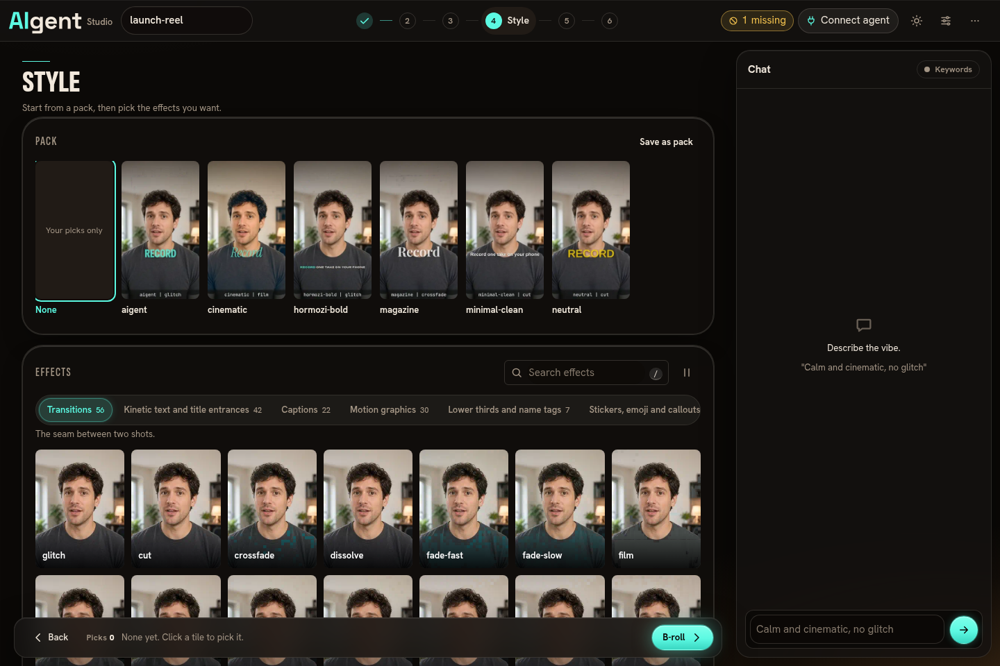
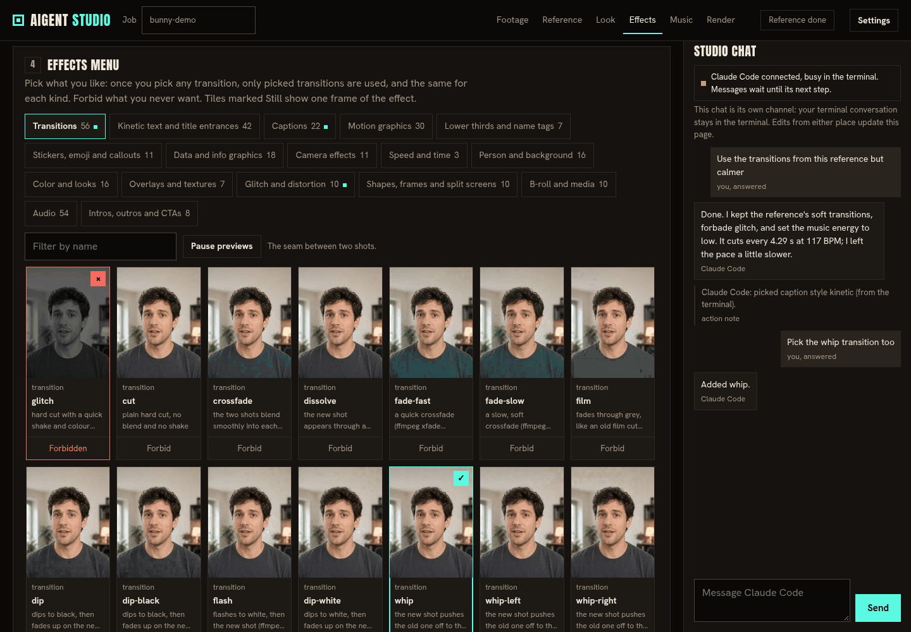
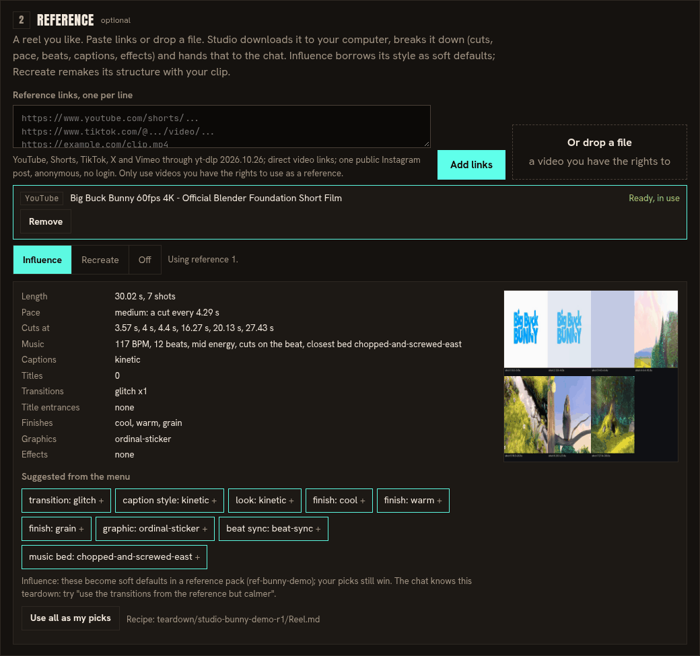
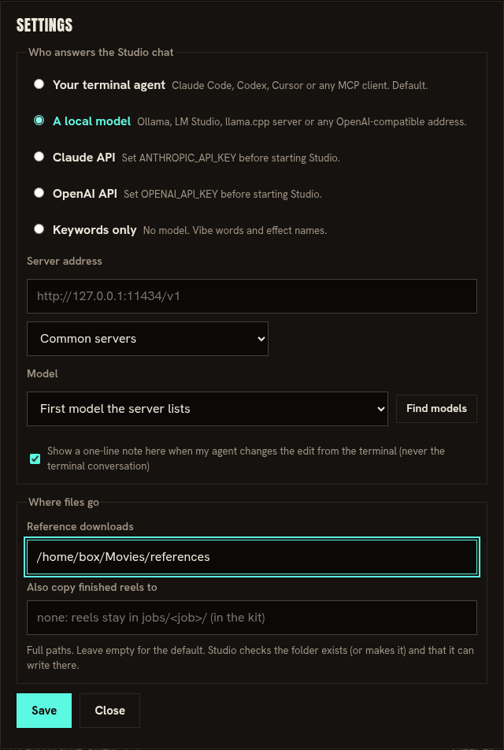
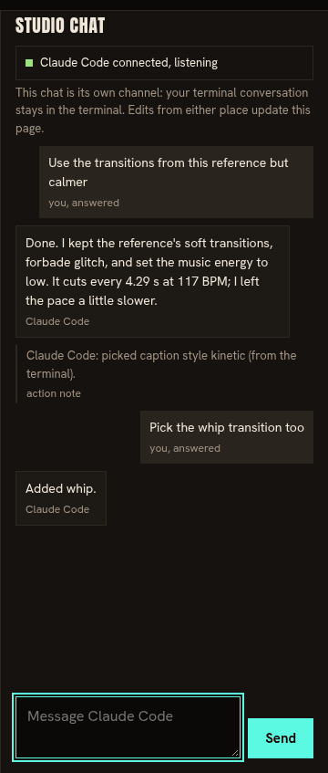
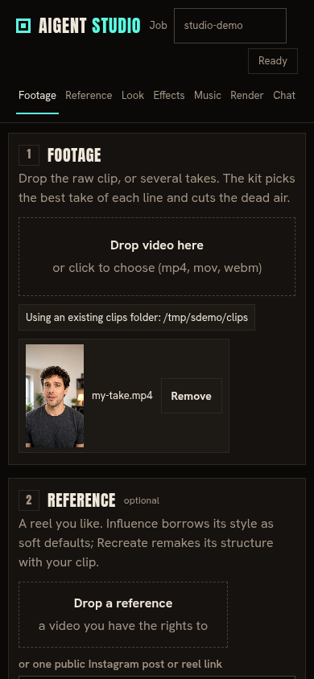

# Studio

Studio is a local web page over the kit. Drop in your footage, add a reference reel if you have one, click the effects you want from a visual menu, set the music and pace, then draft, review and render. It runs on your computer, needs no account and no cloud, and drives the same engine as the CLI and the MCP server.

```
npm run studio
```

That starts Studio on http://127.0.0.1:4757 and opens your browser. `--port <n>` picks another port, `--no-open` skips the browser. Never used a terminal? Run the one-line installer in [Setup](#setup-without-a-terminal) and double-click the "Talking Head Studio" icon it puts on your desktop.



## What you can do

1. **Footage.** Drag clips onto the page or pick files (mp4, mov, m4v, webm, mkv). They go to `inbox/studio/<job>/`. An assistant can also point the session at a clips folder (`clips` in `studio_set_selections`).
2. **Reference.** Paste one or more links (one per line) or drop a file. Links can be YouTube (and Shorts), TikTok, X, Vimeo, a direct video file (.mp4, .mov, .m4v, .webm), or one public Instagram post. Studio downloads each into your download folder, breaks it down, and shows what it found: length, cut times and pace, music BPM, beats and energy, caption style, titles, transitions, finishes, graphics and effects, plus suggestions mapped to the effects menu that you can click to pick. The chat gets the same teardown. See [Reference links](#reference-links). Then choose:
   - **Influence:** the reference becomes soft defaults on top of the pack you picked (the pack's locks stay). Saved as a local pack, `ref-<job>`.
   - **Recreate:** the draft uses the reference's Reel.md as the recipe (`--recipe`), so its shots, titles and look are copied as closely as the engine can.
3. **Look.** Pick a style pack from the gallery. Your picks below add to it.
4. **Effects menu.** Every effect the engine has, as a grid of previews, in tabs by type (table below). Click a tile to pick it; press F on a tile, right-click it, or use its "Forbid" button to forbid it. Picking any of a kind means only your picks of that kind are used; forbidding one leaves the rest. Some kinds take one choice (caption style, look, theme). Animated previews loop; "Pause previews" switches to stills and is on by default when your system asks for reduced motion. Tiles marked "Still" have no animated preview yet (`npm run menu:render` rebuilds the animated ones). "Needs your words" marks graphics that only appear when you say the matching words.
5. **Save as a pack.** "Save my selections as a pack" writes `packs/local/<name>/pack.json` (validated, gitignored) so you can reuse the look with `--pack <name>`.
6. **Music and sound.** A bed by energy (auto, low, mid, high), a named bed, no music, or your own upload. Sound effects on or off, the sound density cap, tighten pauses, and punch-ins.
7. **Vibe box and chat.** Type "calm and cinematic, no glitch, typewriter titles". See [Chat](#chat).
8. **Draft, review, render.** Draft runs `npm run reel ... --draft` and shows the choices table: every transition, finish, title and graphic per beat, with why it was picked. Change any cell and apply; the change is pinned. Render builds the reel (and the export size you picked) with progress, then plays it with a download link.



## Menu categories

The categories come from `kit/studio/categories.json`, which maps the engine's own catalogs (transitions, title and caption entrances, caption styles, graphics, effects, finishes, looks, themes, fonts, beds, sounds and editing options) into tabs. It only regroups; it never adds an effect the engine does not have, and `tests/studio.test.mjs` fails if it names one. An item can sit in more than one tab. Empty categories are hidden in the page.

| Category | Items | What is in it |
| --- | ---: | --- |
| Transitions | 56 | all 56 seams (50 stock, 6 drawn) |
| Kinetic text and title entrances | 42 | 9 title entrances, the font pairings, title placement (left, right, above, chest, face), text graphics and effects |
| Captions | 22 | caption entrances, 7 caption styles, 5 looks |
| Motion graphics | 30 | every graphic in `kit/graphics.json` |
| Lower thirds and name tags | 7 | lower third, news strap, logo bug, channel bug, ticker, app label, tape label |
| Stickers, emoji and callouts | 11 | sticker pop, ordinal sticker, highlight, icon badge, HUD callout, price tag, release pill, stamps and scribbles |
| Data and info graphics | 18 | 9 data graphics (chart, stat callout, checklist, step counter, split flap and more) and 9 data effects |
| Camera effects | 11 | the effects marked camera in `effects/catalog.json` (slow push, lean in, locked on, over-the-shoulder zoom and more) plus punch-ins |
| Speed and time | 3 | tighten, pause point, wave trim |
| Person and background | 16 | title layers (front, behind the head, auto) and effects that use the person mask |
| Color and looks | 16 | looks, film finishes, themes |
| Overlays and textures | 7 | grain, vignette, scan lines, glass widgets, shortcut rain, noise, light leak |
| Glitch and distortion | 10 | glitch seams and effects |
| Shapes, frames and split screens | 10 | reel frame, split headline, B-roll split, grid, versus, screen card, colour and chapter cards |
| B-roll and media | 10 | screen card, profile wall, phone fan, carousel spin, headline wall, match cut and more |
| Audio | 54 | 11 music beds, 37 sound effects, beat sync, sound map and cap |
| Intros, outros and CTAs | 8 | CTA card and button, number pop, chapter card, tap, countdown flip, comment box, cards |

269 unique items in all. Counts are from this release; `node -e "import('./kit/studio/core.mjs').then(C=>console.table(C.catalog().categories.map(c=>({c:c.label,n:c.count}))))"` prints the current ones.


### Candidates to build next

No category is empty today, so none is hidden. These are thin, or are things people ask for that the engine does not do yet (listed in `categories.json` under `candidates`):

- **Speed ramps and slow motion.** Speed and time has 3 items; the engine cuts and freezes but does not change playback speed.
- **Emoji.** Stickers cover hearts, stars and fire; there is no emoji picker.
- **Intro stings and logo reveals.** Only the end card and number pop exist.
- **Light and lens effects.** Light leak is a transition; there is no lens flare or bokeh overlay.
- **Sound design: ducking controls.** Ducking is automatic; there is no per-clip control.
- Thin today: Lower thirds and name tags (7) and Overlays and textures (7).

## Reference links



- **Queue.** Paste several links at once; they download and tear down one at a time, each with its status (waiting, downloading with a progress bar, breaking it down, ready, failed with the reason) and Stop, Try again, Remove and "Use this one" buttons. The newest ready one is used unless you pick another.
- **Downloaders.** YouTube, TikTok, X, Vimeo and most video pages go through [yt-dlp](https://github.com/yt-dlp/yt-dlp), an optional free program you install yourself (`pip install yt-dlp`, or its standalone program on your PATH, or `YTDLP=/path/to/yt-dlp`). The one-line installers add it to the kit's venv. It runs as a separate program; none of its code is in the kit. A direct video link is downloaded by Studio itself. Instagram uses the kit's [instaloader](https://github.com/instaloader/instaloader) helper (MIT): one public post, anonymous, never a login. Without yt-dlp, the page says how to install it and the link fails with that hint.
- **Where it goes.** By default `teardown-in/studio/<job>/` in the kit, which git ignores. Pick any folder in [Settings](#settings). Downloads never go into the repo's tracked files, and the teardown (`teardown/studio-<job>-r<id>/`: Reel.md, teardown.md, contact sheet) is gitignored too.
- **Long videos.** Studio keeps the first 90 seconds for the teardown (`STUDIO_REF_MAX_SECONDS` changes it); with ffmpeg present yt-dlp downloads only that part.
- **Teardown.** The same `npm run teardown` as the CLI (rea-video when installed, otherwise the built-in analyzer). `STUDIO_TEARDOWN_ARGS` adds flags, for example `--engine lite --no-asr` for speed.
- **Influence and Recreate** work the same for links and files: Influence makes `packs/local/ref-<job>/` from the teardown, Recreate drafts with its Reel.md.
- **Rights.** Only download videos you have the rights to use as a reference, and follow each site's terms. Studio uses a reference to learn its style and structure; your reel is made from your own footage.

## Settings



The Settings button (top right) saves to `jobs/.studio/settings.json`, which git ignores. Environment variables win over it.

| Setting | Default | Environment |
|---|---|---|
| Who answers the Studio chat | your terminal agent | `STUDIO_CHAT` = `agent`, `local`, `anthropic`, `openai`, `auto` (a key if set, else keywords) or `keywords` |
| Local model server and model | Ollama at `http://127.0.0.1:11434/v1`, first model it lists | `STUDIO_LOCAL_URL`, `STUDIO_MODEL` |
| Reference downloads | `teardown-in/studio/<job>/` in the kit | `STUDIO_DOWNLOADS` |
| Also copy finished reels to | none (reels stay in `jobs/<job>/`) | `STUDIO_RENDERS` |
| Action notes from the terminal | on | |

Folders must be full paths; Studio makes them if needed and checks it can write there before saving. The `studio_settings` MCP tool reads and changes the same file.

## Chat

The Studio chat is answered by one of these, picked in Settings:

- **Your terminal agent (default).** Claude Code, Codex, Cursor or any MCP client, running in your terminal. See the next section.
- **A local model.** Any OpenAI-compatible server on your computer: [Ollama](https://ollama.com) (`http://127.0.0.1:11434/v1`), LM Studio (`http://127.0.0.1:1234/v1`) or the llama.cpp server (`http://127.0.0.1:8080/v1`). "Find models" lists what the server has. No key needed (`LOCAL_LLM_API_KEY` if yours asks for one).
- **Claude or OpenAI API.** Set `ANTHROPIC_API_KEY` or `OPENAI_API_KEY` before starting Studio (`STUDIO_MODEL` picks the model; `ANTHROPIC_BASE_URL` and `OPENAI_BASE_URL` point at compatible servers). Keys stay in your environment; nothing is saved.
- **Keywords only.** No model: vibe words (calm, calmer, cinematic, hype, fast, clean, magazine, techy, retro, silent and more, in `kit/studio/vibes.json`), pack and effect names, "no ..." to forbid, and "the transitions from the reference" (or titles, captions, grade, graphics, effects, music, beats, or everything).

Every backend gets the session and the reference teardown, so "use the transitions from this reference but calmer" works in each, and every change is checked against the engine's names before it is applied.

## Your terminal agent in Studio



You tell your agent, in its terminal: **"Set up Studio from AGENTS.md and run the Studio chat loop."** It installs what is missing, registers the kit's MCP server in its own config (`npm run studio:connect -- claude`, `codex` or `cursor`), asks you to restart it once so the tools load, starts Studio (`studio_start`), opens the page, and listens. The steps per agent are in [AGENTS.md](../AGENTS.md#studio-set-it-up-and-be-the-agent-in-it) and the loop is in [skills/aigent-studio/SKILL.md](../skills/aigent-studio/SKILL.md).

By hand, per agent:

```
# Claude Code (in the kit folder)
claude mcp add aigent-talking-head -e PYTHON=$PWD/.venv/bin/python -- node $PWD/kit/mcp.mjs
npm run studio:connect -- claude        # same, plus the Studio hook in .claude/settings.local.json

# Codex: ~/.codex/config.toml
[mcp_servers.aigent-talking-head]
command = "node"
args = ["/path/to/aigent-talking-head/kit/mcp.mjs"]
tool_timeout_sec = 300

# Cursor: .cursor/mcp.json in the kit, or ~/.cursor/mcp.json
{ "mcpServers": { "aigent-talking-head": { "command": "node", "args": ["/path/to/aigent-talking-head/kit/mcp.mjs"] } } }
```

Then, in the agent: "Run the Studio chat loop."

**Two channels, one agent.** The Studio chat shows only the Studio conversation: what you type in the page, the agent's answers to it, and short action notes. Your terminal conversation stays in the terminal and is never copied into Studio. Edits are shared: whatever the agent changes, from either conversation, updates the page live. When it changes the edit because you asked in the terminal, Studio shows a one-line note such as "Claude Code changed picked transition whip (from the terminal)." Turn those notes off in Settings.

**How a Studio message reaches the agent.** A terminal agent cannot be interrupted in the middle of a step, so:

- **Idle and listening:** it waits on `studio_wait_for_message` and answers within a second or two. The page shows "Claude Code connected, listening".
- **Busy in the terminal:** the message queues. The agent checks `studio_get_pending` at the start of each turn. In Claude Code, the Studio hook (`kit/studio/hooks/studio-pending.mjs`, installed by `npm run studio:connect -- claude`) adds "N Studio messages waiting" to its context after each tool call, when you send it a prompt, and when it finishes a turn, so it picks them up at its next step. Codex and Cursor have no equivalent hook here; they rely on the per-turn check in AGENTS.md. A long command (a render) still finishes first.
- **On the page:** each message you send shows "queued", then "seen by your agent", then "answered". The status bar shows connected and listening, connected but busy, or no agent connected, with what to say to yours.

**MCP tools for the channel:** `studio_start`, `studio_wait_for_message`, `studio_get_pending`, `studio_reply` (Studio channel only; `replyTo` marks messages answered), `studio_set_selections` with `origin: "terminal"` for terminal edits, plus `studio_add_reference_url`, `studio_get_reference_teardown`, `studio_settings`, `studio_get_state` and `studio_run`. Presence is in `jobs/.studio/agent.json`; the hook reads `GET /api/agent/pending` (localhost only).

`npm run studio:agent` starts Studio in the background and prints its URL as JSON (`--no-open`, `--port`, `--stop`), so an agent's terminal is not held by the server. `tests/studio-agent.test.mjs` runs the whole loop with a scripted MCP client acting as the agent.


## Render


Draft first. The choices table shows each pick and why. Render then builds the reel, applies your choices edits, and lists every output (`reel-vN.mp4` and the export) with a player and a download link. The effects pass (camera moves, person-mask effects) runs when the effects venv is set up (`npm run effects:setup`); without it, Studio says which picked effects were skipped.

## On a phone



Studio is meant for a laptop, and it works at phone width: a step menu, a drop-down for the effect tabs, two tiles per row, and no sideways scrolling.

## Setup without a terminal

The one-line installers check for Git, Node.js, ffmpeg, Python and Chrome, offer to install what is missing, set everything up, and put a "Talking Head Studio" launcher on your desktop. Running them again updates the kit. Details and what to tell your AI assistant: [docs/setup-with-ai.md](setup-with-ai.md).

macOS or Linux (Terminal):

```
curl -fsSL https://raw.githubusercontent.com/wrg32786/aigent-talking-head/main/install/install.sh | bash
```

Windows (PowerShell):

```
irm https://raw.githubusercontent.com/wrg32786/aigent-talking-head/main/install/install.ps1 | iex
```

A double-click app with no installer at all is planned: [docs/desktop-app-plan.md](desktop-app-plan.md).

## Files and safety

- The session lives in `jobs/.studio/state.json` (`STUDIO_DIR` moves it). Uploads go to `inbox/studio/<job>/` and `teardown-in/studio/<job>/`, drafts to `jobs/<job>/`, teardowns to `teardown/studio-<job>/`. All gitignored.
- The server listens on 127.0.0.1 only, refuses other Host headers (so a web page can't reach it by DNS rebinding) and cross-site posts, and serves files only from the kit's media folders.
- One task runs at a time; Cancel stops it.
- `STUDIO_REEL_ARGS` and `STUDIO_TEARDOWN_ARGS` add flags to every draft or teardown (for example `--engine lite --no-asr`). `STUDIO_TEARDOWN` swaps the teardown script (the tests use a stand-in).

## Design

Plain HTML, CSS and JavaScript, no framework or build step, in the AIgent theme (Anton, Hanken Grotesk and JetBrains Mono from the kit's fonts). Keyboard: Tab through everything, arrow keys move between effect tabs, F forbids a tile, and focus stays put when the page updates. Controls are at least 44 px on touch screens and narrow windows (36 px with a mouse on a wide screen), text at least 12 px on a 16 px base, contrast at least 4.5:1, focus is always visible, and looping motion can be paused. Uppercase Anton is kept for headings only, because it is the AIgent brand face; the cyan accent marks only what is selected, the primary action and the running task; no gradients, glows, glass or rounded corners. The layout was checked against the checklists in [ui-ux-pro-max-skill](https://github.com/nextlevelbuilder/ui-ux-pro-max-skill) and [Anti-Slop](https://github.com/miqdadbadjuber/Anti-Slop) (both MIT), used as guidance only; no code or text from them is included.
