# Studio

Studio is a local web page over the kit. Drop in your footage, add a reference reel if you have one, click the effects you want from a visual menu, set the music and pace, then draft, review and render. It runs on your computer, needs no account and no cloud, and drives the same engine as the CLI and the MCP server.

```
npm run studio
```

That starts Studio on http://127.0.0.1:4757 and opens your browser. `--port <n>` picks another port, `--no-open` skips the browser. Never used a terminal? Run the one-line installer in [Setup](#setup-without-a-terminal) and double-click the "Talking Head Studio" icon it puts on your desktop.


Four steps across the top: Footage, Reference, Style, Render. Each one is its own screen with Back and Next at the bottom, and a step shows a check when it is done. The chat sits on the right (behind the chat button on a phone). Dark is the default; switch to light with the sun button or in Settings.

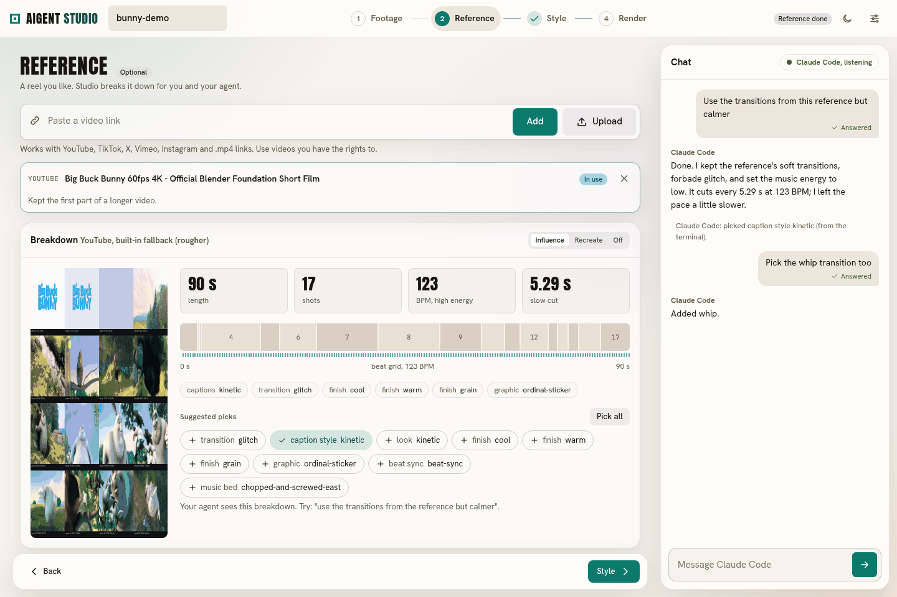

## What you can do

1. **Footage.** Drag clips onto the page or pick files (mp4, mov, m4v, webm, mkv), or paste a public Dropbox or Google Drive share link or a plain video URL (see [Footage from a link](#footage-from-a-link)). They go to `inbox/studio/<job>/`. An assistant can also point the session at a clips folder (`clips` in `studio_set_selections`, refused when it has no clips.json), reorder or drop files (`footage`: the paths from the session in the order to use; an unknown or repeated file is refused), and mark the files as already cut (`asIs`: each file is one clip, in order, never re-cut). Several different files keep the order you gave them; best-take picking only runs when the files are takes of the same lines. Or film it now with **Record now** (see [Record now](#record-now)).
2. **Reference.** Paste one or more links (Enter adds them, Shift+Enter starts another line) or upload a file. Links can be YouTube (and Shorts), TikTok, X, Vimeo, a direct video file (.mp4, .mov, .m4v, .webm), or one public Instagram post. Studio downloads each into your download folder, breaks it down, and shows what it found: length, cut times and pace, music BPM, beats and energy, caption style, titles, transitions, finishes, graphics and effects, plus suggestions mapped to the effects menu that you can click to pick. The chat gets the same teardown. See [Reference links](#reference-links). Then choose:
   - **Influence:** the reference becomes soft defaults on top of the pack you picked (the pack's locks stay). Saved as a local pack, `ref-<job>`.
   - **Recreate:** the draft uses the reference's Reel.md as the recipe (`--recipe`), so its shots, titles and look are copied as closely as the engine can.
3. **Style.** Three parts on one screen:
   - **Pack.** Pick a style pack from the row of previews. Your picks add to it. "Save as pack" writes `packs/local/<name>/pack.json` (validated, gitignored) so you can reuse the look with `--pack <name>`.
   - **Effects.** Every effect the engine has, as a grid of looping previews, in tabs by type (table below). Click a tile to pick it; press F, right-click it, or use its forbid button (the circle with a line) to forbid it. Hover or focus a tile for its description in a hover card instead of text on every tile. Picking any of a kind means only your picks of that kind are used; forbidding one leaves the rest. Some kinds take one choice (caption style, look, theme). Press / to search. The pause button switches to stills and is on by default when your system asks for reduced motion. Small labels mark tiles with a still preview ("still"), graphics that only appear when you say the matching words ("your words"), and options set elsewhere ("info"). Your picks collect in the tray at the bottom; click one to drop it.
   - **Sound and pace.** A bed by energy (auto, low, mid, high), a named bed with a play button, no music, or your own upload. Sound effects on or off, sparse sounds (the density cap), how tight to cut pauses, and zoom punches.
4. **Chat.** Type "calm and cinematic, no glitch, typewriter titles". See [Chat](#chat).
5. **Render.** Draft runs `npm run reel ... --draft` and shows the choices table: every transition, finish, title and graphic per beat, with why it was picked. Change any cell and apply; the change is pinned. Render builds the reel (and the export size you picked) with progress, then plays it with a download link.


## Words and brands

In the Style step, **Words and brands** has two lists:

- **Your words.** One per line, the way Whisper writes it, then `=`, then how you write it: `Agent Academy = AIgent Academy`, `chat GBT | chat GPT = ChatGPT`, `school = Skool after on, in` (only after those words). The draft fixes them in captions, titles and the clip list, and keeps their own capitals even in an all-caps caption style. AIgent Academy, Skool, claude.ai, ChatGPT and Claude Code are built in (`kit/glossary.json`, the aigent pack). The same text works as `npm run reel -- --glossary "..."`, a pack's `style.glossary`, or `glossary` in `studio_set_selections`.
- **Logos when you say a word.** Type the word, click **Add its logo** and pick an svg, png, webp or jpg. When the word is said, its logo shows on a small white plate for about a second, at most one every 4 s, never over a title or graphic. The marks are kept in `jobs/.studio/brands/`. **Use the kit's Skool mark** adds `kit/example/skool-logo.svg`. Studio never downloads a logo; use only marks you have the right to use. CLI: `--brands '[{"word":"Skool","logo":"path/to/mark.svg"}]'` or a JSON file.

A patch that changes nothing (the setting was already that way) returns `noChange` to the agent and shows "Studio: that change did nothing" in the chat, so an agent never reports a change that did not happen.

## Menu categories

The categories come from `kit/studio/categories.json`, which maps the engine's own catalogs (transitions, title and caption entrances, caption styles, graphics, effects, finishes, looks, themes, fonts, beds, sounds and editing options) into tabs. It only regroups; it never adds an effect the engine does not have, and `tests/studio.test.mjs` fails if it names one. An item can sit in more than one tab. Empty categories are hidden in the page.

| Category | Items | What is in it |
| --- | ---: | --- |
| Transitions | 56 | all 56 seams (50 stock, 6 drawn) |
| Kinetic text and title entrances | 42 | 9 title entrances, the font pairings, title placement (left, right, above, chest, face), text graphics and effects |
| Captions | 22 | caption entrances, 7 caption styles, 5 looks |
| Motion graphics | 30 | every graphic in `kit/graphics.json` |
| Lower thirds and name tags | 7 | lower third, news strap, logo bug, channel bug, ticker, app label, tape label |
| Stickers, emoji and callouts | 11 | sticker pop, ordinal sticker, highlight, icon badge, HUD callout, price tag, release pill, stamps and scribbles |
| Data and info graphics | 18 | 9 data graphics (chart, stat callout, checklist, step counter, split flap and more) and 9 data effects |
| Camera effects | 11 | the effects marked camera in `effects/catalog.json` (slow push, lean in, locked on, over-the-shoulder zoom and more) plus punch-ins |
| Speed and time | 3 | tighten, pause point, wave trim |
| Person and background | 16 | title layers (front, behind the head, auto) and effects that use the person mask |
| Color and looks | 16 | looks, film finishes, themes |
| Overlays and textures | 7 | grain, vignette, scan lines, glass widgets, shortcut rain, noise, light leak |
| Glitch and distortion | 10 | glitch seams and effects |
| Shapes, frames and split screens | 10 | reel frame, split headline, B-roll split, grid, versus, screen card, colour and chapter cards |
| B-roll and media | 10 | screen card, profile wall, phone fan, carousel spin, headline wall, match cut and more |
| Audio | 54 | 11 music beds, 37 sound effects, beat sync, sound map and cap |
| Intros, outros and CTAs | 8 | CTA card and button, number pop, chapter card, tap, countdown flip, comment box, cards |

269 unique items in all. Counts are from this release; `node -e "import('./kit/studio/core.mjs').then(C=>console.table(C.catalog().categories.map(c=>({c:c.label,n:c.count}))))"` prints the current ones.

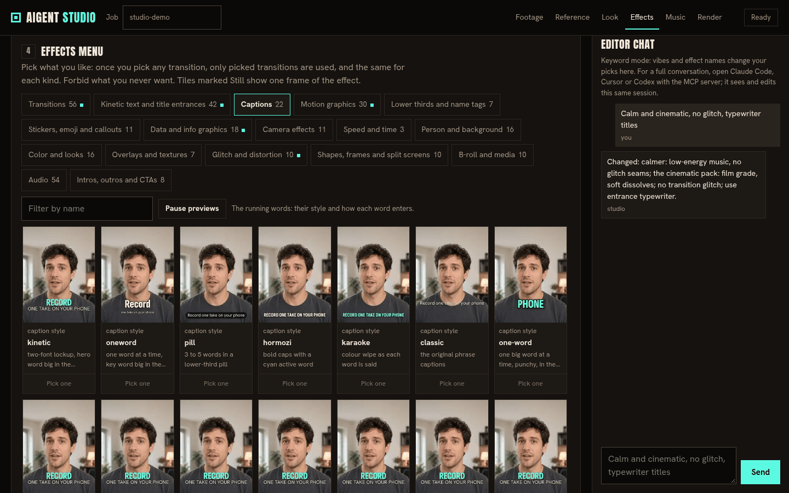

### Candidates to build next

No category is empty today, so none is hidden. These are thin, or are things people ask for that the engine does not do yet (listed in `categories.json` under `candidates`):

- **Speed ramps and slow motion.** Speed and time has 3 items; the engine cuts and freezes but does not change playback speed.
- **Emoji.** Stickers cover hearts, stars and fire; there is no emoji picker.
- **Intro stings and logo reveals.** Only the end card and number pop exist.
- **Light and lens effects.** Light leak is a transition; there is no lens flare or bokeh overlay.
- **Sound design: ducking controls.** Ducking is automatic; there is no per-clip control.
- Thin today: Lower thirds and name tags (7) and Overlays and textures (7).

## Record now

Film takes in the Footage step with this computer's camera and mic. Click **Record now**, then **Turn on camera**; the browser asks once for the camera and mic.

<p>


</p>

- **Camera and mic.** Pick either from the lists (they fill in after you allow access). The bar under them is a live mic level.
- **Frame.** 9:16 (default, for reels), 16:9 or 1:1. The preview shows the whole camera; the recording is cropped to the frame from the middle of the picture, at the camera's full resolution (up to 1920 px on the long side).
- **Mirror preview.** Flips only the preview, like a mirror. The take is saved the right way round.
- **Framing guides.** Rule-of-thirds lines, a head zone and the caption band. Keep your head in the zone: kinetic titles can then sit behind your head and captions sit below it, inside the reels safe area from `kit/exports.json`.
- **Countdown.** 3, 2, 1 before it records (a switch turns it off). Then pause, resume and stop, with a timer.
- **Teleprompter.** Pick a script from the Scripts area (or paste one). It sits in a band at the top of the preview, near the lens, so your eyes stay close to the camera, and it scrolls smoothly at your speed: each line takes as long as it takes to say at your words per minute, and a `[pause]` mark holds its line 1.5 s longer. It starts when recording starts, after the countdown, and stops when you pause. The current line is highlighted; set the text size and mirror the text for a beam-splitter rig. Voice-follow pacing is not used: Chrome's speech recognition sends the audio to a server, and Studio keeps everything on this computer.
- **Speed while it scrolls.** A speed bar sits right under the text: minus and plus (10 WPM a step), a slider, and the speed as WPM with a slow, normal or fast label (under 130 is slow, 130 to 175 normal, above that fast). The up and down arrow keys do the same. Changing it mid-take speeds up or slows down from where you are, with no jump. Studio remembers the speed in this browser.
- **Rehearse.** With the teleprompter on, **Rehearse** scrolls the script with nothing recorded, camera on or off. Pause, resume and stop it yourself (Space pauses it too). Starting a take ends a rehearsal.
- **Pop out.** The arrow button on the speed bar (or **Pop out the teleprompter** on the right) opens the teleprompter in its own small window that you can drag next to your camera and resize. In Chrome and Edge it is a Document Picture-in-Picture window, which stays on top of other apps; in other browsers it is a normal window (allow pop-ups for Studio if the browser blocks it). It is the same teleprompter, not a copy: the script, speed, current line, mirror and text size, rehearse, the countdown, recording, pause and stop are shared, and the controls in either window work. Close it, or click **Back to page**, and the teleprompter returns to the page.
- **Keys** while the recorder is on screen (in the pop-out too): Space records or stops (or pauses a rehearsal), P pauses or resumes, up and down change the speed, left and right move a line.

<p>
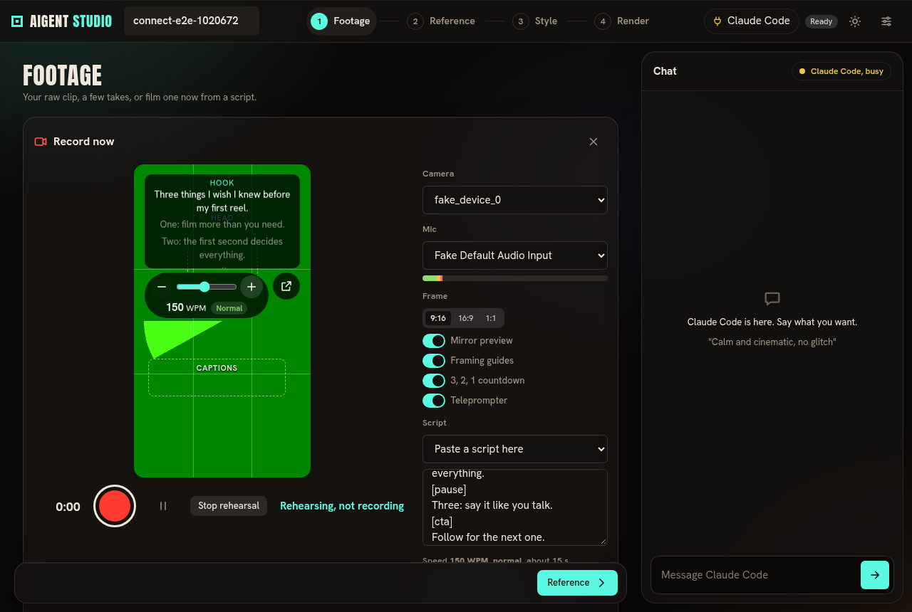
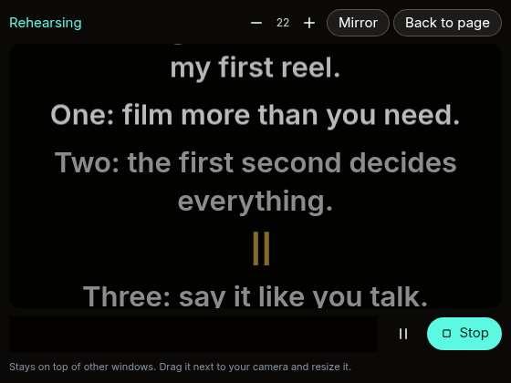
</p>

- **Takes remember their script.** A take filmed with the teleprompter on keeps a copy of the script text. `studio_takes` shows it, and the next draft passes it to Whisper as a hint (`TX_PROMPT`, read by `kit/tx.py` and `kit/clip.py`), so names and unusual words in your captions come out spelled the way the script has them.
- **Takes.** Each take is listed with a thumbnail and its length. A new take is kept and in the footage as soon as it is saved. The switch takes it out of the edit or puts it back, **Retake** throws away the last take and records again, and the bin deletes a take's files.

**How a take is saved.** The page records with MediaRecorder (webm in Chrome, Edge and Firefox, mp4 in Safari) and sends it to Studio in numbered pieces about once a second while you film, so a long take survives a slow request: a failed piece is retried, a repeated piece is ignored, and pieces arriving out of order are refused until the missing one comes. On stop, Studio converts the take with FFmpeg to an H.264 and AAC mp4 at 30 fps with a thumbnail, in `inbox/studio/<job>/takes/` (gitignored, next to uploaded footage), adds it to the footage and posts "New take recorded: 42 s (take 3)" in the Studio chat, which your agent reads with the session context. If you switch steps while filming the take keeps going and a red Recording badge in the top bar brings you back; when you are not recording, leaving the step turns the camera off.

**Agents.** `studio_takes` lists the takes (id, file, thumbnail, seconds, status, kept) and keeps, unkeeps or discards one. The page uses `POST /api/record/start`, `/api/record/chunk?id=&seq=`, `/api/record/finish`, `/api/record/abort`, `/api/record/take` and `GET /api/record/takes`.

**Where it works.** Browsers only allow the camera on a secure page, and `http://127.0.0.1` or `http://localhost` on the same computer count as secure. Studio listens on 127.0.0.1 only and never opens itself to your network, so to film on a phone, run Studio on the phone itself or put it behind your own https. If the camera is blocked, missing or busy in another app, the recorder says so in one line with a Try again button. Tested in Chrome with a fake camera and mic; see What is not tested in the changelog.

## Scripts

The Scripts area in the Footage step holds what you will say on camera, per reel (job). Scripts are files in `jobs/.studio/scripts/<job>/` (gitignored, next to the session).

<p>

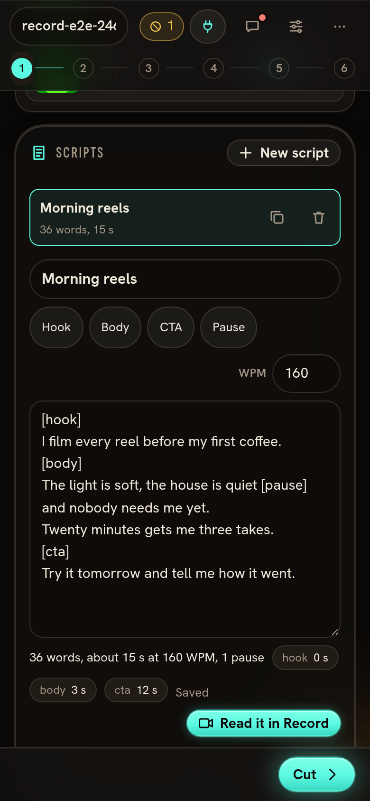
</p>
<p>
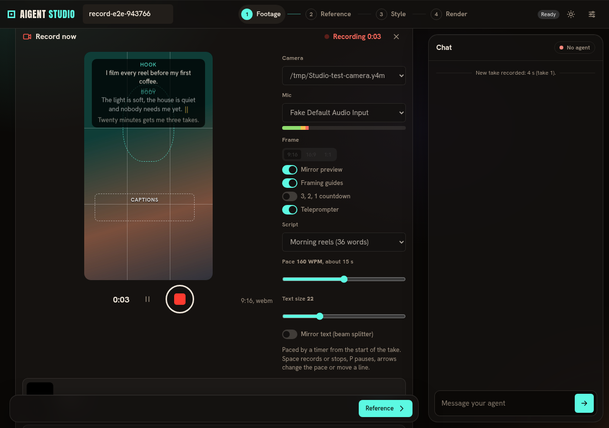

</p>

- **Edit.** New, rename (the title box), duplicate and delete. The editor saves as you type and shows the word count and read time at the script's WPM (default 150).
- **Marks.** A line that is only `[hook]`, `[body]` or `[cta]` starts a section; the stats show when each starts. `[pause]` anywhere is a breath: it adds 1.5 s and the teleprompter holds there.
- **Ask for one.** Type a request under the editor ("write a 30 s script on cold showers", "rewrite this tighter") and it goes to whoever answers the chat. After a reference breakdown, **Write script from this reference** sends your agent a Studio message with the teardown, so the script follows the reference's hook, pacing and beat times.
- **Who writes.** Your terminal agent writes with `write_script` and runs a humanizer skill on every draft first: its own if it has one, otherwise the bundled `skills/humanizer` ([blader/humanizer](https://github.com/blader/humanizer), MIT, by Siqi Chen). With an API key or a local model, the Studio chat writes the script itself and follows a short form of the same rules (`HUMANIZER_RULES` in `kit/studio/scripts.mjs`); em dashes are removed either way. In keywords mode the page says in one line that writing scripts needs an agent, an API key or a local model.
- **Read it.** **Read it in Record** opens the recorder with that script in the teleprompter (see [Record now](#record-now)).

API: `GET /api/scripts`, `GET /api/scripts/get?id=`, `POST /api/scripts` (create, or replace with `id`), `POST /api/scripts/action` (`delete`, `duplicate`, `rename`), `POST /api/scripts/from-reference`. MCP: `list_scripts`, `get_script`, `write_script`.

## Footage from a link


Paste a link in the box under **Drop video here** and click **Add**. Studio downloads it into `inbox/studio/<job>/` and adds it to the footage, the same as an upload, with its size and a progress bar while it comes in. No account sign-in is involved.

- **Dropbox.** A shared file link (`dropbox.com/s/...` or `dropbox.com/scl/fi/...?rlkey=...`). Studio asks Dropbox for the file itself with `dl=1`.
- **Google Drive.** A shared file link (`drive.google.com/file/d/<id>/view`, `open?id=` or `uc?id=`). Studio uses Drive's `uc?export=download` link. A file too big for Drive's virus scan answers with a "can't scan this file" page first; Studio reads its confirm form and goes on to the file (its own code, no extra library).
- **Plain video URLs** that answer with a video file (mp4, mov, m4v, webm, mkv).
- **What fails, and the line it shows.** A private, expired or sign-in link: "This link needs a login. Make it public or download it and drop the file in." A folder link, a link that opens a web page, or a file that is not a video each say so. Folder links are not supported yet: share the file itself.
- **Limits.** 20 GB per file (`STUDIO_FOOTAGE_MAX_BYTES`). A download can be cancelled; a failed one can be dismissed. A file never overwrites another with the same name.

The page uses `POST /api/footage/url { url }` and `POST /api/footage/import { id, action: cancel | dismiss }`; progress is in the session's `imports` list. Code: `kit/studio/cloud.mjs`, tested against a local mock of Dropbox and Drive in `tests/studio-connect.test.mjs` (no real Dropbox or Drive in CI).

## Reference links


The breakdown is visual: four numbers (length, shots, BPM and energy, average shot), a timeline of the shots with a beat grid at the measured BPM, tags for what was found, and suggested picks you click to add (or Pick all). It also says which teardown engine ran; the built-in fallback is rougher, so treat its finds as guesses.

- **Queue.** Paste several links at once; they download and tear down one at a time, each with its status (waiting, downloading with a progress bar, breaking it down, ready, failed with the reason) and Stop, Try again, Remove and "Use this one" buttons. The newest ready one is used unless you pick another.
- **Downloaders.** YouTube, TikTok, X, Vimeo and most video pages go through [yt-dlp](https://github.com/yt-dlp/yt-dlp), an optional free program you install yourself (`pip install yt-dlp`, or its standalone program on your PATH, or `YTDLP=/path/to/yt-dlp`). The one-line installers add it to the kit's venv. It runs as a separate program; none of its code is in the kit. A direct video link is downloaded by Studio itself. Instagram uses the kit's [instaloader](https://github.com/instaloader/instaloader) helper (MIT): one public post, anonymous, never a login. Without yt-dlp, the page says how to install it and the link fails with that hint.
- **Where it goes.** By default `teardown-in/studio/<job>/` in the kit, which git ignores. Pick any folder in [Settings](#settings). Downloads never go into the repo's tracked files, and the teardown (`teardown/studio-<job>-r<id>/`: Reel.md, teardown.md, contact sheet) is gitignored too.
- **Long videos.** Studio keeps the first 90 seconds for the teardown (`STUDIO_REF_MAX_SECONDS` changes it); with ffmpeg present yt-dlp downloads only that part.
- **Teardown.** The same `npm run teardown` as the CLI (rea-video when installed, otherwise the built-in analyzer). `STUDIO_TEARDOWN_ARGS` adds flags, for example `--engine lite --no-asr` for speed.
- **Influence and Recreate** work the same for links and files: Influence makes `packs/local/ref-<job>/` from the teardown, Recreate drafts with its Reel.md.
- **Rights.** Only download videos you have the rights to use as a reference, and follow each site's terms. Studio uses a reference to learn its style and structure; your reel is made from your own footage.

## Settings


The settings button (top right, the sliders) opens a side sheet and saves to `jobs/.studio/settings.json`, which git ignores. Environment variables win over it.

| Setting | Default | Environment |
|---|---|---|
| Who answers the Studio chat | your terminal agent | `STUDIO_CHAT` = `agent`, `local`, `anthropic`, `openai`, `auto` (a key if set, else keywords) or `keywords` |
| Local model server and model | Ollama at `http://127.0.0.1:11434/v1`, first model it lists | `STUDIO_LOCAL_URL`, `STUDIO_MODEL` |
| Reference downloads | `teardown-in/studio/<job>/` in the kit | `STUDIO_DOWNLOADS` |
| Also copy finished reels to | none (reels stay in `jobs/<job>/`) | `STUDIO_RENDERS` |
| Action notes from the terminal | on | |

Theme (dark or light) and Glass panels (on, or solid panels for older computers) live under Look and are saved in the browser, not in the file.

Folders must be full paths; Studio makes them if needed and checks it can write there before saving. The `studio_settings` MCP tool reads and changes the same file.

## Chat

The Studio chat is answered by one of these, picked in Settings:

- **Your terminal agent (default).** Claude Code, Codex, Cursor or any MCP client, running in your terminal. See the next section.
- **A local model.** Any OpenAI-compatible server on your computer: [Ollama](https://ollama.com) (`http://127.0.0.1:11434/v1`), LM Studio (`http://127.0.0.1:1234/v1`) or the llama.cpp server (`http://127.0.0.1:8080/v1`). "Find models" lists what the server has. No key needed (`LOCAL_LLM_API_KEY` if yours asks for one).
- **Claude or OpenAI API.** Set `ANTHROPIC_API_KEY` or `OPENAI_API_KEY` before starting Studio (`STUDIO_MODEL` picks the model; `ANTHROPIC_BASE_URL` and `OPENAI_BASE_URL` point at compatible servers). Keys stay in your environment; nothing is saved.
- **Keywords only.** No model: vibe words (calm, calmer, cinematic, hype, fast, clean, magazine, techy, retro, silent and more, in `kit/studio/vibes.json`), pack and effect names, "no ..." to forbid, and "the transitions from the reference" (or titles, captions, grade, graphics, effects, music, beats, or everything).

Every backend gets the session and the reference teardown, so "use the transitions from this reference but calmer" works in each, and every change is checked against the engine's names before it is applied.

## Your terminal agent in Studio


You tell your agent, in its terminal: **"Set up Studio from AGENTS.md and run the Studio chat loop."** It runs `npm run setup:all` (everything installs up front; it tells you only what it cannot do itself), registers the kit's MCP server in its own config (the [Connect agent](#connect-agent) sheet shows the same lines), asks you to restart it once so the tools load, starts Studio (`studio_start`), opens the page, and listens. The steps per agent are in [AGENTS.md](../AGENTS.md#studio-set-it-up-and-be-the-agent-in-it) and the loop is in [skills/aigent-studio/SKILL.md](../skills/aigent-studio/SKILL.md).

### Connect agent

<p>

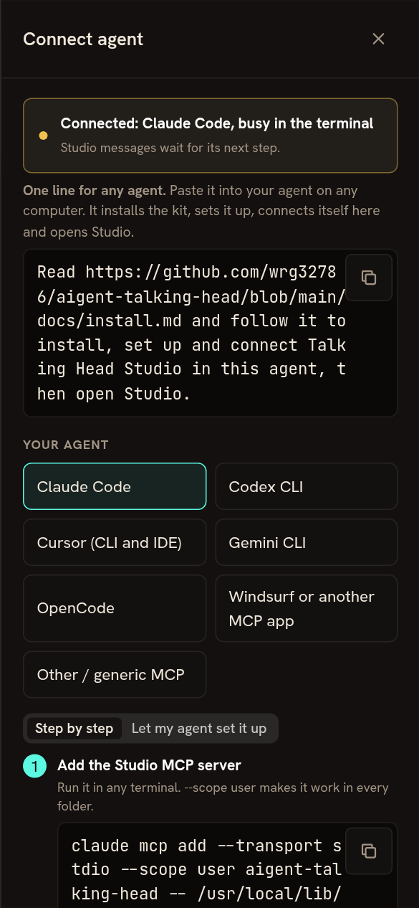
</p>

**Connect agent** in the top bar (also in the empty chat and in Settings) opens a sheet where you pick your agent: Claude Code, Codex CLI, Cursor (CLI and IDE), Gemini CLI, OpenCode, Windsurf or another MCP app, or Other / generic MCP. For the one you pick it shows exactly what to do, each with a copy button:

1. The one line that adds the Studio MCP server, or the config to paste, with the real absolute paths of this install filled in (Node, `kit/mcp.mjs` and the kit's Python). The server writes these itself, so they are right for your computer.
2. For Claude Code, the hook install (`node kit/studio/connect.mjs claude --user`).
3. Restart the agent once.
4. The one sentence to say to it: "Run the Studio chat loop".

**Let my agent set it up** gives one prompt to paste into any agent instead: it points the agent at AGENTS.md with the paths, and the agent registers itself and starts listening.

The sheet shows the connection live: "Waiting for your agent", then "Connected: Claude Code, busy in the terminal" or "Connected: Claude Code, listening" in green as soon as it connects. Studio remembers the agent you picked (`agent` in `jobs/.studio/settings.json`). The page reads `GET /api/connect`; the commands come from `kit/studio/agents.mjs`, which `npm run studio:connect` also uses.


**What each command is based on.** Checked against each agent's own docs on 2026-11-19:

| Agent | What Studio shows | Source | Checked |
|---|---|---|---|
| Claude Code | `claude mcp add --env PYTHON=... --transport stdio --scope user aigent-talking-head -- <node> <kit>/kit/mcp.mjs`, then the hook | [code.claude.com/docs/en/mcp](https://code.claude.com/docs/en/mcp) (`--env` before the name needs another option between, so `--transport stdio` sits there; `--` separates the server command), [hooks](https://code.claude.com/docs/en/hooks) | yes |
| Codex CLI | `codex mcp add aigent-talking-head --env PYTHON=... -- <node> <kit>/kit/mcp.mjs`, or `[mcp_servers.aigent-talking-head]` with `command`, `args`, `env`, `tool_timeout_sec = 300` in `~/.codex/config.toml` | [developers.openai.com/codex/mcp](https://developers.openai.com/codex/mcp) | yes |
| Cursor (CLI and IDE) | `mcpServers` JSON in `~/.cursor/mcp.json` (or `.cursor/mcp.json` in a project); the `agent` CLI reads the same file (`agent mcp list`) | [cursor.com/docs/context/mcp](https://cursor.com/docs/context/mcp), [cursor.com/docs/cli/mcp](https://cursor.com/docs/cli/mcp) | yes |
| Gemini CLI | `gemini mcp add --scope user -e PYTHON=... aigent-talking-head <node> <kit>/kit/mcp.mjs`, or `mcpServers` in `~/.gemini/settings.json` | [gemini-cli docs/tools/mcp-server.md](https://github.com/google-gemini/gemini-cli/blob/main/docs/tools/mcp-server.md) | yes |
| OpenCode | `opencode mcp add aigent-talking-head --global --env PYTHON=... -- <node> <kit>/kit/mcp.mjs`, or `mcp.servers` with `type: "local"`, `command` as an array and `environment` in `opencode.jsonc` | [opencode.ai/docs/mcp-servers](https://opencode.ai/docs/mcp-servers/) | yes |
| Windsurf or another MCP app | the common `mcpServers` JSON | [docs.windsurf.com/windsurf/cascade/mcp](https://docs.windsurf.com/windsurf/cascade/mcp) now opens the Devin Local docs, which name `~/.config/devin/mcp_config.json` but do not show its format | **not verified**: marked in the sheet |
| Other / generic MCP | the stdio command and the `mcpServers` JSON | [modelcontextprotocol.io: connect local servers](https://modelcontextprotocol.io/docs/develop/connect-local-servers) | yes |

By hand, from the kit folder, `npm run studio:connect -- claude` (or `codex`, `cursor`, `print`) still writes the config for you.

**Two channels, one agent.** The Studio chat shows only the Studio conversation: what you type in the page, the agent's answers to it, and short action notes. Your terminal conversation stays in the terminal and is never copied into Studio. Edits are shared: whatever the agent changes, from either conversation, updates the page live. When it changes the edit because you asked in the terminal, Studio shows a one-line note such as "Claude Code: picked transition whip (from the terminal)." Turn those notes off in Settings.

**How a Studio message reaches the agent.** A terminal agent cannot be interrupted in the middle of a step, so:

- **Idle and listening:** it waits on `studio_wait_for_message` and answers within a second or two. The page shows "Claude Code connected, listening".
- **Busy in the terminal:** the message queues. The agent checks `studio_get_pending` at the start of each turn. In Claude Code, the Studio hook (`kit/studio/hooks/studio-pending.mjs`, installed by `npm run studio:connect -- claude`) adds "N Studio messages waiting" to its context after each tool call, when you send it a prompt, and when it finishes a turn, so it picks them up at its next step. Codex and Cursor have no equivalent hook here; they rely on the per-turn check in AGENTS.md. A long command (a render) still finishes first.
- **On the page:** each message you send shows Queued, then Seen, then Answered with a check. The badge at the top of the chat shows "Claude Code, listening" (green), "busy" (amber, messages wait for its next step) or "No agent" (red), and an empty chat shows the one line to say to your agent with a copy button.

**MCP tools for the channel:** `studio_start`, `studio_wait_for_message`, `studio_get_pending`, `studio_reply` (Studio channel only; `replyTo` marks messages answered), `studio_set_selections` with `origin: "terminal"` for terminal edits, plus `studio_add_reference_url`, `studio_get_reference_teardown`, `studio_settings`, `studio_takes`, `list_scripts`, `get_script`, `write_script`, `studio_get_state` and `studio_run`. Presence is in `jobs/.studio/agent.json`; the hook reads `GET /api/agent/pending` (localhost only).

`npm run studio:agent` starts Studio in the background and prints its URL as JSON (`--no-open`, `--port`, `--stop`), so an agent's terminal is not held by the server. `tests/studio-agent.test.mjs` runs the whole loop with a scripted MCP client acting as the agent.

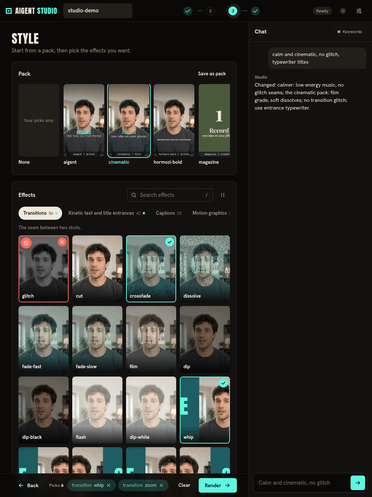

## AG-UI

Studio also speaks [AG-UI](https://github.com/ag-ui-protocol/ag-ui) (MIT), the open event protocol between agents and user interfaces, so an AG-UI client can watch Studio or talk to it. `kit/studio/agui.mjs` maps the session onto AG-UI event shapes; it has no dependencies and copies no AG-UI code.

- `GET /api/agui/events` is an observer stream: `STATE_SNAPSHOT` and `MESSAGES_SNAPSHOT` first, then `STATE_DELTA` (RFC 6902 JSON Patch on the edit: job, footage, pack, picks, music, sound, pace, export, reference), `TEXT_MESSAGE_START`, `TEXT_MESSAGE_CONTENT` and `TEXT_MESSAGE_END` for each answer, `STEP_STARTED` and `STEP_FINISHED` for drafts, renders and reference downloads, and `CUSTOM` events `studio.message_status` (queued, seen, answered) and `studio.action_note`.
- `POST /api/agui` takes a `RunAgentInput` and streams a run: `RUN_STARTED`, the status of the message, the answer as text message events, a `STATE_SNAPSHOT`, then `RUN_FINISHED`. The last user message goes into the Studio chat, the same channel as the page, so whoever answers the Studio chat answers it (your terminal agent by default). `forwardedProps.timeout_s` (default 300) bounds the wait; if no answer comes in time the run finishes with `result.status` still queued or seen, and the message stays in the chat.

Like the rest of Studio, both endpoints answer on localhost only and refuse cross-site browser posts. Tool calls are not mapped: the agent's tools are its MCP tools, and AG-UI clients see their effect as state deltas.

## Render

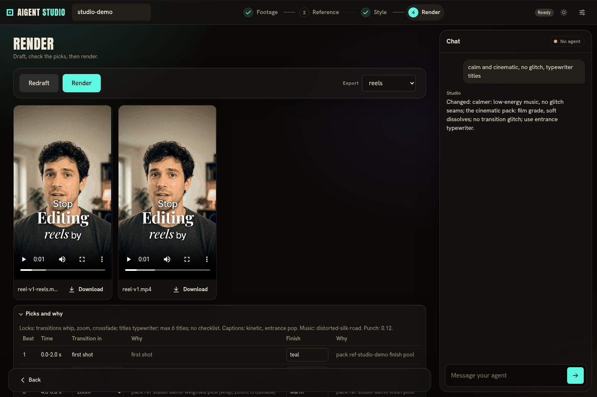

Draft first. "Picks and why" opens with each pick per beat and the reason. The log and the exact command are folded below it. Render then builds the reel, applies your choices edits, and lists every output (`reel-vN.mp4` and the export) with a player and a download link. The effects pass (camera moves, person-mask effects) runs when the effects venv is set up (`npm run effects:setup`); without it, Studio says which picked effects were skipped. When the draft tightened pauses, **Pauses cut** lists each one with **Keep this pause** (`pace.keepPauses`, `--keep-pauses clip@seconds`). A cancel that lands after the render wrote its video keeps the video; the task ends done.

## Review your edit

Five tools in the Reference and Render steps help you see what changed and say what to change next. They read files the kit already writes (the teardown's `Reel.md`, the draft's `clips.json` and `choices.json`), so nothing goes online.

**What to swap** (Reference step, under the breakdown). The reference's parts in order with their times: the hook, every cut and how it moves, title moments, b-roll and cards, graphics and the call to action. Click a time to watch that moment in the reference. Each part lists the Studio picks that match it (transition, title entrance, finish, caption style, punch, graphic); click one chip to pick it, or **Use** to pick them all. Only items the menu has are offered.

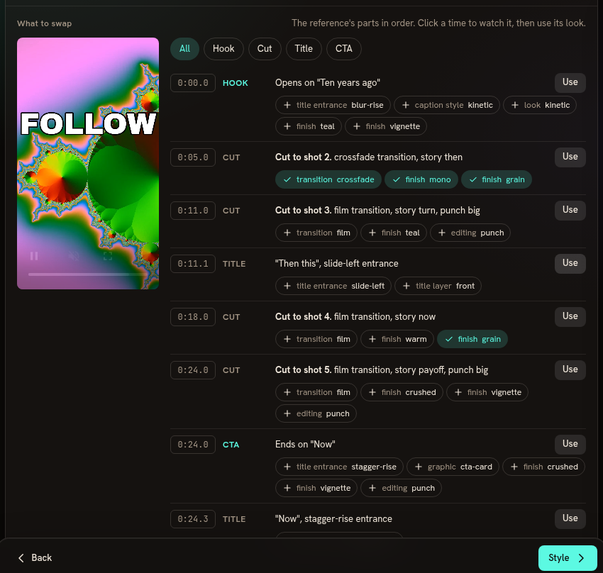

**Show original** (Render step). Your reel and the reference on one clock: side by side, or the reference laid over your reel with an opacity slider. One play button and one scrubber drive both. If the reference starts earlier or later than your reel, set "Original starts at" in seconds. The reference plays muted unless you tick its sound.

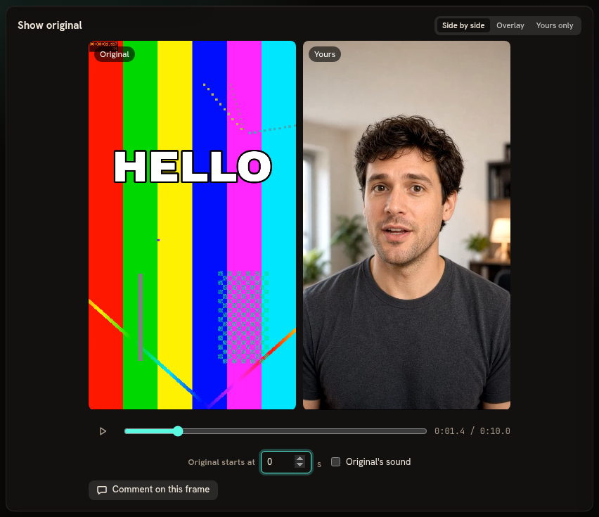

**Comment on the preview.** Press **Comment on this frame**: the reel pauses and you click a spot or drag a box on it, then type what should change ("move this title up"). It goes to the Studio chat as one message with the reel name, the time, the spot or box in percent of the frame, and a saved copy of the frame with your mark on it (`jobs/<job>/comments/comment-N.jpg`). Your terminal agent gets the frame path and the box in the message's `attach` field (`studio_wait_for_message`, `studio_get_pending`), so it can open the image and act on it. With a model or keywords answering the chat, the same line goes to them.

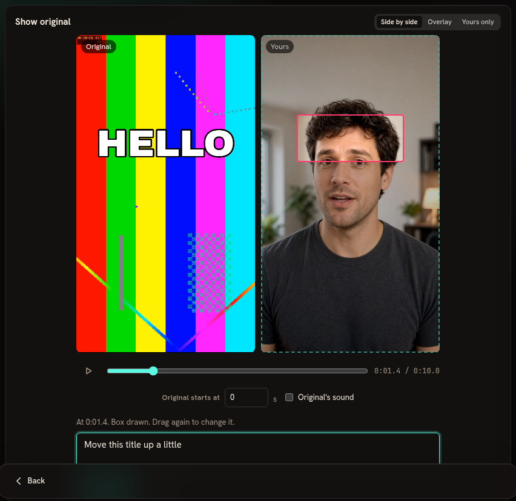

**Clean-up pass.** After a draft, Studio lists what it could cut, from the Whisper word timings of your clips: pauses longer than 0.7 s (you can change that), filler words (um, uh, erm, ah, hmm) and the takes the take check flagged as retakes. Each row has a play button to hear it and Keep or Remove. Pauses and fillers start as Remove; retakes are already left out of the draft, and Keep brings one back. **Apply and redraft** writes `jobs/<job>/cleanup.json` and drafts again from the same clips (no new transcription) with `npm run reel -- --cleanup <file>`: each removed span becomes a jump cut, like `--tighten`, and the captions follow. Nothing is deleted, and **Turn off** goes back to the plain draft. When you change the footage, the clean-up stops applying until you review it again.

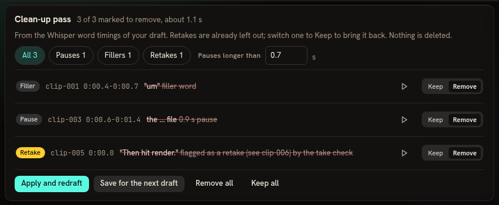

**Edit receipt.** `choices.json` in plain sentences: the style and your locks, captions and music, then every beat, title, graphic and card with its time and the reason the engine gave. The clean-up shows here too. **Copy** puts it on the clipboard as text. "Picks and why" below it is still where you change a pick.

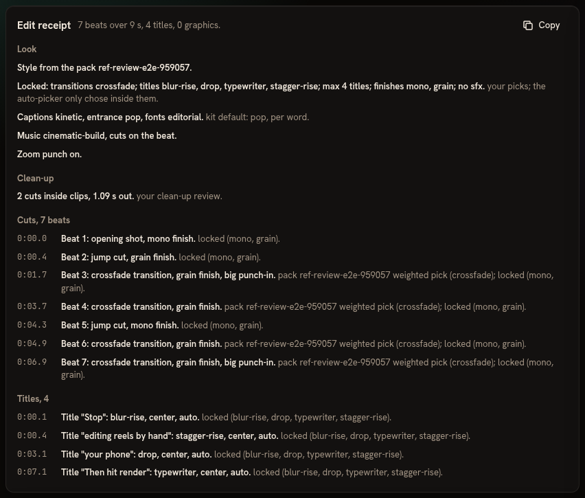

API: `GET /api/reference/video` (the session's reference file, with range requests), `GET /api/cleanup?silence=`, `POST /api/cleanup` (`decisions`, `silence`, `redraft`, or `on: false`), `POST /api/comment` (`text`, `t`, `region` as 0 to 1 fractions, `video`, `image` as a data URL), and `GET /api/choices` now returns `receipt`. The state carries `swap` (the parts list) and `cleanupReady`. The logic lives in `kit/studio/review.mjs`.

On a phone the two videos stay side by side at half width and the lists stack: [screenshot](studio/review-phone.png).

## On a phone

<p>

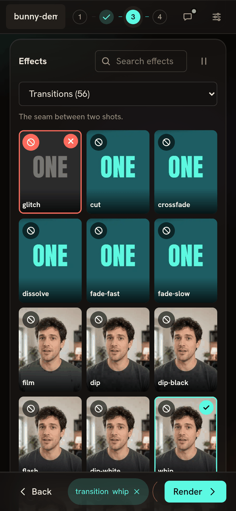
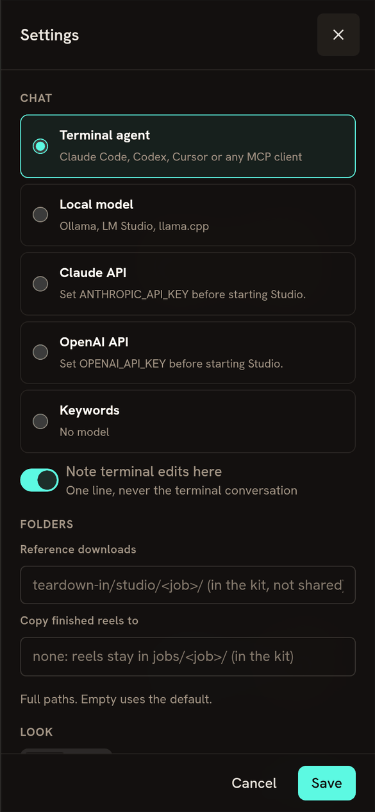
</p>

Studio is meant for a laptop, and it works at phone width: numbered steps in the header, a drop-down for the effect tabs, three tiles per row with the forbid button always shown, the chat as a full-screen sheet behind the chat button (its dot shows the agent status), and no sideways scrolling.

## Setup check

Everything the kit can use is installed up front by `npm run setup:all` (the one-line installers run it too, and your agent runs it during setup): Node packages, the Python venv and `requirements.txt`, yt-dlp and instaloader, ffmpeg and ffprobe, Chrome, the Whisper model (small.en, about 470 MB), the effects pass (MediaPipe, OpenCV, rembg; `npm run effects:setup`), the humanizer skill and the Studio page. It is safe to stop and run again: each step checks first and only does what is missing, and it ends with a summary of what was installed, already there, skipped, failed or needs you. `--skip model,effects` leaves out the big downloads; `--yes` lets it install ffmpeg and Chrome with Homebrew, winget, or apt, dnf or pacman when that needs no password. When it would need your password it does not ask; it prints the line for you to run ("Installing ffmpeg and ffprobe needs your password: run sudo apt-get install -y ffmpeg").

**Setup check** in Settings (and the amber "missing" pill in the top bar, when something Studio needs is missing) lists each one as ready or missing, what it is for, and the one fix with a copy button. `npm run setup:all -- --check` prints the same list, and agents get it from the MCP tool `setup_status`, which also returns `forUser`: the plain-words lines for what only you can do. Features say what they need instead of failing later: Draft and Render refuse with the fix when ffmpeg, Python or Chrome is missing, Record now says when takes cannot be saved as mp4, and reference links say when yt-dlp or instaloader is missing.

## Setup without a terminal

The one-line installers check for Git, Node.js, ffmpeg, Python and Chrome, offer to install what is missing, set everything up with `npm run setup:all` (add `--minimal` or `-Minimal` to skip the Whisper model and the effects pass), and put a "Talking Head Studio" launcher on your desktop. Running them again updates the kit. Details and what to tell your AI assistant: [docs/setup-with-ai.md](setup-with-ai.md).

macOS or Linux (Terminal):

```
curl -fsSL https://raw.githubusercontent.com/wrg32786/aigent-talking-head/main/install/install.sh | bash
```

Windows (PowerShell):

```
irm https://raw.githubusercontent.com/wrg32786/aigent-talking-head/main/install/install.ps1 | iex
```

A double-click app with no installer at all is planned: [docs/desktop-app-plan.md](desktop-app-plan.md).

## Files and safety

- The session lives in `jobs/.studio/state.json` (`STUDIO_DIR` moves it). Uploads go to `inbox/studio/<job>/` (recorded takes in its `takes/` folder) and `teardown-in/studio/<job>/`, drafts to `jobs/<job>/`, teardowns to `teardown/studio-<job>/`. All gitignored.
- The server listens on 127.0.0.1 only, refuses other Host headers (so a web page can't reach it by DNS rebinding) and cross-site posts, and serves files only from the kit's media folders.
- One task runs at a time; Cancel stops it.
- `STUDIO_REEL_ARGS` and `STUDIO_TEARDOWN_ARGS` add flags to every draft or teardown (for example `--engine lite --no-asr`). `STUDIO_TEARDOWN` and `STUDIO_SETUP` swap the teardown and setup scripts (the tests use stand-ins).

## Design

The page is React 19 with [Astryx](https://github.com/meta/astryx) components (MIT, Meta): buttons, badges, switches, segmented controls, progress bars, status dots, the keyboard hint and the settings drawer. Its theme (`kit/studio/web/src/theme.js`) extends Astryx Neutral with the AIgent palette: warm ink and paper neutrals, one cyan accent, Anton for headings, Hanken Grotesk and JetBrains Mono from the kit's fonts. Effect tiles, the shot timeline and the chat are drawn for Studio.

**Prebuilt, so installs stay one step.** The source is in `kit/studio/web`; the built page is committed in `kit/studio/public`, so the installers and `npm run studio` never run a build or download React. `npm run check` fails if the committed build is older than the source. After editing the page, run `npm run studio:build` (it installs the page's own dependencies in `kit/studio/web` and rebuilds) and commit both folders. License notices for everything bundled are in `kit/studio/public/THIRD_PARTY_LICENSES.txt`.

**Glass.** The floating layers are frosted glass: the header, the step bar, the chat panel, the settings drawer, the hover card, the toast and the save popover. Each is a translucent surface with a 20 px backdrop blur and a one-pixel top highlight, floating with a soft shadow over one faint ambient light. Cards are translucent but not blurred, so a page has at most a few blurred layers and stays smooth on older laptops and phones. Fallbacks:

- **Settings, Look, Glass panels** turns every panel solid (saved in the browser).
- `prefers-reduced-transparency` gets solid panels automatically, and so do browsers without `backdrop-filter`.
- `prefers-reduced-motion` stops transitions and the preview loops (or pause them with the button above the grid).

**Contrast with glass.** Glass opacity is set so text clears 4.5:1 even in the worst case, with pure white footage right behind a dark panel or pure black behind a light one: body text 11.2:1 and secondary text 4.7:1 in dark, 14.5:1 and 5.6:1 in light. Accent text on light glass uses a deeper teal (5.5:1 on a picked chip). Cards over the ambient light measure 12.9:1 and 5.3:1 in dark, 17.0:1 and 6.6:1 in light.

Rules it keeps: the cyan accent marks only the primary action, the current step and what is picked; one dark fade sits under tile names so they read on any preview frame. Keyboard: Tab through everything, arrow keys move between effect tabs, F forbids a tile, / jumps to search, Escape closes the chat sheet and the drawer, and focus stays on the same tile when the page updates. Controls are at least 44 px on touch screens and text at least 12 px.

Credits: Astryx and React are bundled (both MIT). The token names and component shapes first followed [shadcn/ui](https://github.com/shadcn-ui/ui) (MIT) and the dismissal and focus behavior [vercel-labs/ui](https://github.com/vercel-labs/ui) (Apache-2.0), with no code copied from either. Checked against [ui-ux-pro-max-skill](https://github.com/nextlevelbuilder/ui-ux-pro-max-skill) and [Anti-Slop](https://github.com/miqdadbadjuber/Anti-Slop) (both MIT), used as guidance only. See THIRD_PARTY.md.
