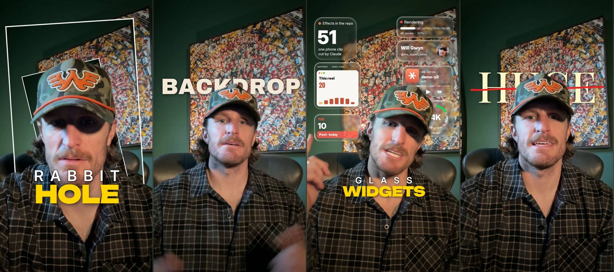

# Demo reel

A 40-second reel made with this kit from one phone recording session: 20 effects, each landing as Will says its name. The whole edit is the plan files in this folder.

[](demo-reel.mp4)

`demo-reel.mp4` is the finished reel scaled to 720x1280 for the repo. The master is 1080x1920.

## What's here

| File | What it is |
|---|---|
| `demo-reel.mp4` | The reel: 40.5 s, -14.3 LUFS, true peak -1.0 dBTP (`npm run verify`). |
| `cut.json` | The edit: 20 segments from two takes of the same script, 26 effect sounds, and the `yeehaw` music bed ducked under the voice. |
| `fx.json` | The effects plan: one effect per segment, each starting on its cut. |
| `captions.js` | Kinetic captions for the lines where the effect has no text of its own. |
| `fonts-demo.json` | The font pairing: Unbounded caps over small tracked Inter. |

## How it was built

```
npm run fx -- --name demo-v2 --plan jobs/demo-v2/fx.json --mask birefnet
npm run verify -- demo-v2
```

`npm run fx` assembles the cut from `cut.json`, renders the captions, cuts the speaker out of each frame and runs the effects in `fx.json`.

The plan files are for reading. They won't re-run as they stand, because three things live in the job folder, which is not in git: the two source takes, the 12 cover images that `orbit`, `carousel-spin`, `fan-build` and `place-in-grid` use, and 22 CC0 effect sounds from [ANVEAI/motion-pack](https://github.com/ANVEAI/motion-pack).

## What to copy from it

- **Effects land on the word.** Every cut sits 0.1 s before the word, and the effect starts on the cut. Word onsets were measured from the audio, because Whisper's word times drifted on these takes.
- **Words sit behind the head.** `backdrop-word`, `huge-strike`, `spotlight` and `crayon-write` carry `"drop"` so the cap cuts into each word. A word floating clear above the head misses the point of the effect.
- **Captions step aside.** Only the lines whose effect has no text of its own get a caption.
- **Sounds are levelled against the mix.** Each effect sound was measured against the voice and music at its moment, and the buried ones were raised.

## Rights

The footage shows Will Gwyn, and the music is our own track (`kit/music/yeehaw.mp3`). Both are for The AIgent's own use and are not covered by the repo's Apache-2.0 licence.
