# Font pairings

| Pairing | Hero face | Partner face | Lockup | Stands in for |
|---|---|---|---|---|
| `theme` | the theme's display font, caps | the theme's caption font, small tracked caps | `stack`: partner line above/below, justified to the hero | (default) |
| `modern` | Archivo Black caps, white | Allura script, accent | `overlap`: a short script tail tucks under the hero's right corner, rotated -7° | a modern bold sans + Constane |
| `druk` | Unbounded 900 caps (wide), accent | Hanken Grotesk 600, small caps tracked out to the hero's width | `stack` | Druk Wide + Helvetica |
| `elegant` | Marcellus caps, white | Pinyon Script, accent | `overlap`: script centred across the hero's baseline | Optitimes + Sloop |
| `editorial` | Instrument Serif Italic, accent | Libre Caslon Text 500 roman | `inline` on one baseline when it fits, else stacked | Vanguard + Athelas |
| `literata` | Archivo Black caps, white | Literata 500, accent | `stack` | the real pair: Archivo Black + Literata |
| `bricolage` | Bricolage Grotesque 800, white | Gloock, accent | `stack` | the real pair: Bricolage Grotesque + Gloock |
| `pirata` | Pirata One (blackletter), accent | Nunito Sans 700, white | `stack` | the real pair: Pirata One + Nunito Sans |
| `michroma` | Michroma caps (wide), white | Cardo Italic, accent | `stack` | the real pair: Michroma + Cardo |
| `redhat` | Red Hat Display 900 caps, accent | Red Hat Mono 500, small caps tracked out | `stack` | the real pair: Red Hat Display + Red Hat Mono |
| `jakarta` | Plus Jakarta Sans 800 caps, white | Ribeye, accent | `overlap`: a script tail under the hero's right corner | the real pair: Plus Jakarta Sans + Ribeye |
| `grotesk-times` | Hanken Grotesk 800, white | Crimson Pro 500, accent | `inline` when it fits, else stacked | ID Grotesk + Times |
| `avantgarde` | League Spartan 800 caps, white | Caprasimo, accent | `stack` | Avant Garde + Cooper |
| `recoleta` | Fraunces 700, accent | Hanken Grotesk 600, small caps tracked out | `stack` | Recoleta + Berthold |
| `haas` | Inter Tight 800, white | Inter Tight 400, white | `stack` | Neue Haas Grotesk Display + Helvetica Neue |
| `wabbit` | Archivo Black caps, white | Chewy, accent | `overlap`: a brush tail under the hero's right corner | Archivo Black + Wascally Wabbit |

## Examples

One title and one caption line in each pairing. `npm run fonts:examples` rebuilds these from `pairings.json`.

| | | | | |
|:---:|:---:|:---:|:---:|:---:|
| 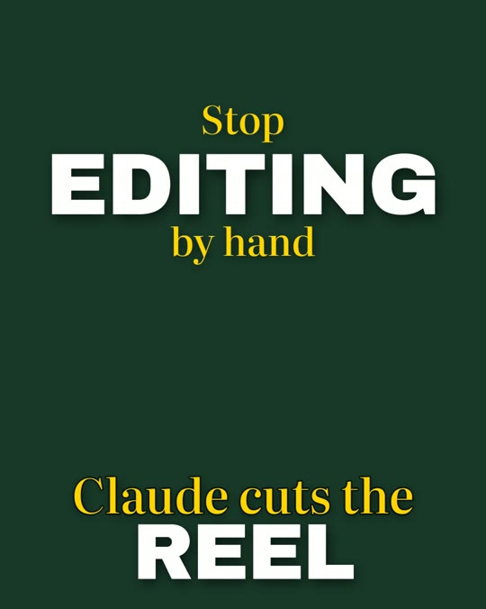 `literata` | 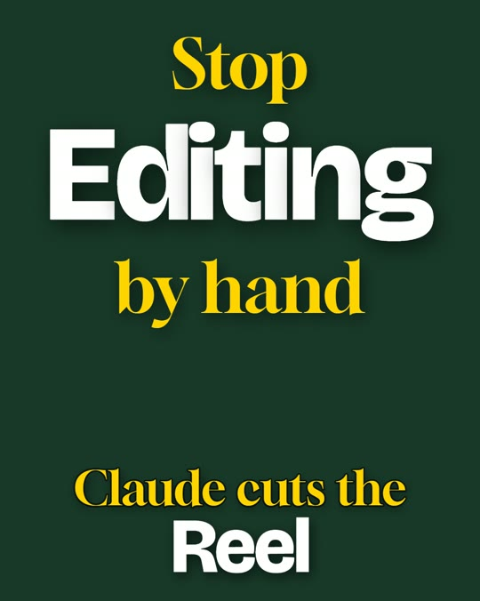 `bricolage` | 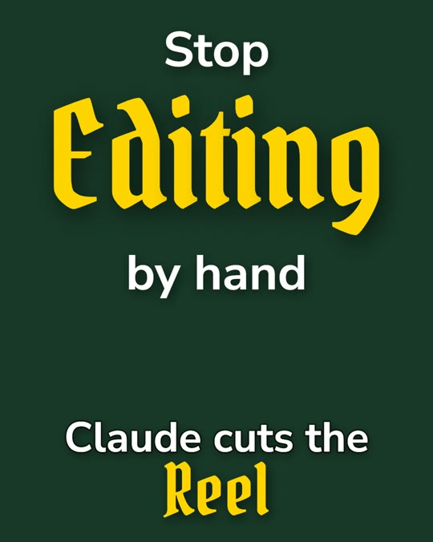 `pirata` | 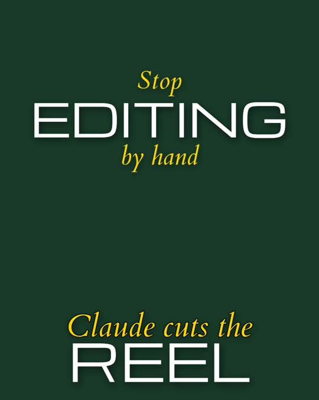 `michroma` | 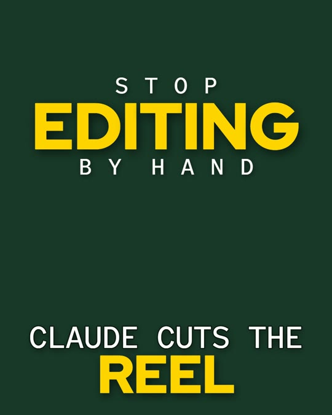 `redhat` |
| 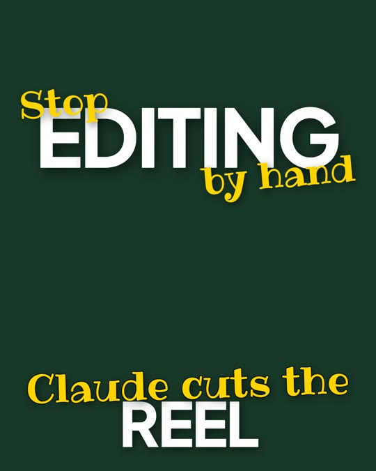 `jakarta` | 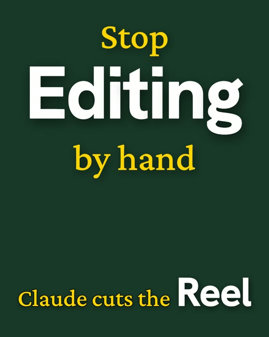 `grotesk-times` | 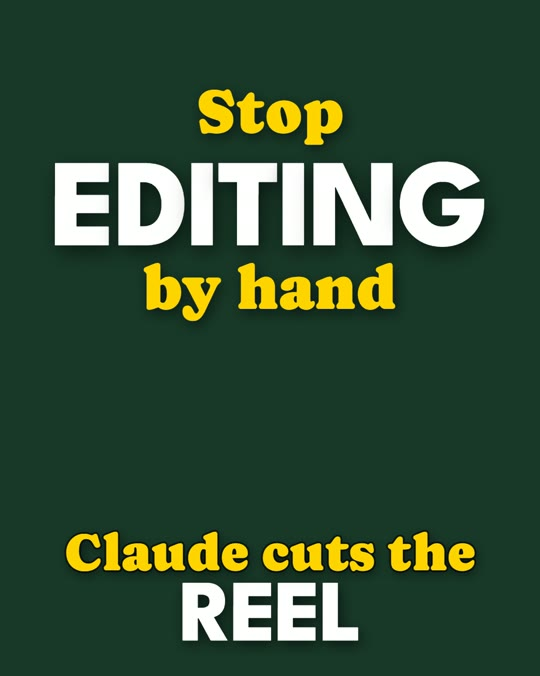 `avantgarde` | 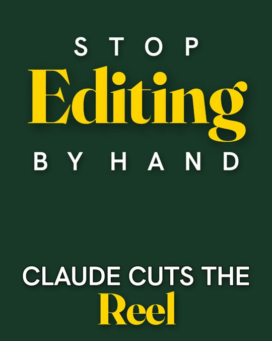 `recoleta` | 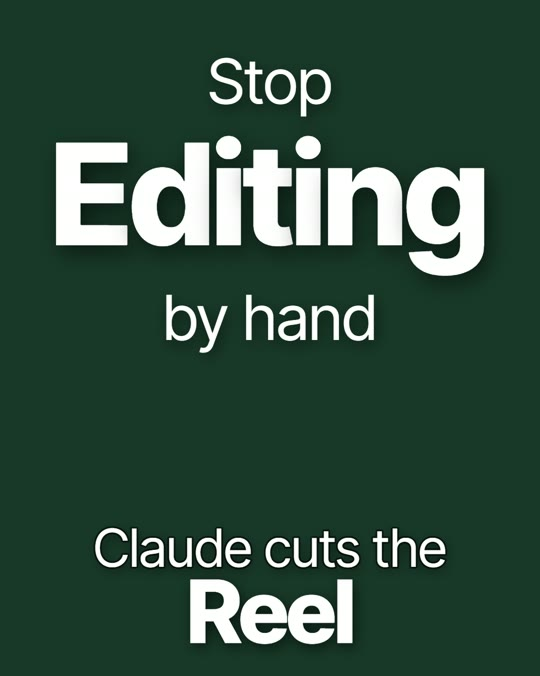 `haas` |
| 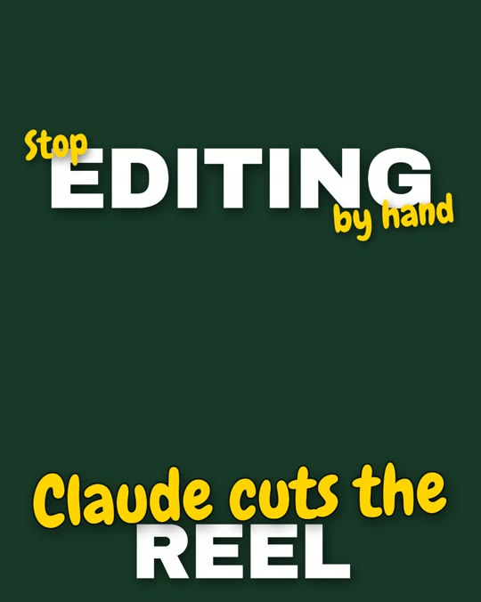 `wabbit` | 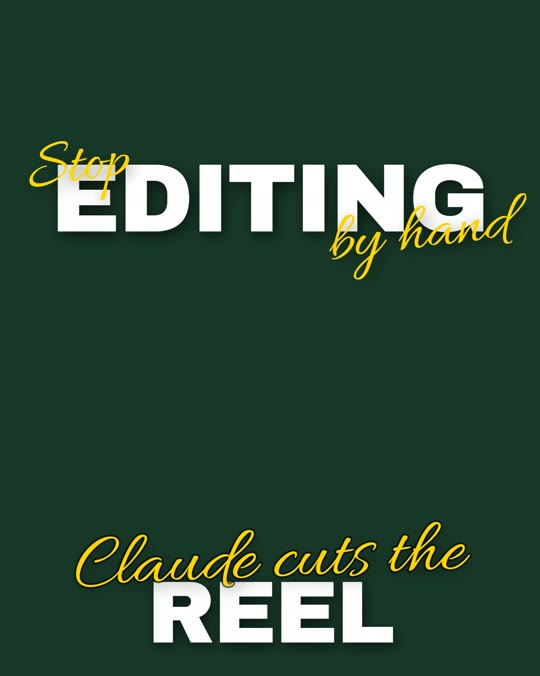 `modern` | 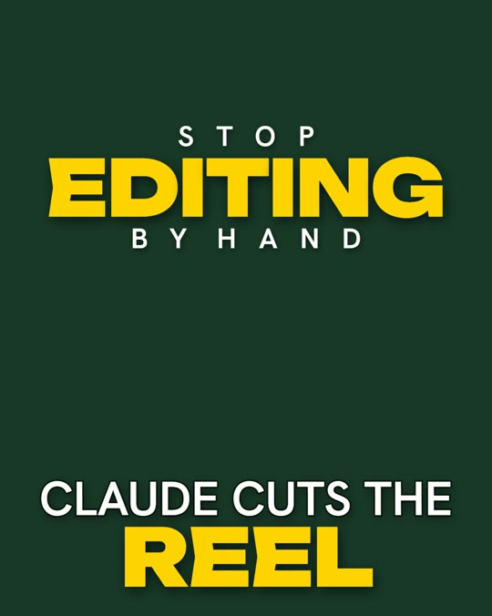 `druk` | 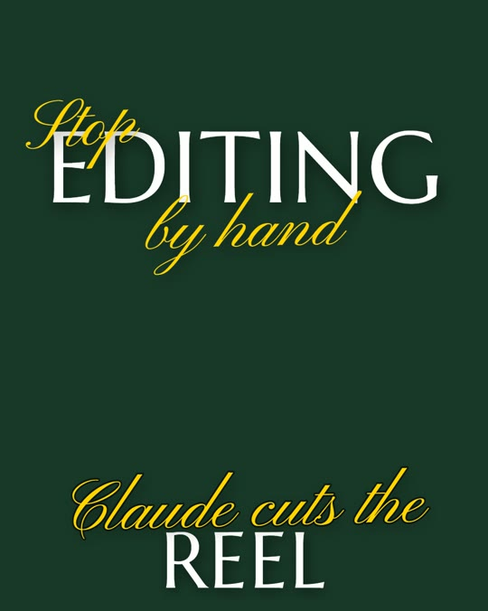 `elegant` | 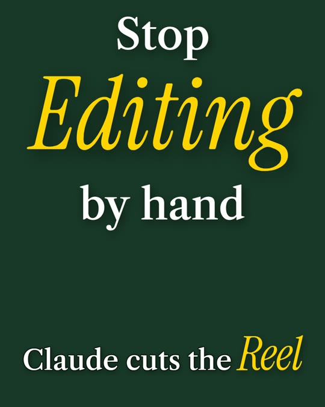 `editorial` |

## Lockups: the two faces together

Every kinetic title and every kinetic caption line is set as one lockup, not one font per line. The hero word (the longest non-filler word, or a number) goes big in the hero face; the words before and after it go in the partner face at 36 to 70% of that size, placed by the pairing's `lockup` rule in `pairings.json`. Titles size the hero to about 90% of the safe width (880 px) up to 360 px tall, with the partner at the pairing's `scale`. Caption lines are read at speed, so there the partner runs 55 to 65% of the hero (`kineticScale`, default 0.6; a script gets `kineticScriptScale`, default 0.88 by font size, because its x-height is small), never below 46 px for sans or serif and 60 px for script at 1080 wide, with a thin dark outline. The partner words always stay on one line: tracking gives way first, then size. An inline lockup that doesn't fit stacks.

Change it per phrase in `captions.js`:

```js
{"start": 4.0, "end": 6.0, "text": "Stop editing by hand", "mode": 7, "hero": "editing"}   // or "hero": [1], or [1, 2] for two words
{"start": 6.1, "end": 7.2, "text": "Ask for the reel", "mode": 0, "lockup": {"arrange": "stack"}}  // this one stacked
{"start": 7.3, "end": 9.0, "text": "THE REEL", "mode": 7, "lockup": false}                        // one font, as before
```

Or for the whole job: `"lockup": {...}` at the top of `captions.js`, or in `build/cut.json` (`"lockup": {...}` and `"hero": {"4.0": "editing"}`, keyed by the phrase's start time). `npm run check` flags a hero that isn't in the phrase. Lockup fields: `arrange` (stack, overlap, inline), `partner` (script, secondary), `scale`, `scriptBoost`, `kineticScale`, `kineticScriptScale`, `partnerUpper`, `partnerTracking` (em), `justify`, `heroUpper`, `anchor` (right, center), `rotate` (degrees), `drop`, `heroColor` and `partnerColor` (accent, text or a hex colour).

Use: `npm run reel -- inbox/take.mov --fonts druk`, or `FONTS=elegant node kit/render.mjs ...`, or `"fonts": "editorial"` in `captions.js`.

## Cycling pairings in one reel

List several, comma-separated, and the reel cycles them: `--fonts literata,bricolage,michroma`, or `"fonts": "literata,bricolage,michroma"` in `captions.js`.

- Each kinetic title takes the next pairing in turn, then the list starts again.
- Every caption line, sticker, spray word and pill takes the pairing of the title it sits under, so one combo is on screen at a time.
- A pairing is always applied whole (hero face, partner face, script, tracking and lockup rule together). A phrase never mixes faces from two combos.
- The first name is the base: it sets everything before the first title. A reel with no kinetic titles stays on it.
- `build/lockups.json` shows which pairing each phrase got (`fonts`, `faces`).

`--fonts literata,bricolage,michroma,redhat`:


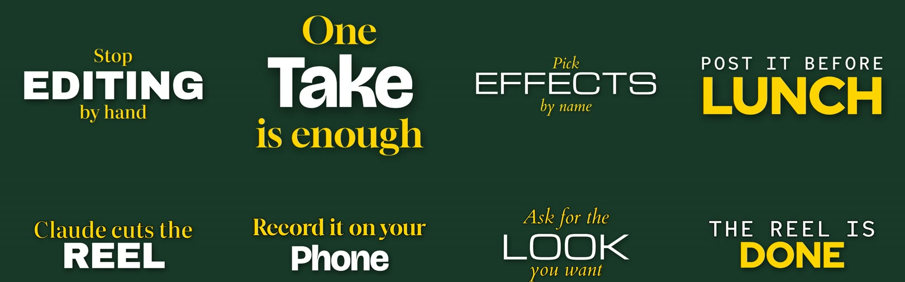

All files here are fonts from Google Fonts (github.com/google/fonts, checked Nov 10, 2026), committed unmodified. All are SIL Open Font License 1.1, each with its `OFL-<name>.txt`, except Chewy, which is Apache-2.0 (`LICENSE-chewy.txt`). Variable fonts are saved as `<Name>-VF.ttf`. The first six new pairings use the exact fonts from Will's list (Nov 10, 2026); the last five are free stand-ins for commercial pairs, and "The Editorial Method + Collidge" has no close free pair, so it isn't here. Marcellus has the Reserved Font Name "Marcellus": don't ship a modified copy under that name. Druk, Helvetica, Optitimes, Sloop, Vanguard and Athelas are commercial and are not included.

## Your own licensed fonts

Put the files in `kit/fonts/local/` (gitignored) and add `kit/fonts/local/pairings.json` in the same shape as `pairings.json`, for example:

```json
{ "pairings": { "druk-real": {
  "display":   { "family": "Druk Wide", "file": "DrukWide-Super.otf", "weight": 900, "upper": true },
  "secondary": { "family": "Helvetica Neue", "file": "HelveticaNeue-Medium.otf", "weight": 500 } } } }
```

`file` is relative to that pairings file, or an absolute path. Then `--fonts druk-real`. You can also pass a pairing file directly: `--fonts /path/to/my-pairing.json` (one pairing object at the top level). Never commit licensed font files.
