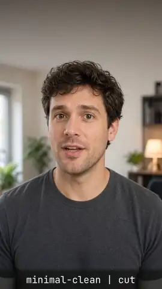

# minimal-clean style pack

For talks and tutorials where the words carry it. Phrase captions, no titles, no film finish, no glitch.

Use it: `npm run reel -- inbox/take.mov --pack minimal-clean`

- Base preset: minimal-clean
- Locks: transitions cut; finishes none; no cards
- Version 1.0.0, Apache-2.0, by AIgent

Copy it to make your own: `npm run pack:new -- my-look --from minimal-clean`. The format is in [docs/packs.md](../../docs/packs.md).
