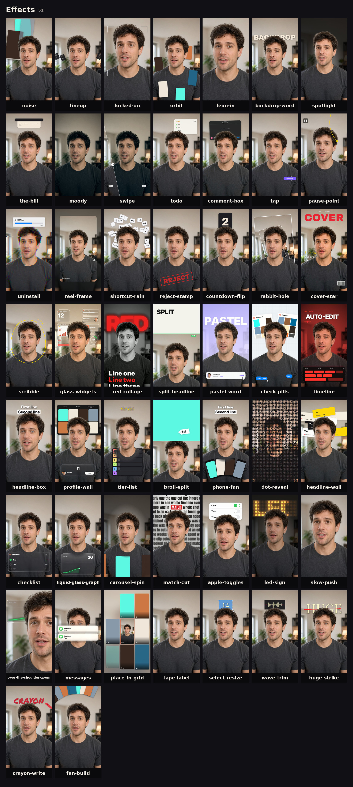
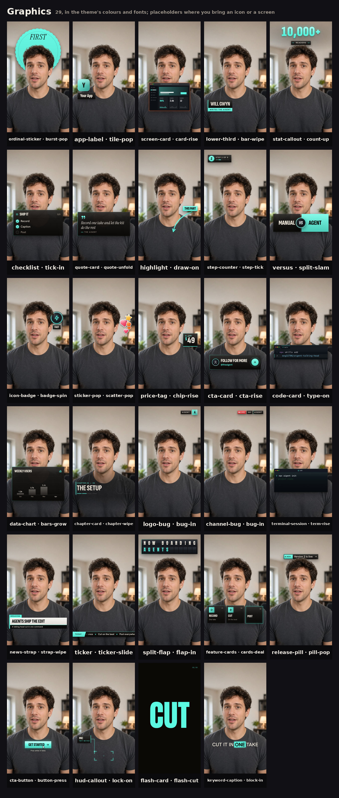
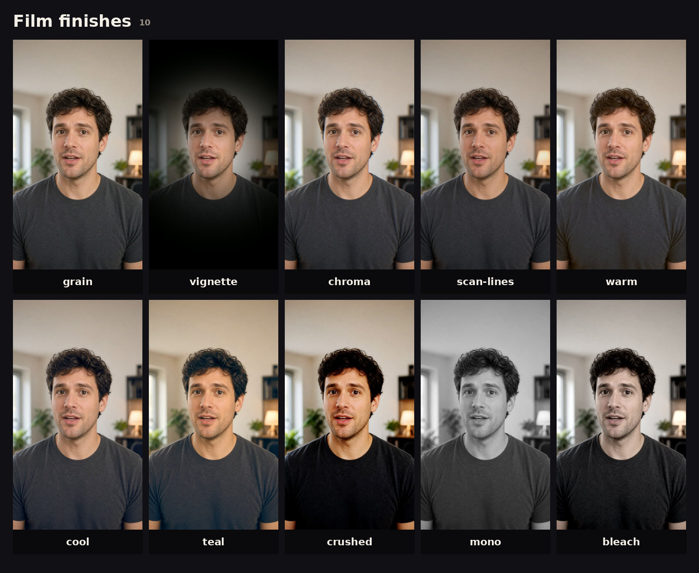
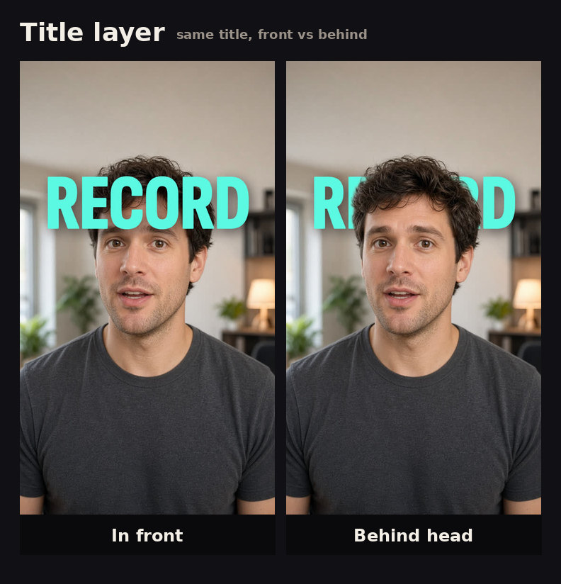
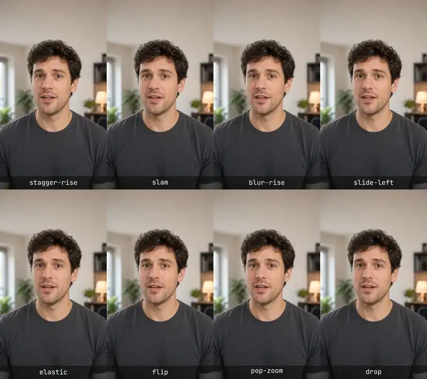
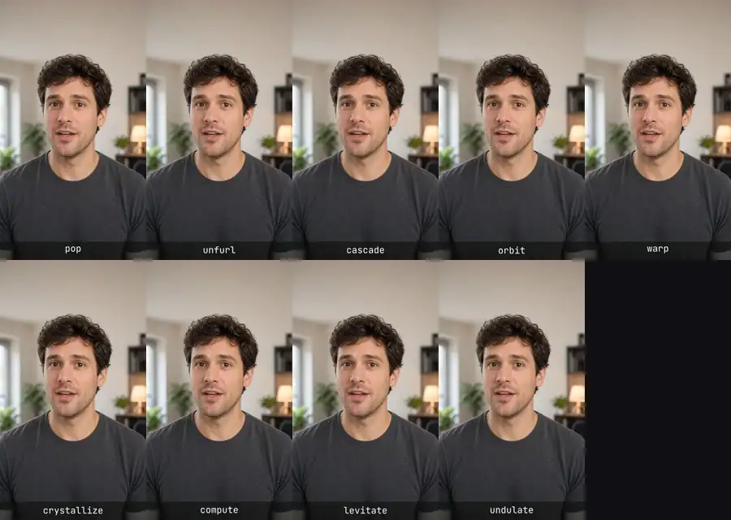
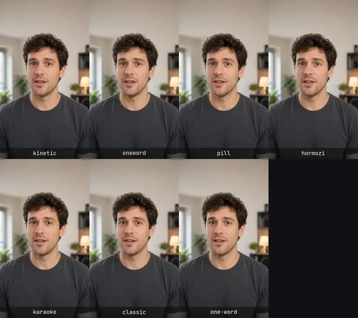
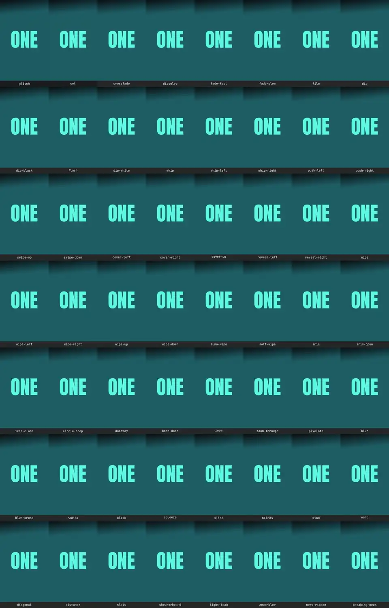
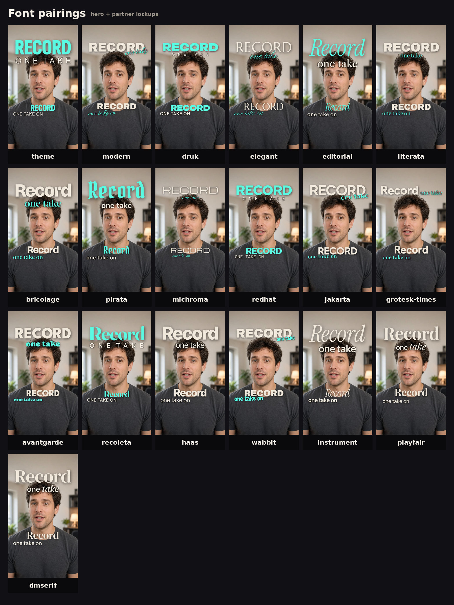
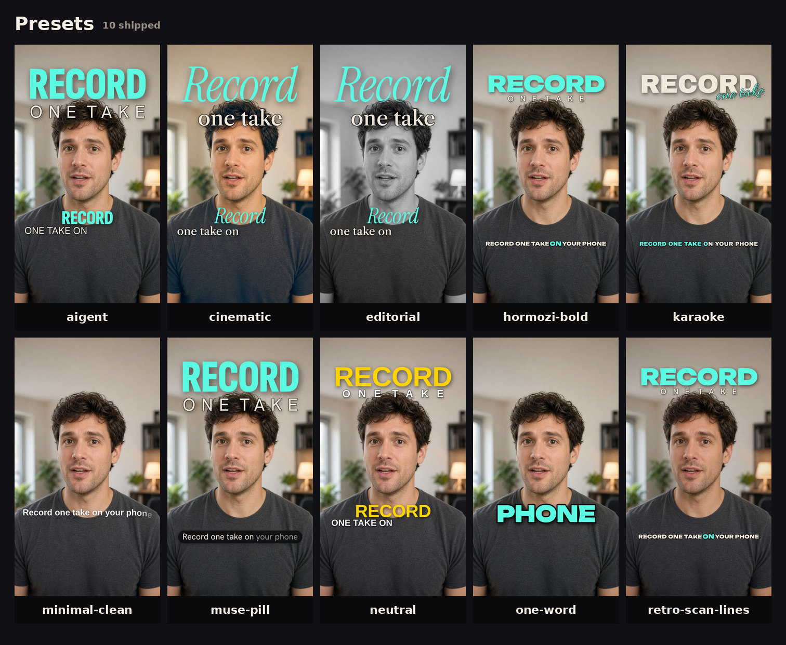

# Showcase

Labelled contact sheets of every effect, graphic, film finish, title entrance, caption style, font pairing and preset. The root README shows these too.

The animated grids come from the [effects menu](../docs/effects.md) (`npm run menu:render`), which lists each one with its exact name.

Every option, one tile at a time, is in the [full gallery](GALLERY.md).

Open [index.html](index.html) from a full clone or zip of the repo, or serve this folder. If you download only that HTML file, the images will not load. Rebuild with `npm run showcase` from the repo root (needs ffmpeg, Chrome, Pillow, and `npm run effects:setup` for the 51 effect stills and the person mask). Stills use `source/presenter.jpg`, an AI-generated fictional person made for this project, licensed Apache-2.0 with the repo. No private footage and no third-party portraits.

This folder is GitHub Pages-ready (`.nojekyll`). Repo settings and workflows are not changed by the generator.
